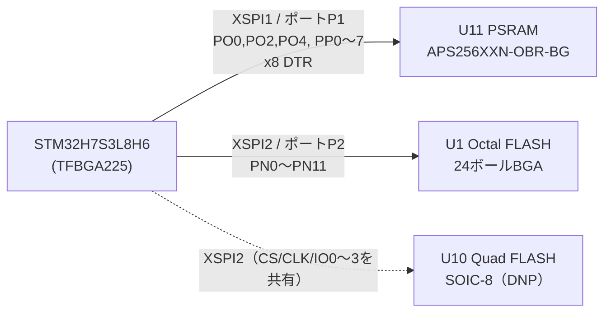

# JUMBLEQ メインボード rev.D 設計書（BGA化＋PSRAM＋FLASH複数品種対応）

Oct 26, 2026 · @山本俊一

## 概要

rev.Dでは、MCUをTFBGA225のSTM32H7S3L8H6（OCTO品）に変更します。PSRAM APS256XXN（256Mbit、x8モード）をXSPI1に、FLASHをXSPI2に移します。rev.Cで使っていたGPIOは、すべて同じピン名・同じ機能のまま残せます。

当初はST DK方式どおり、HEXA品（STM32H7S3L8H6H）でPSRAMをx16接続する案でした。しかしHEXA品ではPD8〜PD11のボールがなくなり、PD11にしかない**SAI2A\_DATA\_OUT（MCU→DSPの音声出力）を出せません**。そのためOCTO品を採用し、PSRAMはx8モードで使います。帯域は約400MB/sで、ディレイやサンプラーに必要な帯域を大きく上回ります。

| 項目 | rev.C | rev.D（本案） |
| --- | --- | --- |
| MCU | STM32H7S3Z8T6（LQFP144） | STM32H7S3L8H6（TFBGA225、13×13mm、0.8mmピッチ） |
| XSPI1（ポートP1、PO/PP） | Octal FLASH MX25UW25645G | PSRAM APS256XXN-OBR（x8、24ボールBGA） |
| XSPI2（ポートP2、PN） | 未使用（LQFP144にはPNが出ていない） | FLASH：24ボールBGA（Octal/Quad）＋Quad用SOIC-8パッド |
| VDDXSPI1／VDDXSPI2 | 1.8V（4ピン）／なし | 1.8V（3ボール）／1.8V（3ボール） |
| SMPS関連ボール | なし | VDDSMPS・VFBSMPS・VSSSMPSをGNDへ、VLXSMPSは開放（LDO動作のまま） |
| 外部コネクタJ1〜J4・DSP・USB | — | J1の9番ピンのみ変更（GND→PA4、ADC1\_IN18）。ほかは変更なし |
| DSPコア電源のPNP（Q1） | STD2805T4（TO-252） | FZT953（SOT-223） |
| 1V8レギュレータ | AP2127N-1.8（SOT-23） | AP7361C-18E-13（SOT-223、入力は5Vのまま） |
| 外部5V入力（J7） | JST PH S2B-PH-K（2A） | JST XH S2B-XH-A（3A）。ボード電源としても使えるようTPS2121で切替 |
| USBホストポート | なし | USB-C（OTG\_FS、MIDIコントローラー用） |

PCBの層構成（6層）と基板外形73×72mmは、そのまま使える見込みです。ビアは、一般部ではrev.Cと同じ0.5/0.3mm、BGA部（U2のボール間のドッグボーン）では0.45/0.2mmを使い分けます（「PCB部品配置」参照）。

## MCU選定

採用するのはSTM32H7S3L8H6（TFBGA225 OCTO品）です。同じTFBGA225でもOCTO品とHEXA品はボール配置が異なり、フットプリント互換にはなりません。DSPへの音声出力にSAI2A（PD11）が必須なため、OCTO品に確定しました（2026-10-26）。

| 比較 | STM32H7S3L8H6（OCTO）採用 | STM32H7S3L8H6H（HEXA） |
| --- | --- | --- |
| XSPI1ポートP1 | 8bit（PP0〜7、DQS0） | 16bit（PP0〜15、DQS0/1） |
| XSPI2ポートP2 | 8bit（PN0〜12） | 8bit（PN0〜12） |
| PD8〜PD11 | あり | なし（ボールがPP8〜15/PO3に置き換わる） |
| 影響を受ける信号 | なし | SAI2A\_DATA\_OUT（代替ピンなし）、USART3\_TX/RX/CK（J2、代替はI2S3/ETHと競合） |
| PSRAM帯域（200MHz DTR） | 約400MB/s | 約800MB/s |
| IO数 | 152 | 150 |

デザイン上の注意：

- **電源ボール**：VDD×10、VDDLDO×4、VDDXSPI1×3（L8/L10/M10）、VDDXSPI2×3（H12/J11/K12）、VSS×34。VDDXSPI1/2は各ドメインに1µF＋100nF×3（AN5935 Table 4）。
- **LDO動作を継続**：VDDLDOは3V3につなぎ、4.7µFをVDDLDOボールの近くに1個置きます。VCAP1〜4には、rev.Cと同じく2.2µF（ESR 100mΩ未満）を付けます。
- **SMPS未使用**：データシートDS14359のFigure 2「1. LDO supply」に従い、VDDSMPS（H1）、VFBSMPS（G2）、VSSSMPS（H2）をGNDへつなぎ、VLXSMPS（G1）は開放にします。VDDSMPSをVSSへつなぐ点は、AN5935 Table 4とも一致します。
- **HSLV**：XSPI1\_HSLVとXSPI2\_HSLVの両方をセットします。ただし対応するVDDXSPIが2.7Vを超えている状態でセットすると、デバイスを破損するおそれがあります。
- **配線**：PN（XSPI2）はF13〜L15の右端、PO/PP（XSPI1）はN8〜R11の右下に集まっています。PSRAMを右下、FLASHを右側に置くと、メモリ配線を最短にできます。
- **ビア**：ボールピッチ0.8mmです。ボール間のドッグボーンには0.45/0.2mmのビアを使います（JLCPCBで追加料金がかからない最小サイズ。「PCB部品配置」参照）。

## メモリ構成

PSRAMをXSPI1、FLASHをXSPI2に分けます。これでFLASHからのコード実行とPSRAMへのアクセスが、同じバスを取り合わなくなります。

（Docs版では図として埋め込まれている「rev.D 外部メモリ構成」を、Markdown用にMermaidで書き直したものです）

U10は、U1のCS・CLK・IO0〜3を共有します。実装するのはどちらか一方だけです。

## PSRAM選定と接続

採用するのは[APS256XXN-OBR-BG](https://mouser.com/datasheet/2/1127/APS256XXN_OBR_BG-3515932.pdf)（AP Memory、256Mbit、1.8V、200MHz DDR、24ボールBGA 6×8mm、1.0mmピッチ）です。ST DKで実績のある品で、x8（初期値）とx16をMR8\[6\]で切り替えられます。x8モードでも容量は256Mbit（32MB）のままです。

| PSRAMボール | 信号（x8） | MCUピン | MCUボール | XSPI機能 |
| --- | --- | --- | --- | --- |
| A3 | CE# | PO0 | N12 | XSPIM\_P1\_NCS1（10kプルアップ→1V8） |
| B2 | CLK | PO4 | R10 | XSPIM\_P1\_CLK |
| C3 | DQS/DM | PO2 | P11 | XSPIM\_P1\_DQS0 |
| D3 | ADQ0 | PP0 | N10 | XSPIM\_P1\_IO0 |
| D2 | ADQ1 | PP1 | P12 | XSPIM\_P1\_IO1 |
| C4 | ADQ2 | PP2 | N8 | XSPIM\_P1\_IO2 |
| D4 | ADQ3 | PP3 | N9 | XSPIM\_P1\_IO3 |
| D5 | ADQ4 | PP4 | R8 | XSPIM\_P1\_IO4 |
| E3 | ADQ5 | PP5 | P10 | XSPIM\_P1\_IO5 |
| E2 | ADQ6 | PP6 | R11 | XSPIM\_P1\_IO6 |
| E1 | ADQ7 | PP7 | N11 | XSPIM\_P1\_IO7 |
| D1, E4 | VDD | 1V8 | — | 100nF×2＋4.7µF |
| C1, E5 | VSS | GND | — | — |
| A2, A4, A5, B1, B3, B4, B5, C2, C5 | DNU（x16用） | 開放 | — | — |

rev.CでFLASHをつないでいたPO0/PO2/PO4/PP0〜7をそのまま使うので、GPIO設定は変わりません。PO1（NCS2）とPO5（NCLK）は未使用です。

ファームウェアでは、CE#のLow時間をtCEM以内に収める必要があります（標準温度で4µs、拡張温度で1µs）。この制約はXSPI側の設定で守ります。

**ボール配置の訂正（2026-10-27）**：データシート（APS256XXN-OBx9 Rev.1.0、p.4 Ball Assignment）では、A1にボールはなく、A列はA2=DNU、A3=CE#、A4=DNU、A5=DNUです。最初に作ったシンボルはA列を1つずれて読んでいて、CE#がA2になっていました。My\_Partsと回路図のシンボルを直し、CE#をA3にしました。フットプリントBGA24C100P5X5\_800X600X120（A2〜E5の24パッド、6×8mm、ピッチ1.0mm）は、外形図（p.5）と一致しています。

## FLASHの複数品種対応

FLASHは、JEDEC xSPIの24ボールBGA（6×8mm）を主フットプリント（U1）にします。これに加え、1.8V Quad品用のSOIC-8（208mil）パッド（U10、排他実装）を設けます。WSON-8は手付けしにくいため対象外としました（2026-10-27決定）。どちらもXSPI2ポートP2につなぎ、VDDXSPI2が1.8Vなので**1.8V品のみ**が使えます。

| 実装先 | 対象 | 候補 | ボール配置の照合結果 |
| --- | --- | --- | --- |
| U1（24ボールBGA） | Octal 1.8V | Macronix MX25UW25645G | rev.Cで実績あり（基準） |
| U1（24ボールBGA） | Octal 1.8V | [GigaDevice GD25LX256E](https://www.endrich.com/Datenbl%C3%A4tter/Aktive%20Komponenten/DS-00514-GD25LX256E-Rev1.4.pdf) | 一致。A4=RESET#、A5=ECS#、信号・電源ボールも同じ。C5がWP#なので、C5のプルアップを実装する |
| U1（24ボールBGA） | Octal 1.8V | [ISSI IS25WX256](https://e2e.ti.com/cfs-file/__key/communityserver-discussions-components-files/908/IS25WX064_2D00_JHLE.pdf) | 一致（同シリーズのIS25WX064で確認）。A5=ERR#、C5=W#/Vppで、GDと同じ扱いで使える |
| U1（24ボールBGA） | Octal 1.8V | [Micron MT35XU](https://www.mouser.com/catalog/specsheets/Micron_9-23-2025_MT35XU512ABA.pdf) | 未確認。ボール配置は図にしか載っておらず、取得できたのは512Mbit品の資料だけ。256Mbit品が入手できるかも未確認 |
| U1（24ボールBGA） | Octal 1.8V | [Winbond W35T-NW](https://www.winbond.com/productResource-files/Winbond%20Octal%20NOR%20Flash%20Product%20Brief.pdf) | 未確認。JEDEC xSPI準拠のBGA24。256Mbit品にはSOP16版もあるが、U10のパッドには合わない |
| U10（SOIC-8） | Quad 1.8V | Winbond W25Q256JW、W25Q128JW、Macronix MX25U、ISSI IS25WP、GigaDevice GD25LQ | 標準の8ピン配置。パッケージと容量の在庫を確認する |

| 信号 | MCUピン（ボール） | U1（24ボール） | U10（SOIC-8） |
| --- | --- | --- | --- |
| CS# | PN1（F14）XSPIM\_P2\_NCS1 | C2 | 1（/CS） |
| SCLK | PN6（J14）XSPIM\_P2\_CLK | B2 | 6（CLK） |
| DQS | PN0（G14）XSPIM\_P2\_DQS0 | C3 | — |
| IO0 | PN2（H15） | D3 | 5（DI/IO0） |
| IO1 | PN3（G13） | D2 | 2（DO/IO1） |
| IO2 | PN4（K14） | C4 | 3（/WP/IO2） |
| IO3 | PN5（K15） | D4 | 7（/HOLD·/RESET/IO3） |
| IO4〜IO7 | PN8（K13）、PN9（H14）、PN10（H13）、PN11（G15） | D5、E3、E2、E1 | — |
| RESET# | NRSTからD6経由（rev.Cと同じ） | A4 | — |
| ECS/ERR# | 10kプルアップ→1V8（R3、rev.Cと同じ） | A5 | — |
| W#/Vpp | 10kプルアップ→1V8（新規、未実装パッド） | C5 | — |
| VCC/VCCQ | 1V8 | B4、D1、E4 | 8 |
| GND | GND | B3、C1、E5 | 4 |

レイアウト上の注意：

- U1とU10は同時に実装しません。未実装側のパッドは配線のスタブになるため、U10は裏面のU1直下に置きました（「PCB部品配置」参照）。
- Quad品を使うと外部FLASHからのXIP帯域が下がります。そのためQuad品は、供給違のときの保険という位置づけです。実際の性能は、I/Dキャッシュを有効にした状態で実測して確認します。

## ピン割当

rev.CでMCUにつながっていた信号は、メモリとSPI5（USBホスト追加に伴いPF6〜PF9へ移動）以外はすべて同じGPIOのままで、ボールの位置だけが変わります。ボール番号はST公式のピンデータ（[STM32\_open\_pin\_data](https://github.com/STMicroelectronics/STM32_open_pin_data)、STM32H7S3L8Hx）から、rev.Cのピン番号は回路図mcu.kicad\_schのネットから取り出しました。XSPIの割当は、前の2節に載せています。

| 接続先 | 信号 | ピン | rev.C (LQFP144) | rev.D (TFBGA225) |
| --- | --- | --- | --- | --- |
| DSP | DSP\_RESET | PH1 | 14 | K2 |
| DSP | I2S\_CLKIN | PC9 | 87 | E14 |
| DSP | SAI1A\_DATA\_IN | PE6 | 12 | E1 |
| DSP | SAI1A\_FS | PE4 | 10 | E2 |
| DSP | SAI1A\_SCK | PE5 | 11 | F4 |
| DSP | SAI2A\_DATA\_OUT | PD11 | 68 | M12 |
| DSP | SAI2A\_FS | PD12 | 71 | N13 |
| DSP | SAI2A\_SCK | PD13 | 72 | P14 |
| DSP | SPI5\_MISO | PF8（rev.CはPM14） | 126 | H3 |
| DSP | SPI5\_MOSI | PF9（rev.CはPM13） | 127 | J2 |
| DSP | SPI5\_SCLK | PF7（rev.CはPM11） | 125 | H4 |
| DSP | SPI5\_SS | PF6（rev.CはPM12） | 124 | H5 |
| USB | UCPD\_CC1 | PM0 | 111 | D10 |
| USB | UCPD\_CC2 | PM1 | 112 | C10 |
| USB | UCPD\_INT | PM8 | 121 | C9 |
| USB | UCPD\_ISENSE | PA5 | 33 | N2 |
| USB | UCPD\_PWR\_EN | PM9 | 122 | B8 |
| USB | USB\_HS\_D+ | PM6 | 119 | A9 |
| USB | USB\_HS\_D- | PM5 | 118 | B9 |
| J1 (ADC) | ADC1\_IN0 | PA0 | 26 | M1 |
| J1 (ADC) | ADC1\_IN10 | PC0 | 18 | K3 |
| J1 (ADC) | ADC1\_IN12 | PC2 | 20 | L2 |
| J1 (ADC) | ADC1\_IN13 | PC3 | 21 | L3 |
| J1 (ADC) | ADC1\_IN15 | PA3 | 29 | N1 |
| J1 (ADC) | ADC1\_IN3 | PA6 | 34 | P1 |
| J1 (ADC) | ADC1\_IN5 | PB1 | 39 | R2 |
| J2 | FDCAN2\_RX | PB12 | 75 | L12 |
| J2 | FDCAN2\_TX | PB13 | 76 | N15 |
| J2 | I2S3\_CK | PC10 | 101 | B14 |
| J2 | I2S3\_SDI | PC11 | 102 | B15 |
| J2 | I2S3\_SDO | PB2 | 40 | N4 |
| J2 | I2S3\_WS | PA15 | 97 | G11 |
| J2 | LPUART1\_CTS | PA11 | 93 | C15 |
| J2 | LPUART1\_RTS | PA12 | 94 | C14 |
| J2 | LPUART1\_RX | PA10 | 92 | E13 |
| J2 | LPUART1\_TX | PB6 | 143 | E5 |
| J2 | USART3\_CK | PD10 | 67 | R14 |
| J2 | USART3\_RX | PD9 | 66 | P13 |
| J2 | USART3\_TX | PD8 | 65 | M11 |
| J2 / USB (UCPD) | I2C2\_SCL | PA8 | 90 | F12 |
| J2 / USB (UCPD) | I2C2\_SDA | PA9 | 91 | D14 |
| J3 (Ethernet) | ETH\_MDC | PC1 | 19 | L1 |
| J3 (Ethernet) | ETH\_MDIO | PA2 | 28 | L4 |
| J3 (Ethernet) | ETH\_MII\_RX\_ER | PB10 | 73 | P15 |
| J3 (Ethernet) | ETH\_RMII\_CRS\_DV | PA7 | 35 | M4 |
| J3 (Ethernet) | ETH\_RMII\_INTN | PD4 | 110 | C11 |
| J3 (Ethernet) | ETH\_RMII\_REF\_CLK | PA1 | 27 | M2 |
| J3 (Ethernet) | ETH\_RMII\_RXD0 | PC4 | 36 | L5 |
| J3 (Ethernet) | ETH\_RMII\_RXD1 | PC5 | 37 | N3 |
| J3 (Ethernet) | ETH\_RMII\_TXD0 | PB0 | 38 | P2 |
| J3 (Ethernet) | ETH\_RMII\_TXD1 | PB7 | 144 | D4 |
| J3 (Ethernet) | ETH\_RMII\_TX\_EN | PB11 | 74 | N14 |
| J3 (SDMMC2) | SDMMC2\_CK | PD6 | 130 | E7 |
| J3 (SDMMC2) | SDMMC2\_CMD | PD7 | 131 | B6 |
| J3 (SDMMC2) | SDMMC2\_D0 | PB14 | 77 | M13 |
| J3 (SDMMC2) | SDMMC2\_D1 | PB15 | 78 | M14 |
| J3 (SDMMC2) | SDMMC2\_D2 | PB3 | 134 | C4 |
| J3 (SDMMC2) | SDMMC2\_D3 | PB4 | 135 | D5 |
| J3 (SDMMC2) | SDMMC2\_D4 | PB8 | 1 | B1 |
| J3 (SDMMC2) | SDMMC2\_D5 | PB9 | 2 | C2 |
| J3 (SDMMC2) | SDMMC2\_D6 | PC6 | 84 | E15 |
| J3 (SDMMC2) | SDMMC2\_D7 | PC7 | 85 | F13 |
| J4 (SWD) | DEBUG\_SWCLK | PA14 | 96 | D13 |
| J4 (SWD) | DEBUG\_SWDIO | PA13 | 95 | E12 |
| LED | LED0 | PD2 | 106 | A14 |
| LED | LED1 | PD1 | 105 | B13 |
| LED | LED2 | PD0 | 104 | C13 |
| SW | USER\_SW1 | PD15 | 83 | L13 |
| SW | USER\_SW2 | PD14 | 82 | L14 |
| システム | 24MHz発振器入力 | PH0 | 13 | K1 |
| システム | NRST | NRST | 15 | J4 |
| システム | BOOT0 | BOOT0 | 128 | A6 |
| J1 (ADC) 9番ピン（rev.CはGND、2026-10-27変更） | ADC1\_IN18 | PA4 | 32 | M3 |
| 未接続（ラベルのみ） | PB5 | PB5 | 136 | B3 |

## ファームウェアへの影響

大きく変わるのはUF2ブートローダの外部メモリ初期化です。FLASHがXSPI1からXSPI2へ移り、これに品種の自動判別が加わります。アプリ側では、PSRAMを使う部分の追加に加えて、次のGPIOの変更が必要です。①SPI5をPM11〜14からPF6〜9へ移す（「USBホストポート」参照）。②J1の9番ピンにPA4（ADC1\_IN18）がつながる。既存のキャリア基板が9番ピンをGNDにつないでいる場合があるので、PA4は出力に設定せず、アナログ入力のままにする。③ホスト用ポートの電源スイッチのイネーブル（PM13）は、アクティブHighです。

1. **オプションバイト**：XSPI1\_HSLV（設定済み）に加え、XSPI2\_HSLVもセットします。書き込み手順のREADMEも更新します。
2. **XSPIM**：ダイレクトモード（XSPI1→P1、XSPI2→P2）で使います。
3. **ブートローダ（内蕅64KB）**：XSPI2上のFLASHを初期化してメモリマップドにし、アプリへジャンプします。アドレスはXSPI1側のベースからXSPI2側のベースに変わるので、アプリのリンカスクリプトとUF2の書き込み先アドレスも書き換えます。
4. **FLASHの品種判別**：起動直後に1線のSPIでJEDEC ID（9Fh）を読み、品種ごとのコマンド表を選びます。Octal DTRへの切替手順、ダミーサイクル数、Quad品のQEビットはメーカーごとに異なります。未登録のIDには、SFDP（JESD216）を読んでパラメータを決める方式で対応します。
5. **PSRAM初期化**：リセット後、モードレジスタでレイテンシとバースト長を設定します（x8のままなのでMR8\[6\]=0）。そのうえでXSPI1をメモリマップドにし、CS#のLow時間がtCEMを超えないようにXSPIを設定します。
6. **MPU**：PSRAM領域はキャッシュ可、未実装の領域はアクセス禁止にします。投機的アクセスによるハングを防ぐためです。DMAでやり取りするバッファは、キャッシュの保守も含めて設計します。
7. **アプリ**：ディレイラインやサンプラーのバッファをPSRAMのセクションに置きます。音声処理のホットパスは、内蔵SRAMに残します。

## 1V8電源の見積もり

1V8の負荷は最大で約120mAの見込みです。現行のAP2127N-1.8を5V入力のまま使うと、接合部温度の余裕が少なくなります。そこで入力は5Vのままとし、レギュレータをAP7361C-18E-13（SOT-223）に変えることで確定しました。

| 負荷 | 最大電流 | 根拠 |
| --- | --- | --- |
| PSRAM APS256XXN（x8、200MHzでの読み書き） | 26mA | データシートTable 27（特性値） |
| FLASH（Octal、200MHz DTRでの読み出し） | 50mA（仮置き） | 各社のDC特性表を取得できなかったため、大きめに仮定 |
| VDDXSPI1（IO 11本、200MHz） | 約20mA | 推定。負荷容量10pF、トグル率50%と仮定 |
| VDDXSPI2（IO 11本、200MHz） | 約20mA | 同上 |
| 合計 | 約120mA | AP2127の定格300mAに対しては十分余裕がある |

| 入力電圧 | 損失 | 温度上昇（SOT-23、θJA 180℃/W） | 周囲40℃での接合部温度 |
| --- | --- | --- | --- |
| 5V\_UCPD（現行、5.25Vで計算） | 0.41W | 約75℃ | 約115℃（上限125℃に対して余裕約10℃） |
| 3V3（推奨） | 0.18W | 約32℃ | 約72℃ |

- 3V3入力でも、入出力の差は1.5Vあります。300mA時のドロップアウト（最大700mV）を十分上回ります。
- その代わり、3V3側のAP7361（1A）に約120mAが上乗せされ、損失が約0.2W増えます。AP7361は散熱の大きいパッケージなので、問題になりにくい見込みです。ただしDSPを含めた3V3全体の負荷で確認が必要です。
- 5V入力のままにする場合の候補は[AP7361C-18E-13](https://www.mouser.com/datasheet/2/115/AP7361C-775034.pdf)（SOT-223、1A、θJA 110℃/W）です。温度上昇は約46℃、接合部は約86℃です。ピンは1=IN、2=GND（タブ）、3=OUTで、出力コンデンサは2.2µF以上が必要です。当初挙げたAP2127R-1.8（SOT-89）は、データシートの型番表になく、SOT-89版は3.3V品しかありません。
- 数値の出典は[AP2127データシート](https://www.mouser.com/datasheet/2/115/AP2127-318083.pdf)と[APS256XXNデータシート](https://mouser.com/datasheet/2/1127/APS256XXN_OBR_BG-3515932.pdf)です。FLASHとVDDXSPIの値は推定なので、試作基板で実測して確かめます。

## DSPコア電源（VDRIVEのトランジスタ）

ADAU1466のVDRIVEにつなぐPNPトランジスタQ1を、STD2805T4（TO-252）から[Diodes FZT953](https://diodes.com/datasheet/download/FZT953.pdf)（SOT-223）に変えます（2026-10-26決定）。基板上の占有面積を小さくするためです。

| 条件（[ADAU1462/1466データシート](https://www.analog.com/media/en/technical-documentation/data-sheets/adau1462-1466.pdf) Table 2、25℃） | DVDD電流 | Q1の損失（3.3V→1.2V） | 温度上昇（θJA 78℃/W） |
| --- | --- | --- | --- |
| 標準的なプログラム | 220mA | 約0.46W | 約36℃ |
| 最大負荷のプログラム（表の読み取りから推定） | 495mA | 約1.04W | 約81℃ |

- FZT953はPNP、100V、5Aです。θJA 78℃/Wと許容損失1.6Wは、25×25mm・1ozの基板での値です。hFEは1Aで100以上です。
- Q1のコレクタ側に、散熱用の銅箔面積を確保します。

* [x] ピン配置を確認済み：1=ベース、2=コレクタ、3=エミッタ、4（タブ）=コレクタ。Diodes版（DS35942 Rev.6-2）のTop View Pin-Out図で、タブがC、リードが上からE・C・Bであることを確認。Kexin版（LCSC C499616、ピン番号付き）と一致する。発熱の計算は、Diodes版の熱抵抗を使っている
* [ ] 試作基板で実際のDVDD電流とQ1の温度を測る

## USBホストポート（MIDIコントローラー用）

PCとは今どおりUSB HS（デバイス）でつなぎ、USB OTG FSをホストにします。ホスト用のUSB-Cコネクタを、メインボードに1個追加します。OTG\_FSは、ホストモードでフルスピードとロースピードに対応しています（DS14359 Table 18）。

**SPI5の移動**：OTG\_FSのD+/D−はPM11/PM12に固定されています。そのためDSP用のSPI5を、同じSPI5のままPF6〜PF9へ移します。

| 信号 | rev.Cのピン | rev.Dのピン（ボール） |
| --- | --- | --- |
| SPI5\_SS | PM12 | PF6（H5） |
| SPI5\_SCLK | PM11 | PF7（H4） |
| SPI5\_MISO | PM14 | PF8（H3） |
| SPI5\_MOSI | PM13 | PF9（J2） |
| OTG\_FS\_DP | — | PM11（B7） |
| OTG\_FS\_DM | — | PM12（A7） |

**ホスト用USB-Cポート（ソース）**

- **CC1/CC2**：それぞれ36kΩで3.3Vへプルアップします。これでDefault USB power（500mA）を通知します。接続した機器のRd（5.1kΩ）で、CCの電圧は約0.4Vに下がります。この電圧をGPIOかADCで監視して接続を検出し、検出してからVBUSを出します。
- **D+/D−**：レセプタクルのA6/B6とA7/B7を両面でつなぎ、90Ω差動でPM11/PM12へ配線します。
- **ESD保護**：[USBLC6-4SC6](https://st.com/en/protections-and-emi-filters/usblc6-4.html)（ST、4ライン）を使い、CC1・CC2・D+・D−をまとめて保護します。
- **VBUS**：USB電源スイッチ[TPS25200DRVR](https://www.lcsc.com/product-image/C128401.html)（TI、WSON-6 2×2mm）を使います（2026-10-27、STMPS2141STRから変更）。入力の絶対最大定格が20Vあり、5.4〜7.6Vの入力では出力を5.25〜5.55Vに抑え、約6.8V以上で遮断します。電流制限はILIMのR45（169kΩ）で504〜648mA（データシートの式で算出）。ENはアクティブHighでR33（10kΩ）でプルダウン、FAULTはオープンドレインでR44（10kΩ）で3V3へプルアップします。無効時には約480Ωで出力を放電します。

**給電（PC・iPad・スマホとの接続と、J7の外部5V）**

iPadやスマホとの接続も想定するため、J7の外部5V入力とSource経路（Q3）を残します（2026-10-27決定）。J7はヘッダのままとし、DCジャックや電源専用のUSB-Cコネクタは、このボードを組み込む筐体側に付けます。

Nucleo-H7S3L8（MB1737）では、ボードの電源とSourceで出す電源がどちらもST-LINK等の「5V」から来ます。rev.Cはボード電源が5V\_UCPDに固定されているため、Sourceで動くとボード自身の電源が切れます。rev.Dでは次のようにします。

- **ボード電源の切替**：電源マルチプレクサ[TPS2121](https://ti.com/product/TPS2121)（TI、2.5×2mm、逆流防止付き）で、J7の外部5Vと5V\_UCPDを切り替えます。外部5Vを優先し、その出力でレギュレータ、J8、ホスト用ポートを動かします。
- **Source経路**：Q3は、J7の外部5Vから直接つなぎます。切替後の出力からつなぐと、出した電力が戻ってくるループになるためです。
- **電源の役割交換（PR\_Swap）**：接続直後は、受電側かつUSBデバイスとしてつながります。外部5Vがあれば、USB PDのPR\_Swapで電源の向きだけを入れ替え、iPadやスマホに給電します。データの役割（相手がUSBホスト）は変わりません。
- **J7の電流**：J7をJST PHからJST XHのS2B-XH-A（横向きスルーホール、定格3A、AWG#22）に変えます（2026-10-27決定）。iPad・スマホへの給電は1.5A（Rpで「1.5A」を通知）とし、J7の合計は本体300mA＋MIDIコントローラー500mA＋1.5A＝約2.3Aです。筐体側のDCジャック、電源専用USB-C、ACアダプタもこの電流に対応させます。

* **J8と消費電流**：J8からは、切替後の5Vをキャリア基板へ出します。キャリア基板を含むJUMBLEQ全体の消費電流は300mA以下で、最新のファームウェアはホストに500mAを申告しています（2026-10-27確認）。

**J7の入力保護**（筐体側がDCジャックになる場合に備える。入力側から順に）

1. **逆接続保護**：PチャネルMOSFET [DMP3056L](https://www.farnell.com/datasheets/2814426.pdf)（Diodes、SOT-23、−30V、−4.3A、VGS±25V、RDS(on)最大70mΩ＠VGS−4.5V）を直列に入れます。逆に挿されるとオフのままで、電流が流れません。ゲートはR30でGNDへ引きます。後段のTVS（SMAJ13A、クランプ21.5V）でVGSが定格±25V以内に収まるので、ツェナーは付けません。2.3A時の損失は最大約0.37Wなので、ドレイン側に銅箔を確保します。これで、rev.CのD5（ショットキー）は不要になります。
2. **サージ・ESD保護**：TVS [SMAJ13A](https://www.digikey.ch/en/products/detail/littelfuse-inc/SMAJ13A/762484)（Littelfuse、スタンドオフ13V、クランプ21.5V @ 18.6A）を、MOSFETの後ろに置きます（2026-10-27、SMAJ15Aから変更）。片方向のTVSをMOSFETの前に置くと、逆接続のときに順方向に電流が流れてしまうためです。
3. **過電圧保護**：TPS2121の過電圧監視（OVx）で、標準約5.63V（誤差込み約5.28〜5.94V）を超えたら入力を切り離します。しきい値のばらつき（±4%）のため、この機能だけでは「5.5Vまでは通し、6.0V未満では必ず切る」は実現できません。そこで「6.0V未満で必ず切る」ことを優先し、5.28〜5.5Vの電源で誤って遮断する可能性は許容します。ホスト用ポートの電源スイッチは、入力の定格に余裕があるTPS25200にします（「レビュー対応」参照）。

保護できる範囲：逆接続は−30Vまでです。間違った電圧のアダプタは**12Vアダプタまで**で、ボードの仕様に明記します。それより高い電圧（19VのノートPC用など）を持続的に挂けると、TVSが導通し続けて壊れるおそれがあります。TVSのクランプ電圧（21.5V）は、TPS2121の入力の絶対最大定格（24V）より2.5V低く、Q4のVGS定格（±25V）も下回ります。

**TPS2121の設定（初期案）**

IN1をJ7の外部5V（保護回路の後）、IN2を5V\_UCPDにします。式としきい値は[TPS212xデータシート Rev.F](https://www.ti.com/lit/gpn/TPS2121)によります。

| ピン（RUX） | 目的 | 定数 | 結果 |
| --- | --- | --- | --- |
| OV1（5） | J7の過電圧で遮断 | 上21.5kΩ／下4.99kΩ | 標準約5.63Vで遮断。しきい値（1.01〜1.10V）と抵抗1%の誤差を含めて約5.28〜5.94V |
| OV2（4） | 5V\_UCPDの過電圧で遮断 | 上21.5kΩ／下4.99kΩ | 標準約5.63Vで遮断（範囲はOV1と同じ） |
| CP2（3） | 高速切替（XCOMP）を有効にする | IN2から上10.2kΩ／下5kΩ | 5V\_UCPDが5Vのとき1.64V。VREF（1.06V）より高いので高速切替が有効になる |
| PR1（6） | J7を優先する | IN1から上8.66kΩ／下5kΩ | J7が5V\_UCPDの約0.9倍（5V時に約4.49V）を下回るまでJ7を使う |
| ILIM（10） | 電流制限 | 35.7kΩ | 約3.0A（I = 65.2 ÷ R^0.861、RはkΩ、18〜100kΩ） |
| ST（9） | どちらから給電しているか | 10kΩで3V3へプルアップ | High：J7（または出力なし）、Low：5V\_UCPD |
| SS（11） | 立ち上がり速度 | 100nF | 5Vで約780V/s。出力側200µFでも突入電流は約0.16A |

ピン配置（RUX）：1・8=OUT、2=IN2、3=CP2、4=OV2、5=OV1、6=PR1、7=IN1、9=ST、10=ILIM、11=SS、12=GND。データシートSLVSEA3FのPin Functions表で確認済み。

SSの単位は、Table 9-1と本文（突入電流の計算例）がどちらもV/sです。V/ms表記はグラフの軸だけなので、V/sを採用しました。

- [x] CP2を使った優先判定（XCOMP方式）の動作を、データシートの図で確認する
- [x] RUXパッケージのピン配置（OUTが2ピンあるなど）を、データシートの図で確認する

**新しく増える信号のピン割当（初期案）**

| 信号 | ピン（ボール） | 内容 |
| --- | --- | --- |
| HOST\_CC1\_DET | PF11（M5）ADC1\_INP2 | ホスト用ポートCC1の電圧。ADCで読むと、コントローラー（Rd）とケーブルだけ（Ra）を区別できる |
| HOST\_CC2\_DET | PF12（R3）ADC1\_INP6 | 同上（CC2） |
| HOST\_VBUS\_EN | PM13（C7） | TPS25200のEN（アクティブHigh、10kΩでプルダウン）。SPI5の移動で空いたピン |
| HOST\_VBUS\_FLT | PM14（C8） | TPS25200のFAULT（過電流・過電圧・過熱）。3V3へプルアップ |
| PWR\_ST | PD5（D7） | TPS2121のST |
| LED\_PWR | PG2（C6） | 「電源が足りない」ことを知らせるLED（新規） |

PC13〜PC15はバックアップドメインのピンで駆動能力に制約があるため、割り当てていません。

| 状態 | ボードの電源 | ホスト用ポートのVBUS | 相手（PC・iPad・スマホ）への給電 |
| --- | --- | --- | --- |
| 外部5Vあり | 外部5V | 出す（500mA） | PR\_Swapで給電する（相手が応じた場合） |
| 外部5Vなし。相手が1.5A以上を通知 | 5V\_UCPD | 出す | しない |
| 外部5Vなし。相手がDefault USB power | 5V\_UCPD | 初期設定では出さず、LEDで知らせる。設定で許可できる | しない |

前提（2026-10-27決定）：MIDIコントローラーを使うときは、PCとボードをUSB-Cでつなぐ。PC側の推奨ポート仕様は1.5A対応とする。rev.Cの消費電流は300mA以下。Defaultのとき、このボード（USB 2.0デバイス）が使えるのは500mAまでなので、コントローラーに回せるのは残りの約200mAです。

PC側の通知値は、UCPDでCCの状態を読んで判別します。USB 2.0の構成記述子で申告できる消費電流（bMaxPower）は最大500mAなので、申告値は500mAのままにします。コントローラーへの給電は、Type-Cの電流通知（1.5A／3A）から本体の消費分を差し引いて可否を判断します。Default USB powerのときは、設定で許可した場合だけ給電します。記述子と給電制御の細部は、採用するUSBスタックに合わせて決めます。

- [x] rev.Cでボード本体の5V消費電流を測る（DSP動作時）→ 300mA以下
- [x] Q2/Q3はUSB PDのSink/Source対応のための経路。iPad・スマホとの接続に備えて、J7とSource対応を残す（2026-10-27決定）
- [ ] ファームウェア：USBホストのスタックとUSB-MIDIクラスのドライバ。HS（デバイス）との同時動作も考慮する
- [ ] ファームウェア：USB PDのスタックでPR\_Swapを実装する。外部5Vの有無に応じてSourceに切り替え、相手には5V・1.5Aを通知する
- [ ] iPad・スマホ実機で、PR\_Swapに応じるかを確認する

## 回路図作成での確定事項（2026-10-27）

rev.Dの回路図はERCを通り、残っている警告9件はすべてrev.Cからの引き継ぎです。VCAP1〜4の電源出力どうしの接続（3件）は除外にしています。

- **U2のシンボル**：KiCad標準の部品ではなく、My\_Partsの専用シンボルSTM32H7S3L8Hx\_JUMBLEQを使います。左側のピンを、U1とU11のピンの並びに合わせて並べ替え、XSPIの信号を水平の直線で直接配線しています。フットプリントは標準のままです。U2を動かすとVCAPの除外が外れるので、そのときは除外し直すか、VCAP2〜4のピンの種類をパッシブに変えます。
- **直接配線**：U1、U11、NRSTまわり（SW1、C19）、BOOT0（R1）、HSE\_IN（X1、R4）をU2と直接つなぎました。USBシートでは、R33（ENのプルダウン）とR44（FAULTのプルアップ）をU13と直接つないでいます。
- **U11（PSRAM）**：CE#はA3です（上の「PSRAM選定と接続」を参照）。
- **Q4（DMP3056L）**：データシート（DS37386 Rev.6-2）の上面図で、1=G、2=S、3=Dを確認しました。シンボルQ\_PMOS\_GSDとフットプリントSOT-23のピン番号と一致しています。ドレインがJ7側、ソースが5V側で、逆接続保護として正しい向きです。
- **U12（TPS2121）のフットプリント**：データシート（SLVSEA3F p.39）のランドパターンから、My\_Parts:TI\_RUX0012A\_VQFN-HR-12\_2x2.5mm\_P0.5mmを作りました。
- **ホスト側VBUSのコンデンサ（J10）**：10µF×2（計20µF）のままにします。USB PD規格（r3.2 v1.2）の4.1.2とTable 4.6（p.79）で、専用の電源から給電するポートの最小値cSrcBulkは10µFです。120µF（cSrcBulkShared）は、電源を複数のポートで共有する場合の値です。J10の電源はボード内の5V\_SYSで、ほかの給電ポートとは共有していません。切断後の放電は、U13（TPS25200）の出力放電（約480Ω、最大625Ω）で行います。時定数は最大でも約15msで、Type-CのtVBUSOFF（650ms）に十分収まります。ファームウェアは、CCで切断を検出したらすぐENをLowにします。
- **J9側のコンデンサ（未確認）**：受電時の上限は、交渉成立後のcSnkBulkPdが100µF（Table 4.7、p.83）です。接続直後のcSnkBulkはUSB 3.x規格を参照する決まりで、まだ照合していません。

## レビュー対応（2026-10-27）

Codexによる回路図レビュー（JUMBLEQ\_mainboard\_revD\_review.md）の指摘に対して、次のように対応しました。

- **過電圧遮断と後段部品の定格**：絶対最大定格が6.0VだったU13（STMPS2141STR）は、入力の絶対最大定格が20VのTPS25200DRVRに変えました。TPS25200は出力を5.55V以下に抑えるので、ホスト用ポートにつなぐMIDIコントローラーも守れます。再レビューで、遮断電圧付近の電圧がかかり続ける場合の5V\_SYSの負荷が指摘されたため、次のようにしました。①OV1／OV2の上側抵抗（R34、R36）を21.5kΩにし、遮断電圧をしきい値と抵抗の誤差込みで約5.28〜5.94Vにした。6.0V未満で必ず切れるので、U5（AP7361EA-33E-13、3V3）とU6（AP7361C-18E-13、1V8）は推奨上限6.0V以内で動き、J8にも最大5.94Vしか出ない。その代わり、Type-Cで許される5.28〜5.5Vの電源では誤って遮断する可能性がある。②U14（USBLC6-4SC6、降伏電圧の最小6V）のVBUSピンを5V\_SYSから3V3につなぎ替えた。守っている信号（D+/D−と、Rp 36kΩで引いているCC）はどれも3.3V以下です。HOST\_VBUSにつなぐと、VBUSを切っているあいだCCの電圧が下がり、接続を検出できなくなるので不採用。J8の先のキャリア基板の部品の定格は、未確認です。
- **入力電圧の仕様（ボードの仕様に明記する）**：J7（外部5V）とJ9（PCなどのUSBホスト）の入力電圧は、どちらも4.75〜5.25V（USB 2.0のVBUSの範囲）を正常範囲とします。個体によっては約5.28Vから過電圧として遮断するため、Type-Cで許される5.5Vまでの入力は保証しません。J7につなげられる誤った電源は12Vアダプタまで、逆接続は−30Vまでです。
- **ホスト側VBUSの放電**：TPS25200の出力放電機能で対応しました（「回路図作成での確定事項」参照）。実機で、無負荷での切断・再接続時のVBUS波形を測って確かめます。
- **TVSのクランプ電圧**：D9をSMAJ15AからSMAJ13A（クランプ21.5V）に変えました。J7につなげられるのは12Vアダプタまでで、ボードの仕様に明記します。
- **bMaxPower**：申告値は500mAのままにし、コントローラーへの給電はType-Cの電流通知で判断する方針に変えました（「USBホストポート」参照）。
- **設計書と回路図の不整合**：SPI5のGPIO変更とJ1の9番ピンの変更を「ファームウェアへの影響」に、Q4のゲートにツェナーを付けない根拠を「J7の入力保護」に書きました。
- **U13のフットプリント**：KiCad標準のWSON-6は端子のパッドが0.375×0.4mmでTIの推奨と違うため、TPS25200データシート（SLVSCJ0F、DRV0006A、4222173/C）の図面どおりに My\_Parts:TI\_DRV0006A\_WSON-6-1EP\_2x2mm\_P0.65mm\_EP1x1.6mm を作りました。端子パッド0.45×0.3mm（列の中心間隔1.95mm、ピッチ0.65mm）、露出パッド1.0×1.6mm、マスクは毎側+0.05mm（NSMD）、ペーストは露出パッドを1.0×0.7mm×2に分けています（0.125mm厚のステンシルで約88%）。図面のφ0.2mmのビア（任意）は、基板設計のときに決めます。

## PCB部品配置（2026-10-27）

配線を始める前の部品配置です。本配線、BGAの引き出しの実配線、等長調整はまだしていません。

### 前提

- JLCPCBで基板を作り、Standard PCBAで両面に実装します（10枚ずつの発注を想定）。
- 6層、基板外形、取付穴はrev.Cのままです。
- J1〜J10は機構とキャリアとの互換性のため動かしていません。
- スイッチと表示LEDは、2026-10-27に決めた位置のままです。
- 裏面には背の低い受動部品を置き、例外はU10（下記）だけです。
- 右上の大きなロゴはPCBから外しました（ライブラリの原本は変更していません）。アートワークが終わって空きがあれば、置き直します。
- ビアは通常の貫通ビアで成り立つ配置にしています。パッド内ビアや穴埋めは前提にしていません。
- BGA下の配置の検討では、ビアを0.45/0.2mm、クリアランスを0.1mmと仮定しました。これに合わせて、プロジェクト設定の最小穴径を0.3mmから0.2mmに下げ、ビアサイズの候補に0.45/0.2mmを加えました。JLCPCBの多層板では、穴0.2〜0.25mmで径0.45mm未満にすると追加料金がかかるためです。

### MCUとメモリ

- **U2、U1、U11**：まとめて右へ4mm動かしました（U2は(128,95)→(132,95)、角度180°のまま）。
  - XSPI1（PSRAM）のボールは上側（R〜N行）に、XSPI2（FLASH）のボールは左側（13〜15列）に集まっています。U11を真上、U1を左に置く今の位置関係が配線に合っているので、角度は変えていません。
  - 右へ寄せたのは、J1・J3・J6・DSPにつながるボールが右側に多く、ロゴを外した右上の領域が空いたためです。左側には電源回路のための空きができました。
- **U10（Quad FLASH、U1と排他実装）**：「FLASHの複数品種対応」の方針どおり、裏面のU1直下（118.5, 97.0、90°）に移しました。
  - U1のボールのビアからU10のパッドへ裏面で直接つなげるので、未実装側のスタブは「ビア＋数mm」で済みます。
  - 部品の高さは約2mmです（標準ではDNP）。
- **X1とR4**：HSE\_INのボールK1（右端）の横に移しました（X1は(143.2, 93.4)）。X1のVCCのコンデンサC31はX1の横に置いています。
- **X2**：右へ1.4mm動かし、周りの部品と重ならないようにしました。X2のコンデンサC61は、X2のVCCピンの近くに移しています。
- **X1・X2の型番（2026-10-28確定）**：X1はEPSON X1G0041710031（SG-210STF、24MHz）、X2はX1G0041710019（SG-210STF、12.288MHz）です。どちらも2.5×2.0mmなので、フットプリントをOscillator\_SMD\_SeikoEpson\_SG210-4Pin\_2.5x2.0mmに変えました（回路図とPCB）。
  - ピン配置（1=ST、2=GND、3=OUT、4=VCC）はシンボルのSG-8002CE（1=OE）と同じ番号です。
  - 1番ピンは開放のままにします。データシートでは「HIGHまたは開放で発振出力」です。
  - VCCのコンデンサ（X1はC31、X2はC61）は、VCCピンの近くに置いています。データシートの推奨は0.01〜0.1µFです。

### MCUの電源コンデンサ

U2のコンデンサ31個は、すべて裏面に移しました。担当するボールのドッグボーンビアに、短く直接つなげる位置を選んでいます。

**配置の決め方**

- ボールの間のビアの位置（0.8mmピッチの格子）を使って、次の条件で探索しました。
  - 内側（外周2列より内側）の信号ボールには、必ずビアを1本設ける。
  - 電源・GNDのボールは、自分のビアを持つか、隣の同じネットのボールと表層でつなぐ。
  - コンデンサの電源パッドは担当ボールのビアから0.55mm以内、GNDパッドはGNDボールのビアから0.55mm以内に置く。
  - パッドとビアのクリアランスは0.1mm以上にする。
- 直下に置ける数には上限があるため、100nF（VDD、VDDA、VREF+、DVDD、VDDXSPI）を優先し、4.7µFと1µFのバルクは外周へ回す条件で比べました。その結果、17個をボール領域の直下に置き、残りの14個はボール領域のすぐ外側（パッケージの縁）に置いて、内層の電源面を介してつなぎます。
- ビアの計画位置は、作業用の画像と計画ファイルに残しています（.work/placement-review）。

| 部品 | 値 | ドメイン | 配線でつながるU2のボール（2026-10-29） | 位置 |
| --- | --- | --- | --- | --- |
| C32 | 2.2µF | VCAP | L7 | BGA直下 |
| C33、C35、C36 | 2.2µF | VCAP | D8・E6・F11・K11（C2と共通） | BGA直下 |
| C2 | 100nF | DVDD | D8・E6・F11・K11（C33・C35・C36と共通） | BGA直下 |
| C6 | 100nF | VDD | F7・F8・G7 | BGA直下 |
| C8 | 100nF | VDD | F9・F10・G9・D9 | BGA直下 |
| C10 | 100nF | VDD | H10・J9 | BGA直下 |
| C11 | 100nF | VDD | H6・G6 | BGA直下 |
| C14 | 100nF | VDD | J6・J7（C23と共通） | BGA直下 |
| C15 | 100nF | VDD | L9・K8・K10 | BGA直下 |
| C5、C9、C12、C13 | 100nF | VDD | なし（電源面経由） | ボール領域の外周 |
| C18 | 4.7µF | VDDのバルク | なし（電源面経由） | ボール領域の外周 |
| C16 | 100nF | VDD33USB | なし（電源面経由。F8はC6につながる） | ボール領域の外周 |
| C17 | 100nF | VBAT | C1 | BGA直下 |
| C80 | 4.7µF | VDDLDO | なし（電源面経由） | ボール領域の外周（下辺） |
| C23 | 100nF | VDDA | J6・J7（C14と共通） | BGA直下 |
| C22 | 1µF | VDDA | なし（電源面経由） | ボール領域の外周（上辺） |
| C1 | 1µF | VREF+ | K5・K6 | BGA直下 |
| C79 | 100nF | VDDXSPI1 | M10・L10 | BGA直下 |
| C76、C77、C78 | 1µF、100nF、100nF | VDDXSPI1 | なし（1V8の島経由。L8にはパスコンが直接つながっていない） | ボール領域の外周（上辺） |
| C26 | 100nF | VDDXSPI2 | H12 | BGA直下 |
| C28 | 100nF | VDDXSPI2 | J11・K12（C27・C29と共通） | BGA直下 |
| C27、C29 | 100nF | VDDXSPI2 | J11・K12（裏面の配線でC28とつながる） | ボール領域の外周（左辺） |
| C30 | 4.7µF | VDDXSPI2 | なし（1V8の島経由） | ボール領域の外周（左辺） |

- **表の見方（2026-10-29）**：「配線でつながるU2のボール」は、パスコンの電源側パッドからボールまで、配線（とビア）でつながっているボールです。基板のデータからたどりました。「なし」の部品は、内層の電源面（3V3はIn3、1V8はIn3の島）を介してボールにつながります。ボールの名前はKiCadのフットプリントの番号です。
- 配置検討のときは1個ずつ担当ボールを割り当てていましたが、ファンアウトで隣り合う電源ボールを共通のビアにまとめたため、上の表のような対応になりました。
- 3V3のボールのうち、パスコンに配線でつながっていなかったD9・G9・J9・K8・K10の5個は、裏面の0.25mmの配線で近くのパスコンのパッドかビアへつなぎました（D9・G9はC8、J9はC10、K8・K10はC15）。
- VDDXSPI1のL8だけは、近くに1V8のパスコンやビアがなく、1V8の島を介した接続のままです。

- **前の案との比較**：前の案（18個が直下）では、VDD用100nFが直下に2個しかなく、直下の場所を4.7µFのバルク（C18、C80）とVDDA用1µF（C22）が使っていました。今の案ではバルクを外周へ回し、VDD用100nFの直下を6個に増やしました。代わりに、VDDXSPIの100nF2個（C77、C29）が外周に移っています。
- **外周のコンデンサのつながり方**：外周に置いた14個は、自分のビアからIn3（電源面）とIn4（GND面）を通って、担当ボールのビアにつながります。担当ボールまでの距離は3.8〜6.1mmです。
  - 配置の検討時はIn3〜In4の間隔を0.4mmと仮定し、面の広がりのインダクタンスを約0.6nHと見積もりました（式 μ0·h/π·ln(s/r)、ビア穴の半径0.1mm）。積層をJLC06161H-2116Aに決めてIn3〜In4が0.13mmになったので、同じ式で約0.2nHになります（2026-10-28）。どちらも配置を比べるための概算で、電源品質を検証した値ではありません。
  - BGA直下に置いた場合と比べたループの増え方も、0.13mmの面の組では0.1〜0.2nH程度に縮みます。BGA下の電源面はビアの抜き穴で穴だらけになるので、実際の値はこれより大きくなります。
  - そのため、効きやすい直下の場所を100nFに使い、周波数の低い領域を受け持つ4.7µFと1µFを外周に置きました。
- **内層の島**：VDDXSPI1／2の外周のコンデンサ6個をつなぐには、内層にBGA直下の1V8の島が必要です。
- **シルク**：裏面のコンデンサの部品番号は、BGA下で文字が重なるため、裏面シルクでは非表示にしました（Fab層には残っています）。

**FLASH・PSRAMのコンデンサ**

- **U1（裏面、U10の両側）**：C24とC25はB4、C20とC21はD1、C3とC4はE4（VCC/VCCQ）を担当します。
- **U11（裏面、U11の下）**：C72とC73はD1、C75とC74はE4を担当します。
- U1・U11のビアの位置は手で決めた仮のものです。ファンアウトのときに確定させます。

### 電源回路

- **U6（1V8、AP7361C）**：U10が裏面に移って空いた場所（115.6, 105.3、180°）に移しました。
  - 出力ピンがU1・U2（VDDXSPI）側に、入力ピンがU12側に向く向きです。
  - 出力コンデンサC66・C67と入力コンデンサC65は、ピンの横に置いています。
  - タブ（GND）は左向きです。x 105.5〜111、y 99〜109の空きに、放熱用の銅箔を広げられます。
- **U5（3V3、AP7361EA）**：U6がいた場所（101.7, 103.0、90°）に移しました。
  - ピンは下向き、タブは上向きです。
  - 入力コンデンサC62と出力コンデンサC63・C64はピンの下に並べています。
- **U12（TPS2121）**：U5がいた場所（102.6, 114.0）に移しました。
  - 分圧抵抗（OV1、OV2、PR1、CP2）は、対応する下側のピンの下に2段で並べています。
  - SS、ILIM、STの部品は上側のピンの上に置いています。
  - 入出力のコンデンサ（C85、C86、C87）は、左右のパッドの横に置いています。
- **残した部品**：J7→Q4・D9、J9→U7・R21・Q2・Q3の部品群は、コネクタの近くに置いたままです。
- **5V系の配線**：U12とQ2・Q3の間（x 105〜110、y 109〜122）を空け、5V・5V\_UCPDの太い配線と放熱の通り道にしました。
  - 5V\_UCPDが入るU12のIN2は左側にあるため、Q2から回り込む配線になります。
- 必要な配線幅と銅箔の面積は、電流、銅の厚さ、許容する温度上昇から配線のときに決めます。今回は空きだけを確保しました。

### 未確認事項

- **裏面とキャリア基板の間隔**：U10を実装した場合（高さ約2mm）を含めて、問題ないことを確認しました（2026-10-28）。
- **BGAの引き出しと配線**：引き出しは2026-10-28に作りました（「BGAの引き出し」を参照）。以下は配置の段階での記録です。
  - 内側の信号ボール48個すべてにビアを置けることは確認しました。
  - 内層での信号の通り道、XSPIの等長、USBの差動配線が成り立つかは、ファンアウトと配線のときに確認します。
- **内層の島**：1V8（VDDXSPI）はIn3の島、MCU\_DVDD（VCAP）はIn2の配線にしました（「積層・配線ルール・電源面」を参照）。
- **シルク**：配置に伴って重なりが出ています（表面中心）。アートワークの段階で整理します。

## 積層・配線ルール・電源面（2026-10-28）

BGAの引き出しの前に、積層、配線ルール、内層の電源面を決めました。

### 積層

JLCPCBの6層の標準積層 **JLC06161H-2116A**（仕上がり1.6mm、外層1oz・内層0.5oz）を使います。層の役割はrev.Cと同じ S/G/S/P/G/S です。

| 層 | 役割 | 厚さ（mm） | 隣の層との間（mm） |
| --- | --- | --- | --- |
| F.Cu（L1） | 信号・部品 | 0.035 | 2116プリプレグ 0.1164（Dk 4.16） |
| In1（L2） | GND面 | 0.0152 | コア 0.13（Dk 4.6） |
| In2（L3） | 信号（BGAの引き出し、MCU\_DVDD、1V8の配線） | 0.0152 | 2116＋コア0.7＋2116 |
| In3（L4） | 電源面（3V3、1V8の島、DVDDの島） | 0.0152 | コア 0.13 |
| In4（L5） | GND面 | 0.0152 | 2116プリプレグ 0.1164 |
| B.Cu（L6） | 信号・裏面の部品、GNDのベタ | 0.035 | — |

- 合計は約1.556mmです（KiCadの基板設定に入力済み）。
- **この組み合わせにした理由**：
  - In3（電源）とIn4（GND）が0.13mmのコアで向かい合うので、電源面とGND面の間の容量が大きく、インダクタンスが小さい組になります。裏面のパスコンはIn4のすぐ下にあり、ビアが短くなります。
  - In2（信号）は0.13mmでIn1（GND）を参照し、In3とは0.7mmのコアで離れているので、電源面のノイズを拾いにくくなります。
  - L1はIn1、L6はIn4を参照します。

### インピーダンス

JLCPCBのインピーダンス計算機（JLC06161H-2116A、許容差±0.5%の計算値）で決めました（2026-10-28）。差動の間隔は0.2032mm（8mil）としています。

| 層 | 50Ω単線 | 90Ω差動（幅／間隔） | 参照面 |
| --- | --- | --- | --- |
| L1（F.Cu） | 0.1814mm | 0.1753／0.2032mm | L2（In1） |
| L3（In2） | 0.1778mm | 0.1636／0.2032mm | L2（In1）とL4（In3） |
| L6（B.Cu） | L1と同じ（積層が対称） | L1と同じ | L5（In4） |

- **USB\_HS・USB\_FS**：ネットクラスを幅0.175mm、間隔0.203mmにしました（L1・L6の値）。In2を通す区間は、カスタムルールで幅0.164mm、間隔0.203mmを優先値にしています。
- **XSPI**：ネットクラスの0.18mmは、L1（0.1814mm）でもL3（0.1778mm）でもほぼ50Ωになるので、そのままにしました。
- 最初にIPCの近似式で出した仮の値（L3の50Ωが0.148mmなど）は、計算機の値と合わなかったので使いません。
- L3の下側の参照面はIn3（電源面）です。In3は0.7mm離れていて、主な帰路はIn1になります。

### 配線ルール

| ネットクラス | 対象 | 配線幅 | クリアランス |
| --- | --- | --- | --- |
| Default | その他 | 0.2mm | 0.127mm |
| XSPI | /MCU/PSRAM\_\*、/MCU/FLASH\_\* | 0.18mm | 0.15mm |
| USB\_HS | /MCU/USB\_HS\_D\*、/USB/D+、/USB/D- | 0.175mm（差動 間隔0.203mm） | 0.127mm |
| USB\_FS | /MCU/USB\_FS\_D\* | 0.175mm（差動 間隔0.203mm） | 0.127mm |
| PWR\_5V\_HI | 5V\_IN、5V、5V\_UCPD、VBUS、U7の電流検出 | 1.0mm | 0.15mm |
| PWR\_5V\_SYS | 5V\_SYS、HOST\_VBUS | 0.8mm | 0.15mm |
| PWR\_LV | 3V3、1V8、DVDD、MCU\_DVDD | 0.3mm | 0.127mm |

- **最小値**：配線幅0.1mm、クリアランス0.1mm、ビア穴0.2mm、穴のクリアランス0.2mm、基板端との間隔0.3mm。
- **BGAの下（カスタムルール、.kicad\_dru）**：U2のコートヤード内は配線幅・クリアランスとも0.1mmまで許し、ビアは0.45／0.2mm以上にします。JLCPCBで追加料金がかからない最小のビアです。
- **U3（DSPのQFN）**：パッド同士の間隔が0.107mmしかないため、U3のパッド同士に限りクリアランス0.1mmを許しています。
- **5V系のクリアランス**：最初は0.2mmにしましたが、0402の抵抗の両端の間隔（0.18mm）で違反になったので0.15mmにしました。5Vの電位差では0.15mmで十分です。
- **電流と配線幅**：
  - J7→Q4→5V→U12→5V\_SYSは最大約2.3A（TPS2121の電流制限は約3.0A）です。IPC-2221で外層1oz・温度上昇10℃とすると、2Aで約0.78mm、3Aで約1.37mmが必要です。PWR\_5V\_HIの1.0mmは最小の目安で、U12の周りでは外層の銅箔を広げて太くします。
  - HOST\_VBUSは504〜648mAなので0.8mmで足ります。
  - 内層は0.5ozなので、太い電流は内層に通しません。
- **XSPIの等長**：基準となる値がまだないため、長さとスキューのルールは設定していません。

### 内層の電源面

| 層 | ゾーン | 範囲 |
| --- | --- | --- |
| In1、In4 | GND | 基板全面 |
| In3 | 3V3 | 基板全面（主の電源面） |
| In3 | 1V8の島（優先度2） | 左上。U11、U2のボール領域の上辺・左辺、U1、U6の出力 |
| In3 | DVDDの島（優先度2） | U3の下 |
| B.Cu | GND | 基板全面（裏面の部品の間を埋める） |

- **1V8**：VDDXSPI1・2のボールへは、島の縁からIn2の配線で届けます。外周に置いたVDDXSPI用のコンデンサは、この島につながります。
- **MCU\_DVDD（VCAP）**：4つのVCAPボールをIn2の配線でつなぎます。電流が小さく、面にする必要がないためです。
- **DSPのDVDD**：最大約0.5Aなので、U3の下に島を切りました。
- **5V系**：電流が大きいので内層の面にはせず、外層の太い配線と銅箔で引きます。
- この変更に合わせて、外周のコンデンサC27・C30・C12・C5・C18を、島の範囲に合わせて動かしました。
- ベタの塗りつぶし（Fill）はまだしていません。BGAの引き出しの後に塗ります。

### DRCの結果（2026-10-28）

800件で、この作業の前の801件から増えていません。

- 未配線 499件、シルク関係 293件：配線とアートワークで解消します。
- J9・J10の穴のクリアランス 4件：フットプリントのNPTHとGNDパッドの間隔（0.165mm）で、配置前からあります。
- PinSocketのライブラリとの不一致 4件：配置前からあります。

## BGAの引き出し（2026-10-28）

U2（MCU）、U11（PSRAM）、U1（FLASH）の引き出しを作りました。部品の外側へ出すところまでで、相手の部品までの配線、XSPIの等長、ベタの塗りつぶしはまだしていません。

### 作り方

- 0.05mmの格子で配線を探す自作のルーターを使いました。ネット同士が場所を譲り合うまで繰り返す方式（交渉型）です。
- ビアの位置もルーターが選びます。ビアはボールの間の格子点（U2は0.8mm、U1・U11は1.0mm）だけに置きます。
- クリアランスはDRCと同じ値で見ています。U2のコートヤード内は0.1mm、それ以外は0.15mm（XSPIのネットクラスの値）です。
- 配置のときのビア計画は、裏面のコンデンサがつながるビアだけを固定しました。それ以外の信号と電源のビアは、ルーターが置き直しています。

### U2（MCU）

- **信号**：103本すべてを、ボール領域の外側1.2mm（x 125.2〜138.8、y 88.2〜101.8の枠の外）まで引き出しました。
  - 出口の層は、表層51本、In2 48本、裏面4本です。追加したビアは52個です。
  - 長さは平均2.8mm、最長7.5mmです。
  - 出口は相手の部品の方向に寄せています。終端は開放のままで、ここから相手までを配線します。
  - 幅は0.1mmです（BGA下のカスタムルールの最小値）。
- **電源・GNDボール**：すべて自分のビアを持つか、隣の同じネットのボールと表層でつながっています。
  - 電源・GNDのドッグボーンは、クリアランスが許す範囲で0.15〜0.3mmに太くしました。
- **裏面のコンデンサ**：
  - BGA直下の18個は、パッドから担当ボールのビアへ0.3mmの短い配線でつなぎました（パッドの端からビアの中心まで0.45〜0.65mm）。
  - 外周の14個は、それぞれのパッドに専用のビアを置きました。C5の3V3はC18の3V3パッドへ、C29の1V8はC27のビアへ、C12のGNDはF15ボールのビアへ、裏面の配線でつないでいます。
  - 1V8のビアは1V8の島の内側に、3V3のビアは島から0.55mm以上離して置いています。
- **MCU\_DVDD（VCAP）**：5つのビアをIn2の配線でつなぎました。
- **1V8（VDDXSPI）**：ボール領域内の1V8ビア5個を、In2の配線で外周コンデンサの1V8ビア（1V8の島の上）へつなぎました。
- **1V8の島の形**：C13の3V3ビアを置く場所を作るため、島の右上の縁をx 133.2からx 132.9へ0.3mm縮めました。

### U11（PSRAM）とU1（FLASH）

- **内側の信号ボール**：U11の6本（CLK、DQS、IO0〜IO3）とU1のDQSを、ボール領域の外へ引き出しました。外周のボールは表層から直接配線できるので、引き出していません。
- **U10（裏面のQuad FLASH）と共用のネット**：CS、CLK、IO0〜IO3は、U1のボールの横にビアを置き、裏面の配線でU10のパッドへつなぎました。
  - U10を実装しないときは、この部分がスタブになります。ボールからU10のパッドまでの長さはCLKが4.6mm、それ以外が3.0〜6.7mmです。
  - CLKは最短になるよう、最初に経路を決めました。
- **電源・GNDボール**：すべて自分のビアを持ちます。U10のGNDパッドと1V8パッドにもビアを置きました。
- **コンデンサ**（U11用C72〜C75、U1用C3、C4、C20、C21、C24、C25）：パッドごとに専用のビアを置き、1V8は1V8の島へ、GNDはGND面へつなぎます。

### 確認結果

- **DRC**：988件で、クリアランス違反と短絡はありません。
  - 未配線 499件、シルク関係 293件。
  - 配線の終端が開放 110件：引き出しの終端です。配線で解消します。
  - 1層だけにつながるビア 78件：すべてGND、3V3、1V8のビアで、ベタを塗りつぶすと面につながります。
  - 穴のクリアランス 4件とライブラリとの不一致 4件は、以前からあるものです。
- **内層の面のつながり**：ベタの塗りつぶしを模した計算（クリアランス0.2mm、最小幅0.2mm）で、In1のGND、In3の3V3、1V8の島のビアが、すべて面の主要部分につながることを確認しました。KiCadでの塗りつぶしの結果ではありません。
- 画像は .work/fanout/ に置きました（表層、In2、裏面）。

### 残っていること

- KiCadでベタを塗りつぶし（B）、DRCをもう一度実行する。
- 引き出しの終端から相手の部品までの配線。XSPIは等長の値を決めてから配線する。
- BGAの外では、XSPIを0.18mm、USBを差動の幅に広げる。

## XSPI・USBの本配線（2026-10-28）

レビューの指摘（高速信号の幅0.1mmの区間が長い、PSRAM\_IO2の迂回）を受けて、XSPIは引き出しから通しで配線し直しました。その後のPCBレビュー（JUMBLEQ\_mainboard\_revD\_review.md「PCBレビュー：XSPI・USBの本配線」）の指摘も反映しています（「PCBレビューへの対応」を参照）。

### XSPIの配線条件

- **根拠**：AN5935（STM32H7Rx/7Sxのハードウェア設計ガイド）10.4.3。データ群は互いに±10mm以内、配線長は120mm未満、50Ω、クロックは他の信号から配線幅の3倍以上離し、蛇行させない、ビアはできるだけ減らす。
- **この基板で決めた値**：
  - データ群（IO0〜IO7とDQS）の長さの差：10mm以下（AN5935）。PSRAMは5mm以下を目標にした。
  - CLK：蛇行させない。BGAから1mm以上離れた区間では、他の信号との間隔を0.36mm以上（配線幅0.18mmの2倍、中心間で3倍以上）。
  - CS：規定なし（120mm未満）。
  - 幅：BGAの外は0.18mm（50Ω）。BGA下は0.10〜0.18mmで、通せるところは広げた。
  - 形状：内角90度未満の鋭角（鋭いくさび状の隙間）を作らない。長さ合わせの迂回は、間隔を取ったU字（角は45度で面取り）にする。
- **長さの数え方**：U2のボールからメモリのボールまでの銅箔の最短経路の長さ（ビアは層間の厚さを加算）。U10への分岐は含めない。

### 結果

| | PSRAM（U11） | FLASH（U1） |
| --- | --- | --- |
| データ群の長さ | 9.93〜14.66mm（差4.73mm） | 9.36〜18.55mm（差9.19mm） |
| CLK | 13.06mm | 15.73mm |
| CS | 21.72mm | 19.55mm |

- 幅0.10mmの区間は、最長1.77mm（PSRAM\_DQS）になりました（引き出しのときは最長7.47mm）。
- PSRAMのデータの層とビア：
  - IO0・IO2・IO7：ほぼIn2だけで、ビアは両端に1個ずつ（計2個）。
  - IO1：ほぼ表層で、U11の近くだけIn2を通ります（ビア2個）。
  - IO3：U11の近くで表層とIn2を2回行き来するため、ビアが4個あります。
  - IO4〜IO6：表層だけで、ビアはありません。
- 長さ合わせの迂回（曲がりはすべて45度、内角135度）：
  - PSRAM\_IO6：U11のE2からの斜めの折り返しをやめ、ボールの中心から真下へ出し、x 129.0の直線に東向きのU字（間隔0.7mm、高さ0.9mm）を1つ入れました。
  - FLASH\_IO7：U1のE1からの折り返しをやめ、y 99.1の直線に南向きのU字（間隔0.7mm、高さ1.2mm）を1つ入れました。
  - FLASH\_IO3：In2の折り返しを、2つのビア（x 122.2と123.2、y 94.1）の間の北向きのU字（脚の間隔1.0mm、頂点 y 93.25）に変えました。近くの表層にはU字を置く余地がないため、このビア2個は残しています。迂回をやめると長さが約7.6mmになり、FLASHの差が10mmを超えます。
- CLKの間隔は、BGAから1mm以上離れた区間で最小0.42mmです。
- U1のボールのビアは、1.0mmピッチの格子に固定しました（内側の信号はボールの東・西のビア、電源はそれぞれのビア）。

### USB

インピーダンスの条件は、JLC06161H-2116Aで計算した値です（「インピーダンス」参照）。表層（L1、参照面はL2のGND）の90Ω差動は幅0.1753mm・間隔0.2032mm（中心間隔0.3785mm）、In2（L3）は幅0.1636mm・間隔0.2032mmです。

- **HS（U2→U9）**：90Ω差動（0.175／0.203mm）。D+とD−はどちらも28.70mmです（差0.003mm）。
  - スキューの補正：D−はU2のボールB9がA9より内側にあるため、引き出しが約0.97mm長くなります。この差は、ずれが生じる場所の近く（ペアになった直後の y 103.3〜108.4）で、D+の西側に台形の膨らみを4つ入れて補正しました（斜辺は45度、高さ0.29mm、上辺0.3mm、膨らみの間隔0.4mm）。膨らみの部分でD+とD−の銅箔の間隔は0.20〜0.49mmです。前の直角の細かいミアンダ（中心間0.35mm）はやめました。
- **HS（U9→J9）**：rev.Cの寸法（幅0.2111mm、間隔約0.189mm、内層0.25mm、ビア0.5／0.3mm）を使わず、配線し直しました。
  - U9の6番・5番と同じ列のまま、ピッチ0.3785mm（0.175／0.203mm、90Ω）で約2.7mm並走し、J9の手前で分かれます。U9のパッドの中心間隔は0.4mmですが、D+をx 123.181、D−をx 123.559に置くと、どちらもパッドの中から真っ直ぐ出せます。
  - J9の表裏の端子（A6・B6がD+、A7・B7がD−）は、表層で両方をつなぐことができないため、各ネットにビアを2個置き、In2（幅0.164mm）で反対側の端子につなぎます（ビア0.45／0.2mm）。並走が崩れる区間は、A側の端子まで約1.3mm、B側の端子への分岐が約2.3mmです。
  - 長さ：U9→J9のA6・A7はどちらも4.07mm、B6・B7はどちらも6.39mmです。
  - HSの立ち上がり時間は最小500psで、FR-4の表層では約80mmの長さに相当します。1〜2mmの寸法の変化は、その1/10（約8mm）より短い区間です。インピーダンスの計算は並走区間だけで、分かれる部分の実際の値は計算していません。
- **FS（U2→U14・J10）**：90Ω差動のペア（0.175／0.203mm）として配線し直しました。U2→J10の約44mmのうち、約33mmがペアです。
  - ペアにできない区間：U2の引き出し（BGA内、幅0.10mm）、U14の前後、J10の表裏の端子のつなぎ（J9と同じ形）。
  - U14（USBLC6-4SC6）の1番（D+）と3番（D−）は同じ列に並んでいるため、ペアのままでは片方の線がもう片方の線をまたがないと届きません。そこで、D+は1番のパッドの左の辺の正面にビアを置き、そこから短い直線（約0.3mm）でパッドの辺へ直角に入れました。D+は同じビアでIn2へ移り、D−の下をくぐって西側に出ます。D−は3番のパッドの中を通り抜けます（左の辺へ直角に入り、右下の角の方向へ45度で抜ける）。U14の後はD+が西、D−が東になり、J10のA6・A7にそのまま入ります。
  - 長さ：U2→J10のA6（D+）は43.61mm、A7（D−）は39.29mmで、差は4.3mmです。D+はBGAの引き出し（R1とビアを避けて東へ回る）と、U14でのくぐり抜けの分だけ長くなります。FSの立ち上がり時間は4〜20nsなので、4.3mm（約28ps）の差は立ち上がり時間の1%未満です。長さは補正していません。
  - J10のB6・B7への分岐は、A側より約2.3mm長くなります。
- USB HSの通り道を空けるため、A8（GND）のビア、UCPD\_PWR\_EN・HOST\_VBUS\_FLTの引き出し、C9・C16・C80のビアの位置を変えました。
- **未配線のCC**：U14の4番・6番（CC1・CC2）からJ10のA5・B5への配線は、FSのペアと交差するため、ビアで内層または裏面を通す必要があります。

### 配置と電源面の変更

- **C3・C20（U1の1V8、4.7µF）**：U1とU2の間の通り道をビアがふさいでいたため、U1の北側の裏面（y 91.3、x 117.0と119.4）に移しました。ビアはパッドの外（パッドの端から0.07mm）に置いています。
- **C4・C21（U1の1V8、100nF）**：担当のボールの近くに戻しました。どちらも裏面で、U10のコートヤードの外です。
  - C4（E4担当）：(122.4, 96.5)、180°。E4のビアから1V8のパッドまで0.92mm、GNDのパッドから専用のGNDビアまで0.55mm。E4のボールからパッドまでの直線距離は約1.5mm（前は約4.8mm）。
  - C21（D1担当）：(121.9, 99.1)、90°。D1のビアから1V8のパッドまで1.9mm、GNDのパッドから専用のGNDビアまで0.6mm。D1のボールからパッドまでの直線距離は約2.4mm（前は約7.3mm）。U10の東の端とXSPIのビアの間にしか置けないため、これより近づけられません。
- **1V8の島**：BGA領域内の1V8ビア（VDDXSPI）に届くよう、島をU2の左上に延ばしました。島のクリアランスと最小幅は0.1mmにしています。念のため、裏面の0.1mm配線で島のビア（124.85, 92.6）からC28の1V8パッド（K12のビアへつながる）までと、K12とJ11のビアの間もつないでいます（H12への裏面の配線は、ビアで鋭角になるため外しました）。
- これまでIn2にあった1V8の配線はなくなりました。
- U1・U11のパスコンのビアと、外周コンデンサのビアの位置を、配線に合わせて置き直しました。

### 引き出しの直し

- 前回の引き出しのうち、相手の部品と逆の方向へ出ていた信号（SDMMC2・ETHなど）を含む32本を、相手の方向へ引き出し直しました。
- **USER\_SW2（L14）だけは、引き出しを置けていません。** USER\_SW1と同じ隙間を取り合うためです。スイッチ入力なので、本配線のときに裏面を使って引きます。

### PCBレビューへの対応（2026-10-28）

| 指摘 | 対応 |
| --- | --- |
| 1. USB HSのU9〜J9にrev.Cの寸法 | 0.175／0.203mmで配線し直し、内層は0.164mm、ビアは0.45／0.2mmにした（「USB」参照） |
| 2. USB FSを離して配線 | 90Ω差動のペアとして配線し直した。ペアにできない区間と長さの差は「USB」に記載 |
| 3. XSPIの内角45度の折り返し3か所 | U字の迂回に変え、長さの差は変わらない（PSRAM 4.73mm、FLASH 9.21mm。その後のパッド接続の修正で9.19mm）。XSPI・USBに内角90度未満の鋭角がないことを確認した。90度の角は、FLASH\_IO2の裏面の1か所と、ビアの中心での分岐だけ |
| 4. USB HS D+の直角ミアンダ | 45度の台形4つに変えた。補正量は約0.97mmで、ずれが生じる場所の近くに置いた |
| 5. U1の100nF | C4・C21を担当ボールの近くへ戻した。C3・C20（4.7µF）は北側のまま |
| 6. U14・R44のパッド端 | U14の1番は、パッドの正面に置いたビアから短い直線で左の辺へ直角に入れた。3番はD−がパッドを通り抜ける形（左の辺へ直角に入り、右下の角の方向へ45度で抜ける）。R44の2番もHOST\_VBUS\_FLTが通り抜ける形にした（上の辺へ直角に入り、右下の角の方向へ45度で抜ける。分岐なし。辺の手前の直線は0.3mm）。PSRAM\_CS（R27の2番）とHOST\_VBUS\_FLT（U13の3番）は、辺へ直角に入れ、曲がりはパッドから0.25〜0.3mm離した |

- 回路図の再レビューの残件（U14の過電圧、R33、U5の型番）は、「レビュー対応（2026-10-27）」と「回路図作成での確定事項」に反映済みです。
- R44の3V3側（1番）は未配線のため、両端の熱バランスは本配線のときに確認します。マスクとペーストの開口はKiCad標準の0201・SOT-23-6のままです。

### 配線ルール（2026-10-28追加）

この基板の配線は、次の2つに従います。

| 項目 | ルール |
| --- | --- |
| 配線途中の曲がり | 90度で曲げず、45度の曲がり2回、または円弧を使う |
| ビアへの接続 | 各接続層で、配線の中心線をビアの中心へ合わせる。外周だけに触れる接続は避ける |
| パッドへの接続（2026-10-29追加） | 配線の端点をパッドの中心に置く。辺から入るときは辺へ直角、斜めに入るときは角の方向から入れる |
| 実装パッドとビア（2026-10-29追加） | 実装パッドの中にビアを置かない。新しく置くビアは、パッドの銅箔との間を0.15mm以上空ける（BGAのドッグボーンを除く） |

- KiCadの「ビアの中心にない配線」（track\_not\_centered\_on\_via）のチェックを「無視」から「エラー」に変えました。
- 基板全体の配線を2つのルールで確認し、次を直しました。直した後は、配線途中の内角135度未満の曲がりと、ビアの中心に届いていない配線は0件です。
  - 90度の曲がり：FDCAN2\_RX・USER\_SW1のビアの近くの細かい折れ、HOST\_VBUS\_FLTのU13の手前。
  - 113〜117度の中途半端な曲がり：U1のC1ボールのGND、裏面の1V8（131.0, 82.1）、裏面のGND（131.6, 100.6）。
  - ビアの中心に届いていない配線：1V8（裏面、J11のビア）、MCU\_DVDD（In2、130.0, 97.0のビア）、FLASH\_IO3（表層、120.0, 95.5のビア）。
  - ボールの中心で2本の配線が45度で交わる形（パッドの外に鋭いすき間ができる）：3V3の3か所とGNDの2か所。ボール同士をつなぐ配線を、隣のビアの中心へつなぎ直しました。
  - ビアの中心で2本の配線が14度・31度で交わる形：1V8のK12・H12のビア。
- ビアの中心で2本の配線が90度で交わる箇所が17か所あります（J9・J10の端子のつなぎ、U14の1番のビア、BGAの電源ビアなど）。角はビアの銅箔の内側に収まり、配線途中の曲がりではないため、そのままにしています。
- 長さ・間隔はルールの適用前と変わりません（XSPIのデータ群、USB）。

### パッド接続とU10のビアの修正（2026-10-29）

レビュー（JUMBLEQ\_mainboard\_revD\_review.md「追加レビュー：U10のパッド内ビアと配線端点」）と、BGAのボールの中心に向かっていない接続の指摘を受けて、次を直しました。U1のC5・E1・E2・E3などのBGAの接続は、山本さんが手で直したものをそのまま使っています。

- **パッドの中心に届いていない配線**：基板全体を確認し、57か所を直しました（U10の3か所を含む）。
  - BGAのボール：U11のA3（PSRAM\_CS）・D5（PSRAM\_IO4）・E1（PSRAM\_IO7）・E3（PSRAM\_IO5）、U1のD5（FLASH\_IO4）。
  - 抵抗・IC：R28、R2、U7の20番。R2は辺へ直角に入る形に変えました。
  - U9（USBのコモンモードフィルタ）の4端子：差動ペアの間隔（0.3785mm）とパッドの間隔（0.4mm）の差の分だけ、端点が中心からずれていました。
  - 裏面のパスコン：端点が0.02mmほどずれていたもの。
- **U10のパッド内ビア（5か所）**：すべてパッドの外へ出しました。ビアとパッドの銅箔の間は0.24mm以上です。

| ピン | ネット | 新しいビア | パッドへの入り方 |
| --- | --- | --- | --- |
| 1 | FLASH\_CS | (121.2, 100.85) | 右の辺へ直角 |
| 2 | FLASH\_IO1 | (120.0, 99.4) | 上の辺へ直角 |
| 4 | GND | (115.8, 100.5875) | 左の辺へ直角 |
| 5 | FLASH\_IO0 | (116.3, 92.1) | 上の辺へ直角 |
| 8 | 1V8 | C20の1V8ビア（120.0, 91.8）を共用 | 上の辺へ直角 |

- 4番のGNDは、U1のC1用のGNDビア（117.0, 99.5）にも裏面でつながっていましたが、このビアはパッドの端から0.05mmしか離れていなかったため、(117.0, 99.35)へ動かし、4番には専用のビアを置きました。
- 8番の専用だった1V8のビア（120.0, 94.5）は、パッドの端から0.05mmだったため外しました。
- **U10の3・6・7番**：裏面の配線を、パッドの短い辺へ直角に入れて中心で止める形に直しました。
- **U10側の分岐の長さ**：U1のボールからU10のパッドまでの分岐は、CS 7.67mm、IO0 9.98mm、IO1 8.17mm、IO2 7.67mm、CLK 8.32mm、IO3 4.67mm です。IO0はビアをパッドの外の北側に出したため、約2.8mm長くなりました。U1側（U2〜U1）の長さは変わりません。
- **パスコンのビア**：同じ確認で、裏面のパスコンのパッドに重なっていたビアも直しました（C18・C22・C29・C30）。C29の1V8はC27と同じビアを、C18の3V3はC12と同じビアを使います。C4のGNDは専用ビア（パッドの端から0.015mm）をやめ、隣のC18のGNDビア（123.5, 97.08）へ斜めにつなぎました（山本さんの修正）。パッドに重なるビアは0件になりました。
- **残り**：パッドの端から0.15mm未満（0.015〜0.14mm、重なりなし）のビアが、BGA以外の部品で40か所残っています。ほとんどがBGA下の裏面パスコンのビアで、ビアは表裏ともテンティングです。0.15mm以上に広げるにはパスコンの配置からの見直しが必要なため、今回は動かしていません。

### 確認結果

- **DRC**：934件。「ビアの中心にない配線」は0件です。クリアランス違反、穴同士の間隔、コートヤードの重なりはありません。
  - 未配線 487件（主にGND・3V3・1V8で、ベタを塗りつぶすと減ります）、シルク関係 293件（C4・C21を動かしたことによるU10の参照記号との重なりを含む）。
  - 配線の終端が開放 74件：XSPI以外の引き出しの終端です。XSPIとUSBの開放端はありません。
  - 1層だけにつながるビア 72件：電源・GNDのビアです。
  - 穴のクリアランス 4件（J9・J10）とライブラリとの不一致 4件は、以前からあるものです。
- XSPI（23本）とUSBのデータ線は、未接続がありません。
- 画像は .work/route/ に置きました（route\_top、route\_in2、route\_bottom、route\_usb、review\_fix\_detail）。

### 残っていること

- KiCadでベタを塗りつぶし（B）、1V8の島の延長部分とC4・C21の新しいビアが電源面につながることを確認する。
- U10の参照記号（裏面シルク）の位置を直す。
- USER\_SW2の引き出し。
- XSPI以外の本配線（USBのCCを含む）。

## 未確定事項と次のステップ

回路図に着手する前に、次の5点を決めます（4点目のMicronとWinbond以外は決定済み）。

- [x] OCTO品（PSRAM x8）で確定（2026-10-26）。DSPへの音声出力にSAI2Aが必須で、HEXA品ではPD11が使えないため
- [x] VLXSMPSとVFBSMPSをSMPS未使用時にどう処理するか。STM32H7S3x8のデータシートのピン説明と、STの評価ボードの回路図で確認する
  - 確定（2026-10-26）：VDDSMPS（H1）、VFBSMPS（G2）、VSSSMPS（H2）をGNDへつなぎ、VLXSMPS（G1）は開放にする。根拠はデータシートDS14359 Rev 7のFigure 2「1. LDO supply」（28ページ）
- [x] 1V8電源の容量と発熱。現行のAP2127N-1.8（SOT-23、5V\_UCPD入力）にPSRAM、VDDXSPI2、FLASHが乗る。各データシートの最大電流から損失を算出し、足りなければ3V3入力に変えるか、大きいパッケージのLDOにする
  - 見積もり済み（「1V8電源の見積もり」を参照）。入力は5V\_UCPDのままとし、レギュレータをAP7361C-18E-13（SOT-223）に変えることで確定（2026-10-26）。ピン配置の変更に合わせて配線を直し、出力コンデンサを4.7µFにする
- [ ] FLASH候補のボール配置の照合（Micron、GigaDevice、Winbond）と、Quad品の在庫確認
  - GigaDeviceとISSIは一致を確認。MicronとWinbondは、ボール配置が図にしかなく未確認
- [x] STM32H7S3L8H6とAPS256XXN-OBR-BGの在庫と価格。少量生産のロットで手配できるか
  - 確認済み（2026-10-26）：STM32H7S3L8H6とAPS256XXN-OBR-BGは、どちらもMouserに在庫がある。JLCPCBのGlobal Sourcing経由でも入手できるため、この2品を基本部品として確定する
  - 参考：JLCPCBの手持ち在庫は、STM32H7S3L8H6が7個、STM32H7S3L8H6Hが10個
  - APS256XXN-OBR-WAはWLCSP版でフットプリント互換がないため、対象外

その後の進め方：

1. 上の5点を決め、この設計書を更新する
2. rev.Dブランチで回路図を編集する（MCUシンボルの差し替え、PSRAMとFLASHの再配線、SMPSとVDDLDOの処理、パスコンの追加）
3. ERCの後、この設計書のピン表とネットリストを突き合わせる
4. PCBをレイアウトする（BGAの引き出し、XSPIの等長配線）
5. ブートローダをXSPI2対応にし、PSRAMのテストを追加する

## 出典

- [STM32\_open\_pin\_data（STMicroelectronics）](https://github.com/STMicroelectronics/STM32_open_pin_data)：STM32H7S3L8Hx、STM32H7S3L8HxH、STM32H7S3Z8Txのボール配置
- [AN5935 Getting started with STM32H7Rx/7Sx MCUs hardware development](https://st.com/resource/en/application_note/an5935-getting-started-with-stm32h7rx7sx-mcus-hardware-development-stmicroelectronics.pdf)：電源接続（Table 4）、HSLVの注意
- [APS256XXN-OBR-BG データシート](https://mouser.com/datasheet/2/1127/APS256XXN_OBR_BG-3515932.pdf)：x8/x16の切替、ボール配置、tCEM
- [IS25WX064/032 データシート](https://e2e.ti.com/cfs-file/__key/communityserver-discussions-components-files/908/IS25WX064_2D00_JHLE.pdf)：24ボールBGAのボール配置
- [JLCPCB Impedance Calculator / 積層の一覧](https://jlcpcb.com/pcb-impedance-calculator)：JLC06161H-2116Aの層構成
- [JLCPCB PCB Capabilities](https://jlcpcb.com/capabilities/pcb-capabilities)：最小の配線幅・間隔、ビアの寸法と追加料金
- rev.C回路図（mcu.kicad\_sch、power.kicad\_sch）とPCB（STM32H7S3\_Dev\_Board.kicad\_pcb）
