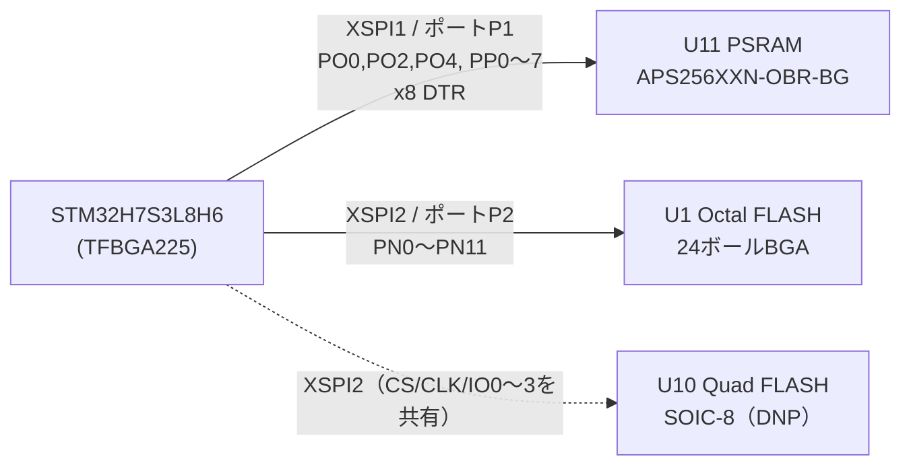

# JUMBLEQ メインボード rev.D 設計書（BGA化＋PSRAM＋FLASH複数品種対応）

Oct 26, 2026 · @山本俊一

## 概要

rev.Dでは、MCUをTFBGA225のSTM32H7S3L8H6（OCTO品）に変更します。PSRAM APS256XXN（256Mbit、x8モード）をXSPI1に、FLASHをXSPI2に移します。rev.Cで使っていたGPIOは、すべて同じピン名・同じ機能のまま残せます。

当初はST DK方式どおり、HEXA品（STM32H7S3L8H6H）でPSRAMをx16接続する案でした。しかしHEXA品ではPD8〜PD11のボールがなくなり、PD11にしかない**SAI2A\_DATA\_OUT（MCU→DSPの音声出力）を出せません**。そのためOCTO品を採用し、PSRAMはx8モードで使います。帯域は約400MB/sで、ディレイやサンプラーに必要な帯域を大きく上回ります。

| 項目 | rev.C | rev.D（本案） |
| --- | --- | --- |
| MCU | STM32H7S3Z8T6（LQFP144） | STM32H7S3L8H6（TFBGA225、13×13mm、0.8mmピッチ） |
| XSPI1（ポートP1、PO/PP） | Octal FLASH MX25UW25645G | PSRAM APS256XXN-OBR（x8、24ボールBGA） |
| XSPI2（ポートP2、PN） | 未使用（LQFP144にはPNが出ていない） | FLASH：24ボールBGA（Octal/Quad）＋Quad用SOIC-8パッド |
| VDDXSPI1／VDDXSPI2 | 1.8V（4ピン）／なし | 1.8V（3ボール）／1.8V（3ボール） |
| SMPS関連ボール | なし | VDDSMPS・VFBSMPS・VSSSMPSをGNDへ、VLXSMPSは開放（LDO動作のまま） |
| 外部コネクタJ1〜J4・DSP・USB | — | J1の9番ピンをGND→PA4（ADC1\_IN18）へ変更。J1は2列×7・計14ピンへ拡張し、13・14番にADC2入力を追加（2026-11-03） |
| DSPコア電源のPNP（Q1） | STD2805T4（TO-252） | FZT953（SOT-223） |
| 1V8レギュレータ | AP2127N-1.8（SOT-23） | AP7361C-18E-13（SOT-223、入力は5Vのまま） |
| 外部5V入力（J7） | JST PH S2B-PH-K（2A） | JST XH S2B-XH-A（3A）。ボード電源としても使えるようTPS2121で切替 |
| USBホストポート | なし | USB-C（OTG\_FS、MIDIコントローラー用） |

PCBの層構成（6層）と基板外形73×72mmは、そのまま使える見込みです。ビアは、一般部ではrev.Cと同じ0.5/0.3mm、BGA部（U2のボール間のドッグボーン）では0.45/0.2mmを使い分けます（「PCB部品配置」参照）。

## MCU選定

採用するのはSTM32H7S3L8H6（TFBGA225 OCTO品）です。同じTFBGA225でもOCTO品とHEXA品はボール配置が異なり、フットプリント互換にはなりません。DSPへの音声出力にSAI2A（PD11）が必須なため、OCTO品に確定しました（2026-10-26）。

| 比較 | STM32H7S3L8H6（OCTO）採用 | STM32H7S3L8H6H（HEXA） |
| --- | --- | --- |
| XSPI1ポートP1 | 8bit（PP0〜7、DQS0） | 16bit（PP0〜15、DQS0/1） |
| XSPI2ポートP2 | 8bit（PN0〜12） | 8bit（PN0〜12） |
| PD8〜PD11 | あり | なし（ボールがPP8〜15/PO3に置き換わる） |
| 影響を受ける信号 | なし | SAI2A\_DATA\_OUT（代替ピンなし）、USART3\_TX/RX/CK（J2、代替はI2S3/ETHと競合） |
| PSRAM帯域（200MHz DTR） | 約400MB/s | 約800MB/s |
| IO数 | 152 | 150 |

デザイン上の注意：

- **電源ボール**：VDD×10、VDDLDO×4、VDDXSPI1×3（L8/L10/M10）、VDDXSPI2×3（H12/J11/K12）、VSS×34。VDDXSPI1/2は各ドメインに1µF＋100nF×3（AN5935 Table 4）。
- **LDO動作を継続**：VDDLDOは3V3につなぎ、4.7µFをVDDLDOボールの近くに1個置きます。VCAP1〜4には、rev.Cと同じく2.2µF（ESR 100mΩ未満）を付けます。
- **SMPS未使用**：データシートDS14359のFigure 2「1. LDO supply」に従い、VDDSMPS（H1）、VFBSMPS（G2）、VSSSMPS（H2）をGNDへつなぎ、VLXSMPS（G1）は開放にします。VDDSMPSをVSSへつなぐ点は、AN5935 Table 4とも一致します。
- **HSLV**：XSPI1\_HSLVとXSPI2\_HSLVの両方をセットします。ただし対応するVDDXSPIが2.7Vを超えている状態でセットすると、デバイスを破損するおそれがあります。
- **配線**：PN（XSPI2）はF13〜L15の右端、PO/PP（XSPI1）はN8〜R11の右下に集まっています。PSRAMを右下、FLASHを右側に置くと、メモリ配線を最短にできます。
- **ビア**：ボールピッチ0.8mmです。ボール間のドッグボーンには0.45/0.2mmのビアを使います（JLCPCBで追加料金がかからない最小サイズ。「PCB部品配置」参照）。

## メモリ構成

PSRAMをXSPI1、FLASHをXSPI2に分けます。これでFLASHからのコード実行とPSRAMへのアクセスが、同じバスを取り合わなくなります。

（Docs版では図として埋め込まれている「rev.D 外部メモリ構成」を、Markdown用にMermaidで書き直したものです）

U10は、U1のCS・CLK・IO0〜3を共有します。実装するのはどちらか一方だけです。

## PSRAM選定と接続

採用するのは[APS256XXN-OBR-BG](https://mouser.com/datasheet/2/1127/APS256XXN_OBR_BG-3515932.pdf)（AP Memory、256Mbit、1.8V、200MHz DDR、24ボールBGA 6×8mm、1.0mmピッチ）です。ST DKで実績のある品で、x8（初期値）とx16をMR8\[6\]で切り替えられます。x8モードでも容量は256Mbit（32MB）のままです。

| PSRAMボール | 信号（x8） | MCUピン | MCUボール | XSPI機能 |
| --- | --- | --- | --- | --- |
| A3 | CE# | PO0 | N12 | XSPIM\_P1\_NCS1（10kプルアップ→1V8） |
| B2 | CLK | PO4 | R10 | XSPIM\_P1\_CLK |
| C3 | DQS/DM | PO2 | P11 | XSPIM\_P1\_DQS0 |
| D3 | ADQ0 | PP0 | N10 | XSPIM\_P1\_IO0 |
| D2 | ADQ1 | PP1 | P12 | XSPIM\_P1\_IO1 |
| C4 | ADQ2 | PP2 | N8 | XSPIM\_P1\_IO2 |
| D4 | ADQ3 | PP3 | N9 | XSPIM\_P1\_IO3 |
| D5 | ADQ4 | PP4 | R8 | XSPIM\_P1\_IO4 |
| E3 | ADQ5 | PP5 | P10 | XSPIM\_P1\_IO5 |
| E2 | ADQ6 | PP6 | R11 | XSPIM\_P1\_IO6 |
| E1 | ADQ7 | PP7 | N11 | XSPIM\_P1\_IO7 |
| D1, E4 | VDD | 1V8 | — | 100nF×2＋4.7µF |
| C1, E5 | VSS | GND | — | — |
| A2, A4, A5, B1, B3, B4, B5, C2, C5 | DNU（x16用） | 開放 | — | — |

rev.CでFLASHをつないでいたPO0/PO2/PO4/PP0〜7をそのまま使うので、GPIO設定は変わりません。PO1（NCS2）とPO5（NCLK）は未使用です。

ファームウェアでは、CE#のLow時間をtCEM以内に収める必要があります（標準温度で4µs、拡張温度で1µs）。この制約はXSPI側の設定で守ります。

**ボール配置の訂正（2026-10-27）**：データシート（APS256XXN-OBx9 Rev.1.0、p.4 Ball Assignment）では、A1にボールはなく、A列はA2=DNU、A3=CE#、A4=DNU、A5=DNUです。最初に作ったシンボルはA列を1つずれて読んでいて、CE#がA2になっていました。My\_Partsと回路図のシンボルを直し、CE#をA3にしました。フットプリントBGA24C100P5X5\_800X600X120（A2〜E5の24パッド、6×8mm、ピッチ1.0mm）は、外形図（p.5）と一致しています。

## FLASHの複数品種対応

FLASHは、JEDEC xSPIの24ボールBGA（6×8mm）を主フットプリント（U1）にします。これに加え、1.8V Quad品用のSOIC-8（208mil）パッド（U10、排他実装）を設けます。WSON-8は手付けしにくいため対象外としました（2026-10-27決定）。どちらもXSPI2ポートP2につなぎ、VDDXSPI2が1.8Vなので**1.8V品のみ**が使えます。

| 実装先 | 対象 | 候補 | ボール配置の照合結果 |
| --- | --- | --- | --- |
| U1（24ボールBGA） | Octal 1.8V | Macronix MX25UW25645G | rev.Cで実績あり（基準） |
| U1（24ボールBGA） | Octal 1.8V | [GigaDevice GD25LX256E](https://www.endrich.com/Datenbl%C3%A4tter/Aktive%20Komponenten/DS-00514-GD25LX256E-Rev1.4.pdf) | 一致。A4=RESET#、A5=ECS#、信号・電源ボールも同じ。C5がWP#なので、C5のプルアップを実装する |
| U1（24ボールBGA） | Octal 1.8V | [ISSI IS25WX256](https://e2e.ti.com/cfs-file/__key/communityserver-discussions-components-files/908/IS25WX064_2D00_JHLE.pdf) | 一致（同シリーズのIS25WX064で確認）。A5=ERR#、C5=W#/Vppで、GDと同じ扱いで使える |
| U1（24ボールBGA） | Octal 1.8V | [Micron MT35XU](https://www.mouser.com/catalog/specsheets/Micron_9-23-2025_MT35XU512ABA.pdf) | 未確認。ボール配置は図にしか載っておらず、取得できたのは512Mbit品の資料だけ。256Mbit品が入手できるかも未確認 |
| U1（24ボールBGA） | Octal 1.8V | [Winbond W35T-NW](https://www.winbond.com/productResource-files/Winbond%20Octal%20NOR%20Flash%20Product%20Brief.pdf) | 未確認。JEDEC xSPI準拠のBGA24。256Mbit品にはSOP16版もあるが、U10のパッドには合わない |
| U10（SOIC-8） | Quad 1.8V | Winbond W25Q256JW、W25Q128JW、Macronix MX25U、ISSI IS25WP、GigaDevice GD25LQ | 標準の8ピン配置。パッケージと容量の在庫を確認する |

| 信号 | MCUピン（ボール） | U1（24ボール） | U10（SOIC-8） |
| --- | --- | --- | --- |
| CS# | PN1（F14）XSPIM\_P2\_NCS1 | C2 | 1（/CS） |
| SCLK | PN6（J14）XSPIM\_P2\_CLK | B2 | 6（CLK） |
| DQS | PN0（G14）XSPIM\_P2\_DQS0 | C3 | — |
| IO0 | PN2（H15） | D3 | 5（DI/IO0） |
| IO1 | PN3（G13） | D2 | 2（DO/IO1） |
| IO2 | PN4（K14） | C4 | 3（/WP/IO2） |
| IO3 | PN5（K15） | D4 | 7（/HOLD·/RESET/IO3） |
| IO4〜IO7 | PN8（K13）、PN9（H14）、PN10（H13）、PN11（G15） | D5、E3、E2、E1 | — |
| RESET# | NRSTからD6経由（rev.Cと同じ） | A4 | — |
| ECS/ERR# | 10kプルアップ→1V8（R3、rev.Cと同じ） | A5 | — |
| W#/Vpp | 10kプルアップ→1V8（新規、未実装パッド） | C5 | — |
| VCC/VCCQ | 1V8 | B4、D1、E4 | 8 |
| GND | GND | B3、C1、E5 | 4 |

レイアウト上の注意：

- U1とU10は同時に実装しません。未実装側のパッドは配線のスタブになるため、U10は裏面のU1直下に置きました（「PCB部品配置」参照）。
- Quad品を使うと外部FLASHからのXIP帯域が下がります。そのためQuad品は、供給違のときの保険という位置づけです。実際の性能は、I/Dキャッシュを有効にした状態で実測して確認します。

## ピン割当

rev.CでMCUにつながっていた信号は、メモリとSPI5（USBホスト追加に伴いPF6〜PF9へ移動）以外はすべて同じGPIOのままで、ボールの位置だけが変わります。ボール番号はST公式のピンデータ（[STM32\_open\_pin\_data](https://github.com/STMicroelectronics/STM32_open_pin_data)、STM32H7S3L8Hx）から、rev.Cのピン番号は回路図mcu.kicad\_schのネットから取り出しました。XSPIの割当は、前の2節に載せています。

| 接続先 | 信号 | ピン | rev.C (LQFP144) | rev.D (TFBGA225) |
| --- | --- | --- | --- | --- |
| DSP | DSP\_RESET | PH1 | 14 | K2 |
| DSP | I2S\_CLKIN | PC9 | 87 | E14 |
| DSP | SAI1A\_DATA\_IN | PE6 | 12 | E1 |
| DSP | SAI1A\_FS | PE4 | 10 | E2 |
| DSP | SAI1A\_SCK | PE5 | 11 | F4 |
| DSP | SAI2A\_DATA\_OUT | PD11 | 68 | M12 |
| DSP | SAI2A\_FS | PD12 | 71 | N13 |
| DSP | SAI2A\_SCK | PD13 | 72 | P14 |
| DSP | SPI5\_MISO | PF8（rev.CはPM14） | 126 | H3 |
| DSP | SPI5\_MOSI | PF9（rev.CはPM13） | 127 | J2 |
| DSP | SPI5\_SCLK | PF7（rev.CはPM11） | 125 | H4 |
| DSP | SPI5\_SS | PF6（rev.CはPM12） | 124 | H5 |
| USB | UCPD\_CC1 | PM0 | 111 | D10 |
| USB | UCPD\_CC2 | PM1 | 112 | C10 |
| USB | UCPD\_INT | PM8 | 121 | C9 |
| USB | UCPD\_ISENSE | PA5 | 33 | N2 |
| USB | UCPD\_PWR\_EN | PM9 | 122 | B8 |
| USB | USB\_HS\_D+ | PM6 | 119 | A9 |
| USB | USB\_HS\_D- | PM5 | 118 | B9 |
| J1 (ADC) | ADC1\_IN0 | PA0 | 26 | M1 |
| J1 (ADC) | ADC1\_IN10 | PC0 | 18 | K3 |
| J1 (ADC) | ADC1\_IN12 | PC2 | 20 | L2 |
| J1 (ADC) | ADC1\_IN13 | PC3 | 21 | L3 |
| J1 (ADC) | ADC1\_IN15 | PA3 | 29 | N1 |
| J1 (ADC) | ADC1\_IN3 | PA6 | 34 | P1 |
| J1 (ADC) | ADC1\_IN5 | PB1 | 39 | R2 |
| J1 (ADC) 13番ピン（追加） | ADC2\_IN2 | PF13 | — | P3 |
| J1 (ADC) 14番ピン（追加） | ADC2\_IN6 | PF14 | — | P4 |
| J2 | FDCAN2\_RX | PB12 | 75 | L12 |
| J2 | FDCAN2\_TX | PB13 | 76 | N15 |
| J2 | I2S3\_CK | PC10 | 101 | B14 |
| J2 | I2S3\_SDI | PC11 | 102 | B15 |
| J2 | I2S3\_SDO | PB2 | 40 | N4 |
| J2 | I2S3\_WS | PA15 | 97 | G11 |
| J2 | LPUART1\_CTS | PA11 | 93 | C15 |
| J2 | LPUART1\_RTS | PA12 | 94 | C14 |
| J2 | LPUART1\_RX | PA10 | 92 | E13 |
| J2 | LPUART1\_TX | PB6 | 143 | E5 |
| J2 | USART3\_CK | PD10 | 67 | R14 |
| J2 | USART3\_RX | PD9 | 66 | P13 |
| J2 | USART3\_TX | PD8 | 65 | M11 |
| J2 / USB (UCPD) | I2C2\_SCL | PA8 | 90 | F12 |
| J2 / USB (UCPD) | I2C2\_SDA | PA9 | 91 | D14 |
| J3 (Ethernet) | ETH\_MDC | PC1 | 19 | L1 |
| J3 (Ethernet) | ETH\_MDIO | PA2 | 28 | L4 |
| J3 (Ethernet) | ETH\_MII\_RX\_ER | PB10 | 73 | P15 |
| J3 (Ethernet) | ETH\_RMII\_CRS\_DV | PA7 | 35 | M4 |
| J3 (Ethernet) | ETH\_RMII\_INTN | PD4 | 110 | C11 |
| J3 (Ethernet) | ETH\_RMII\_REF\_CLK | PA1 | 27 | M2 |
| J3 (Ethernet) | ETH\_RMII\_RXD0 | PC4 | 36 | L5 |
| J3 (Ethernet) | ETH\_RMII\_RXD1 | PC5 | 37 | N3 |
| J3 (Ethernet) | ETH\_RMII\_TXD0 | PB0 | 38 | P2 |
| J3 (Ethernet) | ETH\_RMII\_TXD1 | PB7 | 144 | D4 |
| J3 (Ethernet) | ETH\_RMII\_TX\_EN | PB11 | 74 | N14 |
| J3 (SDMMC2) | SDMMC2\_CK | PD6 | 130 | E7 |
| J3 (SDMMC2) | SDMMC2\_CMD | PD7 | 131 | B6 |
| J3 (SDMMC2) | SDMMC2\_D0 | PB14 | 77 | M13 |
| J3 (SDMMC2) | SDMMC2\_D1 | PB15 | 78 | M14 |
| J3 (SDMMC2) | SDMMC2\_D2 | PB3 | 134 | C4 |
| J3 (SDMMC2) | SDMMC2\_D3 | PB4 | 135 | D5 |
| J3 (SDMMC2) | SDMMC2\_D4 | PB8 | 1 | B1 |
| J3 (SDMMC2) | SDMMC2\_D5 | PB9 | 2 | C2 |
| J3 (SDMMC2) | SDMMC2\_D6 | PC6 | 84 | E15 |
| J3 (SDMMC2) | SDMMC2\_D7 | PC7 | 85 | F13 |
| J4 (SWD) | DEBUG\_SWCLK | PA14 | 96 | D13 |
| J4 (SWD) | DEBUG\_SWDIO | PA13 | 95 | E12 |
| LED | LED0 | PD2 | 106 | A14 |
| LED | LED1 | PD1 | 105 | B13 |
| LED | LED2 | PD0 | 104 | C13 |
| SW | USER\_SW1 | PD15 | 83 | L13 |
| SW | USER\_SW2 | PD14 | 82 | L14 |
| システム | 24MHz発振器入力 | PH0 | 13 | K1 |
| システム | NRST | NRST | 15 | J4 |
| システム | BOOT0 | BOOT0 | 128 | A6 |
| J1 (ADC) 9番ピン（rev.CはGND、2026-10-27変更） | ADC1\_IN18 | PA4 | 32 | M3 |
| 未接続（ラベルのみ） | PB5 | PB5 | 136 | B3 |

## ファームウェアへの影響

大きく変わるのはUF2ブートローダの外部メモリ初期化です。FLASHがXSPI1からXSPI2へ移り、これに品種の自動判別が加わります。アプリ側では、PSRAMを使う部分の追加に加えて、次のGPIOの変更が必要です。①SPI5をPM11〜14からPF6〜9へ移す（「USBホストポート」参照）。②J1の9番ピンにPA4（ADC1\_IN18）がつながる。既存のキャリア基板が9番ピンをGNDにつないでいる場合があるので、PA4は出力に設定せず、アナログ入力のままにする。③ホスト用ポートの電源スイッチのイネーブル（PM13）は、アクティブHighです。④J1の13・14番を使う場合は、PF13/PF14をアナログ入力とし、ADC2のシングルエンド入力IN2/IN6を初期化します（2026-11-03）。

1. **オプションバイト**：XSPI1\_HSLV（設定済み）に加え、XSPI2\_HSLVもセットします。書き込み手順のREADMEも更新します。
2. **XSPIM**：ダイレクトモード（XSPI1→P1、XSPI2→P2）で使います。
3. **ブートローダ（内蕅64KB）**：XSPI2上のFLASHを初期化してメモリマップドにし、アプリへジャンプします。アドレスはXSPI1側のベースからXSPI2側のベースに変わるので、アプリのリンカスクリプトとUF2の書き込み先アドレスも書き換えます。
4. **FLASHの品種判別**：起動直後に1線のSPIでJEDEC ID（9Fh）を読み、品種ごとのコマンド表を選びます。Octal DTRへの切替手順、ダミーサイクル数、Quad品のQEビットはメーカーごとに異なります。未登録のIDには、SFDP（JESD216）を読んでパラメータを決める方式で対応します。
5. **PSRAM初期化**：リセット後、モードレジスタでレイテンシとバースト長を設定します（x8のままなのでMR8\[6\]=0）。そのうえでXSPI1をメモリマップドにし、CS#のLow時間がtCEMを超えないようにXSPIを設定します。
6. **MPU**：PSRAM領域はキャッシュ可、未実装の領域はアクセス禁止にします。投機的アクセスによるハングを防ぐためです。DMAでやり取りするバッファは、キャッシュの保守も含めて設計します。
7. **アプリ**：ディレイラインやサンプラーのバッファをPSRAMのセクションに置きます。音声処理のホットパスは、内蔵SRAMに残します。

## 1V8電源の見積もり

1V8の負荷は最大で約120mAの見込みです。現行のAP2127N-1.8を5V入力のまま使うと、接合部温度の余裕が少なくなります。そこで入力は5Vのままとし、レギュレータをAP7361C-18E-13（SOT-223）に変えることで確定しました。

| 負荷 | 最大電流 | 根拠 |
| --- | --- | --- |
| PSRAM APS256XXN（x8、200MHzでの読み書き） | 26mA | データシートTable 27（特性値） |
| FLASH（Octal、200MHz DTRでの読み出し） | 50mA（仮置き） | 各社のDC特性表を取得できなかったため、大きめに仮定 |
| VDDXSPI1（IO 11本、200MHz） | 約20mA | 推定。負荷容量10pF、トグル率50%と仮定 |
| VDDXSPI2（IO 11本、200MHz） | 約20mA | 同上 |
| 合計 | 約120mA | AP2127の定格300mAに対しては十分余裕がある |

| 入力電圧 | 損失 | 温度上昇（SOT-23、θJA 180℃/W） | 周囲40℃での接合部温度 |
| --- | --- | --- | --- |
| 5V\_UCPD（現行、5.25Vで計算） | 0.41W | 約75℃ | 約115℃（上限125℃に対して余裕約10℃） |
| 3V3（推奨） | 0.18W | 約32℃ | 約72℃ |

- 3V3入力でも、入出力の差は1.5Vあります。300mA時のドロップアウト（最大700mV）を十分上回ります。
- その代わり、3V3側のAP7361（1A）に約120mAが上乗せされ、損失が約0.2W増えます。AP7361は散熱の大きいパッケージなので、問題になりにくい見込みです。ただしDSPを含めた3V3全体の負荷で確認が必要です。
- 5V入力のままにする場合の候補は[AP7361C-18E-13](https://www.mouser.com/datasheet/2/115/AP7361C-775034.pdf)（SOT-223、1A、θJA 110℃/W）です。温度上昇は約46℃、接合部は約86℃です。ピンは1=IN、2=GND（タブ）、3=OUTで、出力コンデンサは2.2µF以上が必要です。当初挙げたAP2127R-1.8（SOT-89）は、データシートの型番表になく、SOT-89版は3.3V品しかありません。
- 数値の出典は[AP2127データシート](https://www.mouser.com/datasheet/2/115/AP2127-318083.pdf)と[APS256XXNデータシート](https://mouser.com/datasheet/2/1127/APS256XXN_OBR_BG-3515932.pdf)です。FLASHとVDDXSPIの値は推定なので、試作基板で実測して確かめます。

## DSPコア電源（VDRIVEのトランジスタ）

ADAU1466のVDRIVEにつなぐPNPトランジスタQ1を、STD2805T4（TO-252）から[Diodes FZT953](https://diodes.com/datasheet/download/FZT953.pdf)（SOT-223）に変えます（2026-10-26決定）。基板上の占有面積を小さくするためです。

| 条件（[ADAU1462/1466データシート](https://www.analog.com/media/en/technical-documentation/data-sheets/adau1462-1466.pdf) Table 2、25℃） | DVDD電流 | Q1の損失（3.3V→1.2V） | 温度上昇（θJA 78℃/W） |
| --- | --- | --- | --- |
| 標準的なプログラム | 220mA | 約0.46W | 約36℃ |
| 最大負荷のプログラム（表の読み取りから推定） | 495mA | 約1.04W | 約81℃ |

- FZT953はPNP、100V、5Aです。θJA 78℃/Wと許容損失1.6Wは、25×25mm・1ozの基板での値です。hFEは1Aで100以上です。
- Q1のコレクタ側に、散熱用の銅箔面積を確保します。

* [x] ピン配置を確認済み：1=ベース、2=コレクタ、3=エミッタ、4（タブ）=コレクタ。Diodes版（DS35942 Rev.6-2）のTop View Pin-Out図で、タブがC、リードが上からE・C・Bであることを確認。Kexin版（LCSC C499616、ピン番号付き）と一致する。発熱の計算は、Diodes版の熱抵抗を使っている
* [ ] 試作基板で実際のDVDD電流とQ1の温度を測る

## USBホストポート（MIDIコントローラー用）

PCとは今どおりUSB HS（デバイス）でつなぎ、USB OTG FSをホストにします。ホスト用のUSB-Cコネクタを、メインボードに1個追加します。OTG\_FSは、ホストモードでフルスピードとロースピードに対応しています（DS14359 Table 18）。

**SPI5の移動**：OTG\_FSのD+/D−はPM11/PM12に固定されています。そのためDSP用のSPI5を、同じSPI5のままPF6〜PF9へ移します。

| 信号 | rev.Cのピン | rev.Dのピン（ボール） |
| --- | --- | --- |
| SPI5\_SS | PM12 | PF6（H5） |
| SPI5\_SCLK | PM11 | PF7（H4） |
| SPI5\_MISO | PM14 | PF8（H3） |
| SPI5\_MOSI | PM13 | PF9（J2） |
| OTG\_FS\_DP | — | PM11（B7） |
| OTG\_FS\_DM | — | PM12（A7） |

**ホスト用USB-Cポート（ソース）**

- **CC1/CC2**：それぞれ36kΩで3.3Vへプルアップします。これでDefault USB power（500mA）を通知します。接続した機器のRd（5.1kΩ）で、CCの電圧は約0.4Vに下がります。この電圧をGPIOかADCで監視して接続を検出し、検出してからVBUSを出します。
- **D+/D−**：レセプタクルのA6/B6とA7/B7を両面でつなぎ、90Ω差動でPM11/PM12へ配線します。
- **ESD保護**：[USBLC6-4SC6](https://st.com/en/protections-and-emi-filters/usblc6-4.html)（ST、4ライン）を使い、CC1・CC2・D+・D−をまとめて保護します。
- **VBUS**：USB電源スイッチ[TPS25200DRVR](https://www.lcsc.com/product-image/C128401.html)（TI、WSON-6 2×2mm）を使います（2026-10-27、STMPS2141STRから変更）。入力の絶対最大定格が20Vあり、5.4〜7.6Vの入力では出力を5.25〜5.55Vに抑え、約6.8V以上で遮断します。電流制限はILIMのR45（169kΩ）で504〜648mA（データシートの式で算出）。ENはアクティブHighでR33（10kΩ）でプルダウン、FAULTはオープンドレインでR44（10kΩ）で3V3へプルアップします。無効時には約480Ωで出力を放電します。

**給電（PC・iPad・スマホとの接続と、J7の外部5V）**

iPadやスマホとの接続も想定するため、J7の外部5V入力とSource経路（Q3）を残します（2026-10-27決定）。J7はヘッダのままとし、DCジャックや電源専用のUSB-Cコネクタは、このボードを組み込む筐体側に付けます。

Nucleo-H7S3L8（MB1737）では、ボードの電源とSourceで出す電源がどちらもST-LINK等の「5V」から来ます。rev.Cはボード電源が5V\_UCPDに固定されているため、Sourceで動くとボード自身の電源が切れます。rev.Dでは次のようにします。

- **ボード電源の切替**：電源マルチプレクサ[TPS2121](https://ti.com/product/TPS2121)（TI、2.5×2mm、逆流防止付き）で、J7の外部5Vと5V\_UCPDを切り替えます。外部5Vを優先し、その出力でレギュレータ、J8、ホスト用ポートを動かします。
- **Source経路**：Q3は、J7の外部5Vから直接つなぎます。切替後の出力からつなぐと、出した電力が戻ってくるループになるためです。
- **電源の役割交換（PR\_Swap）**：接続直後は、受電側かつUSBデバイスとしてつながります。外部5Vがあれば、USB PDのPR\_Swapで電源の向きだけを入れ替え、iPadやスマホに給電します。データの役割（相手がUSBホスト）は変わりません。
- **J7の電流**：J7をJST PHからJST XHのS2B-XH-A（横向きスルーホール、定格3A、AWG#22）に変えます（2026-10-27決定）。iPad・スマホへの給電は1.5A（Rpで「1.5A」を通知）とし、J7の合計は本体300mA＋MIDIコントローラー500mA＋1.5A＝約2.3Aです。筐体側のDCジャック、電源専用USB-C、ACアダプタもこの電流に対応させます。

* **J8と消費電流**：J8からは、切替後の5Vをキャリア基板へ出します。キャリア基板を含むJUMBLEQ全体の消費電流は300mA以下で、最新のファームウェアはホストに500mAを申告しています（2026-10-27確認）。

**J7の入力保護**（筐体側がDCジャックになる場合に備える。入力側から順に）

1. **逆接続保護**：PチャネルMOSFET [DMP3056L](https://www.farnell.com/datasheets/2814426.pdf)（Diodes、SOT-23、−30V、−4.3A、VGS±25V、RDS(on)最大70mΩ＠VGS−4.5V）を直列に入れます。逆に挿されるとオフのままで、電流が流れません。ゲートはR30でGNDへ引きます。後段のTVS（SMAJ13A、クランプ21.5V）でVGSが定格±25V以内に収まるので、ツェナーは付けません。2.3A時の損失は最大約0.37Wなので、ドレイン側に銅箔を確保します。これで、rev.CのD5（ショットキー）は不要になります。
2. **サージ・ESD保護**：TVS [SMAJ13A](https://www.digikey.ch/en/products/detail/littelfuse-inc/SMAJ13A/762484)（Littelfuse、スタンドオフ13V、クランプ21.5V @ 18.6A）を、MOSFETの後ろに置きます（2026-10-27、SMAJ15Aから変更）。片方向のTVSをMOSFETの前に置くと、逆接続のときに順方向に電流が流れてしまうためです。
3. **過電圧保護**：TPS2121の過電圧監視（OVx）で、標準約5.63V（誤差込み約5.28〜5.94V）を超えたら入力を切り離します。しきい値のばらつき（±4%）のため、この機能だけでは「5.5Vまでは通し、6.0V未満では必ず切る」は実現できません。そこで「6.0V未満で必ず切る」ことを優先し、5.28〜5.5Vの電源で誤って遮断する可能性は許容します。ホスト用ポートの電源スイッチは、入力の定格に余裕があるTPS25200にします（「レビュー対応」参照）。

保護できる範囲：逆接続は−30Vまでです。間違った電圧のアダプタは**12Vアダプタまで**で、ボードの仕様に明記します。それより高い電圧（19VのノートPC用など）を持続的に挂けると、TVSが導通し続けて壊れるおそれがあります。TVSのクランプ電圧（21.5V）は、TPS2121の入力の絶対最大定格（24V）より2.5V低く、Q4のVGS定格（±25V）も下回ります。

**TPS2121の設定（初期案）**

IN1をJ7の外部5V（保護回路の後）、IN2を5V\_UCPDにします。式としきい値は[TPS212xデータシート Rev.F](https://www.ti.com/lit/gpn/TPS2121)によります。

| ピン（RUX） | 目的 | 定数 | 結果 |
| --- | --- | --- | --- |
| OV1（5） | J7の過電圧で遮断 | 上21.5kΩ／下4.99kΩ | 標準約5.63Vで遮断。しきい値（1.01〜1.10V）と抵抗1%の誤差を含めて約5.28〜5.94V |
| OV2（4） | 5V\_UCPDの過電圧で遮断 | 上21.5kΩ／下4.99kΩ | 標準約5.63Vで遮断（範囲はOV1と同じ） |
| CP2（3） | 高速切替（XCOMP）を有効にする | IN2から上10.2kΩ／下5kΩ | 5V\_UCPDが5Vのとき1.64V。VREF（1.06V）より高いので高速切替が有効になる |
| PR1（6） | J7を優先する | IN1から上8.66kΩ／下5kΩ | J7が5V\_UCPDの約0.9倍（5V時に約4.49V）を下回るまでJ7を使う |
| ILIM（10） | 電流制限 | 35.7kΩ | 約3.0A（I = 65.2 ÷ R^0.861、RはkΩ、18〜100kΩ） |
| ST（9） | どちらから給電しているか | 10kΩで3V3へプルアップ | High：J7（または出力なし）、Low：5V\_UCPD |
| SS（11） | 立ち上がり速度 | 100nF | 5Vで約780V/s。出力側200µFでも突入電流は約0.16A |

ピン配置（RUX）：1・8=OUT、2=IN2、3=CP2、4=OV2、5=OV1、6=PR1、7=IN1、9=ST、10=ILIM、11=SS、12=GND。データシートSLVSEA3FのPin Functions表で確認済み。

SSの単位は、Table 9-1と本文（突入電流の計算例）がどちらもV/sです。V/ms表記はグラフの軸だけなので、V/sを採用しました。

- [x] CP2を使った優先判定（XCOMP方式）の動作を、データシートの図で確認する
- [x] RUXパッケージのピン配置（OUTが2ピンあるなど）を、データシートの図で確認する

**新しく増える信号のピン割当（初期案）**

| 信号 | ピン（ボール） | 内容 |
| --- | --- | --- |
| HOST\_CC1\_DET | PF11（M5）ADC1\_INP2 | ホスト用ポートCC1の電圧。ADCで読むと、コントローラー（Rd）とケーブルだけ（Ra）を区別できる |
| HOST\_CC2\_DET | PF12（R3）ADC1\_INP6 | 同上（CC2） |
| HOST\_VBUS\_EN | PM13（C7） | TPS25200のEN（アクティブHigh、10kΩでプルダウン）。SPI5の移動で空いたピン |
| HOST\_VBUS\_FLT | PM14（C8） | TPS25200のFAULT（過電流・過電圧・過熱）。3V3へプルアップ |
| PWR\_ST | PD5（D7） | TPS2121のST |
| LED\_PWR | PG2（C6） | 「電源が足りない」ことを知らせるLED（新規） |

PC13〜PC15はバックアップドメインのピンで駆動能力に制約があるため、割り当てていません。

| 状態 | ボードの電源 | ホスト用ポートのVBUS | 相手（PC・iPad・スマホ）への給電 |
| --- | --- | --- | --- |
| 外部5Vあり | 外部5V | 出す（500mA） | PR\_Swapで給電する（相手が応じた場合） |
| 外部5Vなし。相手が1.5A以上を通知 | 5V\_UCPD | 出す | しない |
| 外部5Vなし。相手がDefault USB power | 5V\_UCPD | 初期設定では出さず、LEDで知らせる。設定で許可できる | しない |

前提（2026-10-27決定）：MIDIコントローラーを使うときは、PCとボードをUSB-Cでつなぐ。PC側の推奨ポート仕様は1.5A対応とする。rev.Cの消費電流は300mA以下。Defaultのとき、このボード（USB 2.0デバイス）が使えるのは500mAまでなので、コントローラーに回せるのは残りの約200mAです。

PC側の通知値は、UCPDでCCの状態を読んで判別します。USB 2.0の構成記述子で申告できる消費電流（bMaxPower）は最大500mAなので、申告値は500mAのままにします。コントローラーへの給電は、Type-Cの電流通知（1.5A／3A）から本体の消費分を差し引いて可否を判断します。Default USB powerのときは、設定で許可した場合だけ給電します。記述子と給電制御の細部は、採用するUSBスタックに合わせて決めます。

- [x] rev.Cでボード本体の5V消費電流を測る（DSP動作時）→ 300mA以下
- [x] Q2/Q3はUSB PDのSink/Source対応のための経路。iPad・スマホとの接続に備えて、J7とSource対応を残す（2026-10-27決定）
- [ ] ファームウェア：USBホストのスタックとUSB-MIDIクラスのドライバ。HS（デバイス）との同時動作も考慮する
- [ ] ファームウェア：USB PDのスタックでPR\_Swapを実装する。外部5Vの有無に応じてSourceに切り替え、相手には5V・1.5Aを通知する
- [ ] iPad・スマホ実機で、PR\_Swapに応じるかを確認する

## 回路図作成での確定事項（2026-10-27）

rev.Dの回路図はERCを通り、残っている警告9件はすべてrev.Cからの引き継ぎです。VCAP1〜4の電源出力どうしの接続（3件）は除外にしています。

- **U2のシンボル**：KiCad標準の部品ではなく、My\_Partsの専用シンボルSTM32H7S3L8Hx\_JUMBLEQを使います。左側のピンを、U1とU11のピンの並びに合わせて並べ替え、XSPIの信号を水平の直線で直接配線しています。フットプリントは標準のままです。U2を動かすとVCAPの除外が外れるので、そのときは除外し直すか、VCAP2〜4のピンの種類をパッシブに変えます。
- **直接配線**：U1、U11、NRSTまわり（SW1、C19）、BOOT0（R1）、HSE\_IN（X1、R4）をU2と直接つなぎました。USBシートでは、R33（ENのプルダウン）とR44（FAULTのプルアップ）をU13と直接つないでいます。
- **U11（PSRAM）**：CE#はA3です（上の「PSRAM選定と接続」を参照）。
- **Q4（DMP3056L）**：データシート（DS37386 Rev.6-2）の上面図で、1=G、2=S、3=Dを確認しました。シンボルQ\_PMOS\_GSDとフットプリントSOT-23のピン番号と一致しています。ドレインがJ7側、ソースが5V側で、逆接続保護として正しい向きです。
- **U12（TPS2121）のフットプリント**：データシート（SLVSEA3F p.39）のランドパターンから、My\_Parts:TI\_RUX0012A\_VQFN-HR-12\_2x2.5mm\_P0.5mmを作りました。
- **ホスト側VBUSのコンデンサ（J10）**：10µF×2（計20µF）のままにします。USB PD規格（r3.2 v1.2）の4.1.2とTable 4.6（p.79）で、専用の電源から給電するポートの最小値cSrcBulkは10µFです。120µF（cSrcBulkShared）は、電源を複数のポートで共有する場合の値です。J10の電源はボード内の5V\_SYSで、ほかの給電ポートとは共有していません。切断後の放電は、U13（TPS25200）の出力放電（約480Ω、最大625Ω）で行います。時定数は最大でも約15msで、Type-CのtVBUSOFF（650ms）に十分収まります。ファームウェアは、CCで切断を検出したらすぐENをLowにします。
- **J9側のコンデンサ（未確認）**：受電時の上限は、交渉成立後のcSnkBulkPdが100µF（Table 4.7、p.83）です。接続直後のcSnkBulkはUSB 3.x規格を参照する決まりで、まだ照合していません。

## レビュー対応（2026-10-27）

Codexによる回路図レビュー（JUMBLEQ\_mainboard\_revD\_review.md）の指摘に対して、次のように対応しました。

- **過電圧遮断と後段部品の定格**：絶対最大定格が6.0VだったU13（STMPS2141STR）は、入力の絶対最大定格が20VのTPS25200DRVRに変えました。TPS25200は出力を5.55V以下に抑えるので、ホスト用ポートにつなぐMIDIコントローラーも守れます。再レビューで、遮断電圧付近の電圧がかかり続ける場合の5V\_SYSの負荷が指摘されたため、次のようにしました。①OV1／OV2の上側抵抗（R34、R36）を21.5kΩにし、遮断電圧をしきい値と抵抗の誤差込みで約5.28〜5.94Vにした。6.0V未満で必ず切れるので、U5（AP7361EA-33E-13、3V3）とU6（AP7361C-18E-13、1V8）は推奨上限6.0V以内で動き、J8にも最大5.94Vしか出ない。その代わり、Type-Cで許される5.28〜5.5Vの電源では誤って遮断する可能性がある。②U14（USBLC6-4SC6、降伏電圧の最小6V）のVBUSピンを5V\_SYSから3V3につなぎ替えた。守っている信号（D+/D−と、Rp 36kΩで引いているCC）はどれも3.3V以下です。HOST\_VBUSにつなぐと、VBUSを切っているあいだCCの電圧が下がり、接続を検出できなくなるので不採用。J8の先のキャリア基板の部品の定格は、未確認です。
- **入力電圧の仕様（ボードの仕様に明記する）**：J7（外部5V）とJ9（PCなどのUSBホスト）の入力電圧は、どちらも4.75〜5.25V（USB 2.0のVBUSの範囲）を正常範囲とします。個体によっては約5.28Vから過電圧として遮断するため、Type-Cで許される5.5Vまでの入力は保証しません。J7につなげられる誤った電源は12Vアダプタまで、逆接続は−30Vまでです。
- **ホスト側VBUSの放電**：TPS25200の出力放電機能で対応しました（「回路図作成での確定事項」参照）。実機で、無負荷での切断・再接続時のVBUS波形を測って確かめます。
- **TVSのクランプ電圧**：D9をSMAJ15AからSMAJ13A（クランプ21.5V）に変えました。J7につなげられるのは12Vアダプタまでで、ボードの仕様に明記します。
- **bMaxPower**：申告値は500mAのままにし、コントローラーへの給電はType-Cの電流通知で判断する方針に変えました（「USBホストポート」参照）。
- **設計書と回路図の不整合**：SPI5のGPIO変更とJ1の9番ピンの変更を「ファームウェアへの影響」に、Q4のゲートにツェナーを付けない根拠を「J7の入力保護」に書きました。
- **U13のフットプリント**：KiCad標準のWSON-6は端子のパッドが0.375×0.4mmでTIの推奨と違うため、TPS25200データシート（SLVSCJ0F、DRV0006A、4222173/C）の図面どおりに My\_Parts:TI\_DRV0006A\_WSON-6-1EP\_2x2mm\_P0.65mm\_EP1x1.6mm を作りました。端子パッド0.45×0.3mm（列の中心間隔1.95mm、ピッチ0.65mm）、露出パッド1.0×1.6mm、マスクは毎側+0.05mm（NSMD）、ペーストは露出パッドを1.0×0.7mm×2に分けています（0.125mm厚のステンシルで約88%）。図面のφ0.2mmのビア（任意）は、基板設計のときに決めます。

## PCB部品配置（2026-10-27）

配線を始める前の部品配置です。本配線、BGAの引き出しの実配線、等長調整はまだしていません。

### 前提

- JLCPCBで基板を作り、Standard PCBAで両面に実装します（10枚ずつの発注を想定）。
- 6層、基板外形、取付穴はrev.Cのままです。
- J1〜J10は機構とキャリアとの互換性のため動かしていません。
- スイッチと表示LEDは、2026-10-27に決めた位置のままです。
- 裏面には背の低い受動部品を置き、例外はU10（下記）だけです。
- 右上の大きなロゴはPCBから外しました（ライブラリの原本は変更していません）。アートワークが終わって空きがあれば、置き直します。
- ビアは通常の貫通ビアで成り立つ配置にしています。パッド内ビアや穴埋めは前提にしていません。
- BGA下の配置の検討では、ビアを0.45/0.2mm、クリアランスを0.1mmと仮定しました。これに合わせて、プロジェクト設定の最小穴径を0.3mmから0.2mmに下げ、ビアサイズの候補に0.45/0.2mmを加えました。JLCPCBの多層板では、穴0.2〜0.25mmで径0.45mm未満にすると追加料金がかかるためです。

### MCUとメモリ

- **U2、U1、U11**：まとめて右へ4mm動かしました（U2は(128,95)→(132,95)、角度180°のまま）。
  - XSPI1（PSRAM）のボールは上側（R〜N行）に、XSPI2（FLASH）のボールは左側（13〜15列）に集まっています。U11を真上、U1を左に置く今の位置関係が配線に合っているので、角度は変えていません。
  - 右へ寄せたのは、J1・J3・J6・DSPにつながるボールが右側に多く、ロゴを外した右上の領域が空いたためです。左側には電源回路のための空きができました。
- **U10（Quad FLASH、U1と排他実装）**：「FLASHの複数品種対応」の方針どおり、裏面のU1直下（118.5, 97.0、90°）に移しました。
  - U1のボールのビアからU10のパッドへ裏面で直接つなげるので、未実装側のスタブは「ビア＋数mm」で済みます。
  - 部品の高さは約2mmです（標準ではDNP）。
- **X1とR4**：X1（142.700, 93.050、90°）とR4（140.500, 92.200、180°）はHSE\_INのK1側に配置しています。X1→R4→K1を表面で接続し、C31はX1のVCCピンへ短く直接配線しました（2026-10-30更新）。
- **X2**：DSP側へ移し、現在は（157.200, 113.973、180°）です。R20の既存位置を活かしてX2→R20→U3のMCLKを表面で接続し、C61もX2のVCCピンへ直接配線できる位置へ移しました（2026-10-30更新）。
- **X1・X2の型番（2026-10-28確定）**：X1はEPSON X1G0041710031（SG-210STF、24MHz）、X2はX1G0041710019（SG-210STF、12.288MHz）です。どちらも2.5×2.0mmなので、フットプリントをOscillator\_SMD\_SeikoEpson\_SG210-4Pin\_2.5x2.0mmに変えました（回路図とPCB）。
  - ピン配置（1=ST、2=GND、3=OUT、4=VCC）はシンボルのSG-8002CE（1=OE）と同じ番号です。
  - 1番ピンは開放のままにします。データシートでは「HIGHまたは開放で発振出力」です。
  - VCCのコンデンサ（X1はC31、X2はC61）は、VCCピンの近くに置いています。データシートの推奨は0.01〜0.1µFです。

### MCUの電源コンデンサ（2026-10-29再配置後）

U2用のコンデンサは、USB電源用のC88（1µF）を追加して32個となり、すべて裏面実装です。既存部品の値・フットプリント・ネットは維持しています。C18はC14近傍の下側、C30はC29近傍の左側に置いています。C9・C13はK8・K10のVDD用へ再配分し、C80はその場所を確保するため右側へ移しました。最新の変更は「U2のD9・G9・J9・K8・K10の電源接続見直し」を参照してください。

**配置・接続の方針**

- C16（USB）、C22・C23（VDDA）、C77（VDDXSPI1のL8）の近接配置を維持し、USB電源用のC88（1µF）をD9側へ追加しました。C80（内蔵LDO入力の4.7µF）はK8・K10用100nFの場所を優先して右側へ移し、専用の3V3ビアと既存GNDビアから各プレーンへ接続します。C80からLDO入力への接続は電源面経由です。
- VDD用100nFは、10本のVDD（F7・F9・F10・G6・H6・H10・K6・K8・K10・L9）に対して計10個を配置しています。C9はK8、C13はK10を担当します。C5・C11はG6・H6、C8・C14はF9・F10を2個ずつで担当し、それぞれ同じ引き出しビアを共有します。
- C1（VREF+）、C2（DVDD）、C17（VBAT）、C32・C33・C35・C36（VCAP）の位置・角度を維持しました。VCAPのIn2配線も変更していません。
- 配置したコンデンサのパッドとビア銅箔の間は0.15mm以上を確保しました。パッド内ビアは使っていません。配線端点はパッド中心・ビア中心に置きます。パッドの辺へ直角に接続することを基本とし、共有先パッドへの斜めの接続は角の方向から中心へ入れています。
- 電源・GND配線は0.25mmを優先し、BGA内で経路が限られる部分には0.20・0.15・0.10mmを使用しました。近傍の同じネットのコンデンサと共有する接続もあります。配線で直結したかどうかだけで効果を判断せず、電源面とGND面まで含めて確認します。
- C18（VDDの4.7µF）とC30（VDDXSPI2の4.7µF）は、個別ボール用100nFとは役割を分けたバルクです。C18はC14近傍で3V3面と既存GNDビアへ接続し、C30はC29と電源側をまとめて1V8面へ接続します。現在の座標・接続は「U2用C18・C30の再配置（2026-10-29、Codex）」を参照してください。

| 部品 | 値 | 役割・接続先 |
| --- | --- | --- |
| C32・C33・C35・C36 | 各2.2µF | VCAP1〜4。既存のIn2接続を維持 |
| C2 | 100nF | USB HS PHYのDVDD。位置と既存接続を維持 |
| C1 | 1µF | VREF+。位置を維持 |
| C17 | 100nF | VBAT。位置と既存接続を維持 |
| C5・C11 | 各100nF | VDDのG6・H6を2個で担当。共有する引き出しビアへ接続 |
| C6 | 100nF | VDDのF7。F8・G7とも引き出しビアを共有 |
| C8・C14 | 各100nF | VDDのF9・F10を2個で担当。C14の電源側はC8のパッドへ接続 |
| C10・C12・C15 | 各100nF | それぞれVDDのH10・K6・L9側 |
| C9 | 100nF | VDDのK8。既存のK8引き出しビアへ直接接続 |
| C13 | 100nF | VDDのK10。K10と、同じ3V3電源のJ9（VDDLDO）の既存ビアへ直接接続 |
| C18 | 4.7µF | VDD全体を補助する3V3用バルク。C14近傍に配置し、近傍ビアから3V3面・GND面へ接続 |
| C16 | 100nF | VDD33USB（F8付近）。F7・F8・G7が共有するビアへの接続を維持し、G9（VDDLDO）への枝線も追加 |
| C88 | 1µF | 外部3V3給電のUSB電源用。D9（VDD50USB）の既存ビアへ直接接続し、F8側のC16と組み合わせる |
| C80 | 4.7µF | VDDLDO入力群のバルク。右側の専用3V3ビアから連続した3V3面を介してG7・G9・J7・J9へ接続 |
| C22・C23 | 1µF・100nF | VDDA（J6付近）。同じ電源ビアを利用 |
| C77 | 100nF | VDDXSPI1のL8側。L8のビアへ短く接続 |
| C78・C79 | 各100nF | VDDXSPI1のL10・M10を2個で担当。両方とも共有電源ビアへ接続し、部品とボールの1対1対応ではない |
| C76 | 1µF | VDDXSPI1用バルク。L8側の電源ビアへ接続 |
| C26 | 100nF | VDDXSPI2のH12側 |
| C28 | 100nF | VDDXSPI2のK12・J11側 |
| C27 | 100nF | VDDXSPI2の補助デカップリング |
| C29 | 100nF | VDDXSPI2の補助デカップリング。近傍ビアから1V8電源面へ接続 |
| C30 | 4.7µF | VDDXSPI2（H12・J11・K12）用バルク。C29の隣に配置し、C29と電源側を並列接続。GNDは近傍のMCU用ビアへ接続 |

**電源面と確認範囲**

- In3の1V8電源面は、BGAビアの抜き穴で分断されないよう接続部を広げました。x=129.55〜130.20、y=91.75〜93.60の範囲を補い、再充填後に1つの連続した銅箔になることを確認しました。以前の外周コンデンサからの裏面配線を給電経路として残す前提にはしていません。
- C78・C79の近くにGNDビア（130.50, 88.65、外径0.45mm／穴径0.20mm）を追加しました。C29・C30が共有する1V8の補助ビアの現在位置は（124.50, 92.40）です。C18用には3V3ビア（127.40, 101.30）を追加しています。
- 初回再配置では、C1・C18・C30も含めた25個・50端子について、配線先のビアが対応する連続した電源面またはGND面につながることを確認しました。C18・C30の最新の接続は、その後の再配置後にも確認しています。
- 以前の「平面のインダクタンス約0.2nH」という概算は、今回の配置の妥当性を示す検証値としては使用しません。PDN解析、電源波形測定、実機評価は未実施です。
- 初回22個の座標・比較値は「パスコンの再配置（2026-10-29、Codex）」を、C18・C30は「U2用C18・C30の再配置（2026-10-29、Codex）」を参照してください。C9・C13・C80・C88および5本の電源ボールの最新状態は「U2のD9・G9・J9・K8・K10の電源接続見直し」を正とします。それ以前の座標・比較値は作業履歴です。

**FLASH・PSRAMのコンデンサ**

- **U1（裏面、U10の両側）**：C25（100nF）はB4（1V8）・B3（GND）側の局所デカップリング、C24（4.7µF）は同じ側の1V8用バルクを担当します。C24・C25からB4・B3の引き出しビアへつなぐユーザー修正後の配線を維持しています。「U1用C24・C25の配置・配線確認（2026-10-29、Codex）」は、その手修正前の作業記録です。C20とC21はD1側を担当します。E4（1V8）側では、C4（100nF）のすぐ上にC3（4.7µF）を移し、電源・GNDの両方をC4の同じネットのパッドへ接続しました。現在のC3の配置・接続は「U1用C3の再配置（2026-10-29、Codex）」を参照してください。
- **U11（裏面）**：C72（100nF）はD1（1V8）・C1（GND）、C73（100nF）はE4（1V8）・E5（GND）を担当します。両方ともボール引き出し用の既存ビアへ裏面から直接配線しています。C74（4.7µF）はE4側のバルクとして維持しました。C75（100nF）はPCBではDNP（未実装設定）です。回路図とのDNP属性の不一致は残っており、実装資料作成前に整合が必要です。
- U11のC72・C73の現在の配置・接続は「U11用C72・C73の再配置（2026-10-29、Codex）」を参照してください。以前のファンアウトの節は作業履歴です。

### 電源回路

- **U6（1V8、AP7361C）**：U10が裏面に移って空いた場所（115.6, 105.3、180°）に移しました。
  - 出力ピンがU1・U2（VDDXSPI）側に、入力ピンがU12側に向く向きです。
  - 出力コンデンサC66・C67と入力コンデンサC65は、ピンの横に置いています。
  - タブ（GND）は左向きです。x 105.5〜111、y 99〜109の空きに、放熱用の銅箔を広げられます。
- **U5（3V3、AP7361EA）**：U6がいた場所（101.7, 103.0、90°）に移しました。
  - ピンは下向き、タブは上向きです。
  - 入力コンデンサC62と出力コンデンサC63・C64はピンの下に並べています。
- **U12（TPS2121）**：U5がいた場所（102.6, 114.0）に移しました。
  - 分圧抵抗（OV1、OV2、PR1、CP2）は、対応する下側のピンの下に2段で並べています。
  - SS、ILIM、STの部品は上側のピンの上に置いています。
  - 入出力のコンデンサ（C85、C86、C87）は、左右のパッドの横に置いています。
- **残した部品**：J7→Q4・D9、J9→U7・R21・Q2・Q3の部品群は、コネクタの近くに置いたままです。
- **5V系の配線**：U12とQ2・Q3の間（x 105〜110、y 109〜122）を空け、5V・5V\_UCPDの太い配線と放熱の通り道にしました。
  - 5V\_UCPDが入るU12のIN2は左側にあるため、Q2から回り込む配線になります。
- 上記は配置段階の記録です。現在の配線幅・銅箔・接続状態は「電源回路の本配線（2026-10-29、Codex）」を参照してください。

### 未確認事項

- **裏面とキャリア基板の間隔**：U10を実装した場合（高さ約2mm）を含めて、問題ないことを確認しました（2026-10-28）。
- **BGAの引き出しと配線**：引き出しは2026-10-28に作りました（「BGAの引き出し」を参照）。以下は配置の段階での記録です。
  - 内側の信号ボール48個すべてにビアを置けることは確認しました。
  - 内層での信号の通り道、XSPIの等長、USBの差動配線が成り立つかは、ファンアウトと配線のときに確認します。
- **内層の島**：1V8（VDDXSPI）はIn3の島、MCU\_DVDD（VCAP）はIn2の配線にしました（「積層・配線ルール・電源面」を参照）。
- **シルク**：配置に伴って重なりが出ています（表面中心）。アートワークの段階で整理します。

## 積層・配線ルール・電源面（2026-10-28）

BGAの引き出しの前に、積層、配線ルール、内層の電源面を決めました。

### 積層

JLCPCBの6層の標準積層 **JLC06161H-2116A**（仕上がり1.6mm、外層1oz・内層0.5oz）を使います。層の役割はrev.Cと同じ S/G/S/P/G/S です。

| 層 | 役割 | 厚さ（mm） | 隣の層との間（mm） |
| --- | --- | --- | --- |
| F.Cu（L1） | 信号・部品 | 0.035 | 2116プリプレグ 0.1164（Dk 4.16） |
| In1（L2） | GND面 | 0.0152 | コア 0.13（Dk 4.6） |
| In2（L3） | 信号（BGAの引き出し、MCU\_DVDD、1V8の配線） | 0.0152 | 2116＋コア0.7＋2116 |
| In3（L4） | 電源面（3V3、1V8・DVDD・5V_SYS・5V_UCPD・5V_INの局所ゾーン） | 0.0152 | コア 0.13 |
| In4（L5） | GND面 | 0.0152 | 2116プリプレグ 0.1164 |
| B.Cu（L6） | 信号・裏面の部品、GNDのベタ | 0.035 | — |

- 合計は約1.556mmです（KiCadの基板設定に入力済み）。
- **この組み合わせにした理由**：
  - In3（電源）とIn4（GND）が0.13mmのコアで向かい合うので、電源面とGND面の間の容量が大きく、インダクタンスが小さい組になります。裏面のパスコンはIn4のすぐ下にあり、ビアが短くなります。
  - In2（信号）は0.13mmでIn1（GND）を参照し、In3とは0.7mmのコアで離れているので、電源面のノイズを拾いにくくなります。
  - L1はIn1、L6はIn4を参照します。

### インピーダンス

JLCPCBのインピーダンス計算機（JLC06161H-2116A、許容差±0.5%の計算値）で決めました（2026-10-28）。差動の間隔は0.2032mm（8mil）としています。

| 層 | 50Ω単線 | 90Ω差動（幅／間隔） | 参照面 |
| --- | --- | --- | --- |
| L1（F.Cu） | 0.1814mm | 0.1753／0.2032mm | L2（In1） |
| L3（In2） | 0.1778mm | 0.1636／0.2032mm | L2（In1）とL4（In3） |
| L6（B.Cu） | L1と同じ（積層が対称） | L1と同じ | L5（In4） |

- **USB\_HS・USB\_FS**：ネットクラスを幅0.175mm、間隔0.203mmにしました（L1・L6の値）。In2を通す区間は、カスタムルールで幅0.164mm、間隔0.203mmを優先値にしています。
- **XSPI**：ネットクラスの0.18mmは、L1（0.1814mm）でもL3（0.1778mm）でもほぼ50Ωになるので、そのままにしました。
- 最初にIPCの近似式で出した仮の値（L3の50Ωが0.148mmなど）は、計算機の値と合わなかったので使いません。
- L3の下側の参照面はIn3（電源面）です。In3は0.7mm離れていて、主な帰路はIn1になります。

### 配線ルール

| ネットクラス | 対象 | 配線幅 | クリアランス |
| --- | --- | --- | --- |
| Default | その他 | 0.2mm | 0.127mm |
| XSPI | /MCU/PSRAM\_\*、/MCU/FLASH\_\* | 0.18mm | 0.15mm |
| USB\_HS | /MCU/USB\_HS\_D\*、/USB/D+、/USB/D- | 0.175mm（差動 間隔0.203mm） | 0.127mm |
| USB\_FS | /MCU/USB\_FS\_D\* | 0.175mm（差動 間隔0.203mm） | 0.127mm |
| PWR\_5V\_HI | 5V\_IN、5V、5V\_UCPD、VBUS、U7の電流検出 | 1.0mm | 0.15mm |
| PWR\_5V\_SYS | 5V\_SYS、HOST\_VBUS | 0.8mm | 0.15mm |
| PWR\_LV | 3V3、1V8、DVDD、MCU\_DVDD | 0.3mm | 0.127mm |

- **最小値**：配線幅0.1mm、クリアランス0.1mm、ビア穴0.2mm、穴のクリアランス0.2mm、基板端との間隔0.3mm。
- **BGAの下（カスタムルール、.kicad\_dru）**：U2のコートヤード内は配線幅・クリアランスとも0.1mmまで許し、ビアは0.45／0.2mm以上にします。JLCPCBで追加料金がかからない最小のビアです。
- **U3（DSPのQFN）**：パッド同士の間隔が0.107mmしかないため、U3のパッド同士に限りクリアランス0.1mmを許しています。
- **5V系のクリアランス**：最初は0.2mmにしましたが、0402の抵抗の両端の間隔（0.18mm）で違反になったので0.15mmにしました。5Vの電位差では0.15mmで十分です。
- **電流と配線幅**：
  - J7→Q4→5Vの外部入力全体は従来見積もりで最大約2.3Aです。USB-CへのSource給電は5VからQ3へ分岐し、U12出力の5V_SYSを通りません。U12→5V_SYSは本体・キャリアとUSBホストへの配電で、従来見積もりは約0.8Aです。TPS2121の約3.0Aの電流制限値とは区別します。最大負荷・追加負荷・ホスト電流制限のばらつきを含む電流の実測は未実施です。PWR\_5V\_HIの配線幅設定1.0mmは維持しますが、ゾーンの幅は銅厚と経路に応じて別途確保します。J7→Q4の5V_INはIn3へ移し、主経路の外形幅を約5.83mm、J7端子付近の短い接続部を約3.55mmとしました。保護後の5V主経路は表面ゾーンです。
  - HOST\_VBUSは504〜648mAなので0.8mmで足ります。
  - 内層は0.5ozです。5V_IN・5V_UCPD・5V_SYSの主配電はIn3の局所ゾーンを使用し、表面のパッドや局所ゾーンへビアで接続します。保護後の5V主経路とJ9側VBUSの保護・デカップリング部は表面、J9・J10の左右VBUS端子間は裏面の局所ゾーンです（2026-10-30更新）。ゾーン外形の幅だけで許容電流を保証せず、充填後の接続・細りを確認し、最大負荷時の電圧降下と温度上昇は実機で確認します。
- **XSPIの等長**：基準となる値がまだないため、長さとスキューのルールは設定していません。

### 内層の電源面

In1・In4はGND専用、In3は電源専用とし、信号の迂回経路には使用しません。信号はF.Cu・In2.Cu・B.Cuで配線します（2026-11-02確定）。

| 層 | ゾーン | 範囲 |
| --- | --- | --- |
| In1、In4 | GND | 基板全面 |
| In3 | 3V3 | 基板全面（主の電源面） |
| In3 | DVDDの島（優先度3） | U3の下と各DVDD給電ビア、右側の枝からQ1出力へ接続。既存3V3ビアを島に取り込まない外形 |
| In3 | 1V8の島（優先度2） | 左上。U11、U2のボール領域の上辺・左辺、U1、U6の出力 |
| In3 | 5V_SYSの島（優先度2） | U12からU5・U6・J8・U13への主配電。表面の局所接続と既存ビアを使用 |
| In3 | 5V_UCPDの島（優先度9） | Q2側の電流経路からU12 IN2側への主配電。表面の局所ゾーンとビアを使用 |
| In3 | 5V_INの島（優先度18） | J7の1番端子からQ4入力側の並列ビアへ。Q4側の表裏の局所ゾーンに接続 |
| B.Cu | GND | 基板全面（裏面の部品の間を埋める） |
| B.Cu | VBUS・HOST_VBUSの局所ゾーン（各優先度20） | J9・J10それぞれの左右VBUS端子のビア間を接続。2つのネットは独立 |

- **1V8**：VDDXSPI1・2のボールへは、島の縁からIn2の配線で届けます。外周に置いたVDDXSPI用のコンデンサは、この島につながります。
- **MCU\_DVDD（VCAP）**：4つのVCAPボールをIn2の配線でつなぎます。電流が小さく、面にする必要がないためです。
- **DSPのDVDD**：最大約0.5Aを想定。2026-11-02、主配電をIn3の局所ゾーン「DSP_DVDD_ISLAND」へ移設しました。既存のDVDDビア6個でQ1出力とC47〜C55・U3の4組の電源端子を接続し、表面の局所デカップリング配線を維持しています。裏面のDVDD配線17区間を撤去し、Q1の表裏の放熱用ゾーンは維持しました。過去に撤去した未接続の旧ゾーンをそのまま復元したものではなく、現在のビア位置に合わせて再設計し、充填後の接続を確認しています。
- **5V系**：5V_IN・5V_UCPD・5V_SYSは上表の内層ゾーンで配電し、部品近傍は外層の局所ゾーン・短い配線とビアで接続します。保護前の5V_IN、保護後の5V、U12出力の5V_SYS、および各USBポートのVBUSは別ネットとして維持します。
- この変更に合わせて、外周のコンデンサC27・C30・C12・C5・C18を、島の範囲に合わせて動かしました。
- 電源面はゾーンを再充填して接続を確認しています。DSPのDVDDは「DSPのDVDD内層移設とU3周辺の信号配線整理（2026-11-02）」、その他の電源は「電源ゾーンの現行構成と手修正後の確認（2026-10-30）」を参照してください。

### DRCの結果（2026-10-28）

800件で、この作業の前の801件から増えていません。

- 未配線 499件、シルク関係 293件：配線とアートワークで解消します。
- J9・J10の穴のクリアランス 4件：フットプリントのNPTHとGNDパッドの間隔（0.165mm）で、配置前からあります。
- PinSocketのライブラリとの不一致 4件：配置前からあります。

## BGAの引き出し（2026-10-28）

U2（MCU）、U11（PSRAM）、U1（FLASH）の引き出しを作りました。部品の外側へ出すところまでで、相手の部品までの配線、XSPIの等長、ベタの塗りつぶしはまだしていません。

### 作り方

- 0.05mmの格子で配線を探す自作のルーターを使いました。ネット同士が場所を譲り合うまで繰り返す方式（交渉型）です。
- ビアの位置もルーターが選びます。ビアはボールの間の格子点（U2は0.8mm、U1・U11は1.0mm）だけに置きます。
- クリアランスはDRCと同じ値で見ています。U2のコートヤード内は0.1mm、それ以外は0.15mm（XSPIのネットクラスの値）です。
- 配置のときのビア計画は、裏面のコンデンサがつながるビアだけを固定しました。それ以外の信号と電源のビアは、ルーターが置き直しています。

### U2（MCU）

- **信号**：103本すべてを、ボール領域の外側1.2mm（x 125.2〜138.8、y 88.2〜101.8の枠の外）まで引き出しました。
  - 出口の層は、表層51本、In2 48本、裏面4本です。追加したビアは52個です。
  - 長さは平均2.8mm、最長7.5mmです。
  - 出口は相手の部品の方向に寄せています。終端は開放のままで、ここから相手までを配線します。
  - 幅は0.1mmです（BGA下のカスタムルールの最小値）。
- **電源・GNDボール**：すべて自分のビアを持つか、隣の同じネットのボールと表層でつながっています。
  - 電源・GNDのドッグボーンは、クリアランスが許す範囲で0.15〜0.3mmに太くしました。
- **裏面のコンデンサ**：
  - BGA直下の18個は、パッドから担当ボールのビアへ0.3mmの短い配線でつなぎました（パッドの端からビアの中心まで0.45〜0.65mm）。
  - 外周の14個は、それぞれのパッドに専用のビアを置きました。C5の3V3はC18の3V3パッドへ、C29の1V8はC27のビアへ、C12のGNDはF15ボールのビアへ、裏面の配線でつないでいます。
  - 1V8のビアは1V8の島の内側に、3V3のビアは島から0.55mm以上離して置いています。
- **MCU\_DVDD（VCAP）**：5つのビアをIn2の配線でつなぎました。
- **1V8（VDDXSPI）**：ボール領域内の1V8ビア5個を、In2の配線で外周コンデンサの1V8ビア（1V8の島の上）へつなぎました。
- **1V8の島の形**：C13の3V3ビアを置く場所を作るため、島の右上の縁をx 133.2からx 132.9へ0.3mm縮めました。

### U11（PSRAM）とU1（FLASH）

- **内側の信号ボール**：U11の6本（CLK、DQS、IO0〜IO3）とU1のDQSを、ボール領域の外へ引き出しました。外周のボールは表層から直接配線できるので、引き出していません。
- **U10（裏面のQuad FLASH）と共用のネット**：CS、CLK、IO0〜IO3は、U1のボールの横にビアを置き、裏面の配線でU10のパッドへつなぎました。
  - U10を実装しないときは、この部分がスタブになります。ボールからU10のパッドまでの長さはCLKが4.6mm、それ以外が3.0〜6.7mmです。
  - CLKは最短になるよう、最初に経路を決めました。
- **電源・GNDボール**：すべて自分のビアを持ちます。U10のGNDパッドと1V8パッドにもビアを置きました。
- **コンデンサ**（U11用C72〜C75、U1用C3、C4、C20、C21、C24、C25）：パッドごとに専用のビアを置き、1V8は1V8の島へ、GNDはGND面へつなぎます。

### 確認結果

- **DRC**：988件で、クリアランス違反と短絡はありません。
  - 未配線 499件、シルク関係 293件。
  - 配線の終端が開放 110件：引き出しの終端です。配線で解消します。
  - 1層だけにつながるビア 78件：すべてGND、3V3、1V8のビアで、ベタを塗りつぶすと面につながります。
  - 穴のクリアランス 4件とライブラリとの不一致 4件は、以前からあるものです。
- **内層の面のつながり**：ベタの塗りつぶしを模した計算（クリアランス0.2mm、最小幅0.2mm）で、In1のGND、In3の3V3、1V8の島のビアが、すべて面の主要部分につながることを確認しました。KiCadでの塗りつぶしの結果ではありません。
- 画像は .work/fanout/ に置きました（表層、In2、裏面）。

### 残っていること

- KiCadでベタを塗りつぶし（B）、DRCをもう一度実行する。
- 引き出しの終端から相手の部品までの配線。XSPIは等長の値を決めてから配線する。
- BGAの外では、XSPIを0.18mm、USBを差動の幅に広げる。

## XSPI・USBの本配線（2026-10-28）

レビューの指摘（高速信号の幅0.1mmの区間が長い、PSRAM\_IO2の迂回）を受けて、XSPIは引き出しから通しで配線し直しました。その後のPCBレビュー（JUMBLEQ\_mainboard\_revD\_review.md「PCBレビュー：XSPI・USBの本配線」）の指摘も反映しています（「PCBレビューへの対応」を参照）。

### XSPIの配線条件

- **根拠**：AN5935（STM32H7Rx/7Sxのハードウェア設計ガイド）10.4.3。データ群は互いに±10mm以内、配線長は120mm未満、50Ω、クロックは他の信号から配線幅の3倍以上離し、蛇行させない、ビアはできるだけ減らす。
- **この基板で決めた値**：
  - データ群（IO0〜IO7とDQS）の長さの差：10mm以下（AN5935）。PSRAMは5mm以下を目標にした。
  - CLK：蛇行させない。BGAから1mm以上離れた区間では、他の信号との間隔を0.36mm以上（配線幅0.18mmの2倍、中心間で3倍以上）。
  - CS：規定なし（120mm未満）。
  - 幅：BGAの外は0.18mm（50Ω）。2026-10-30の見直し後、PSRAM・FLASHとも原則0.18mmです。U2のビア列内ではPSRAMのCS・IO0、FLASHのCS・IO1・IO4の通路だけ0.15mmを使用します。0.10mm・0.12mm区間は解消しています。
  - 形状：内角90度未満の鋭角（鋭いくさび状の隙間）を作らない。長さ合わせの迂回は、間隔を取ったU字（角は45度で面取り）にする。
- **長さの数え方**：U2のボールからメモリのボールまでの銅箔の最短経路の長さ（ビアは層間の厚さを加算）。U10への分岐は含めない。

### 結果

| | PSRAM（U11） | FLASH（U1） |
| --- | --- | --- |
| データ群の長さ | 9.95〜14.64mm（差4.69mm） | 9.36〜18.55mm（差9.19mm） |
| CLK | 13.04mm | 15.73mm |
| CS | 21.70mm | 19.59mm |

- PSRAM欄は2026-10-30の配線幅見直し後の再計算値です。保存済み積層の銅箔中心間距離（F.Cu↔In2は0.2867mm）をビア経路へ加算しています。同じ計算法で確認した修正前後のデータ群の差は4.695mmのままです。
- PSRAMの0.10mm・0.12mm区間は解消しました。残る0.15mm区間はU2側In2のCS 3.60mmとIO0 0.40mmのみで、その他は0.18mmです。詳細は「PSRAM配線幅と局所経路の見直し（2026-10-30、Codex）」を参照してください。
- FLASHも0.10mm・0.12mm区間を解消しました。残る0.15mm通路はU2側In2のCS 約6.86mm、IO1 0.40mm、IO4 0.40mmです。表面とU10へ向かう裏面の信号配線は0.18mmです。U1側データ群の長さの差は約9.19mmを維持しています。詳細は「FLASH配線幅と局所経路の見直し（2026-10-30、Codex）」を参照してください。
- PSRAMのデータの層とビア：
  - IO0・IO2・IO7：ほぼIn2だけで、ビアは両端に1個ずつ（計2個）。
  - IO1：ほぼ表層で、U11の近くだけIn2を通ります（ビア2個）。
  - IO3：U11の近くで表層とIn2を2回行き来するため、ビアが4個あります。
  - IO4〜IO6：表層だけで、ビアはありません。
- 長さ合わせの迂回（曲がりはすべて45度、内角135度）：
  - PSRAM\_IO6：U11のE2からの斜めの折り返しをやめ、ボールの中心から真下へ出し、x 129.0の直線に東向きのU字（間隔0.7mm、高さ0.9mm）を1つ入れました。
  - FLASH\_IO7：U1のE1からの折り返しをやめ、y 99.1の直線に南向きのU字（間隔0.7mm、高さ1.2mm）を1つ入れました。
  - FLASH\_IO3：In2の折り返しを、2つのビア（x 122.2と123.2、y 94.1）の間の北向きのU字（脚の間隔1.0mm、頂点 y 93.25）に変えました。近くの表層にはU字を置く余地がないため、このビア2個は残しています。迂回をやめると長さが約7.6mmになり、FLASHの差が10mmを超えます。
- CLKの間隔は、BGAから1mm以上離れた区間で最小0.42mmです。
- U1のボールのビアは、1.0mmピッチの格子に固定しました（内側の信号はボールの東・西のビア、電源はそれぞれのビア）。

### USB

インピーダンスの条件は、JLC06161H-2116Aで計算した値です（「インピーダンス」参照）。表層（L1、参照面はL2のGND）の90Ω差動は幅0.1753mm・間隔0.2032mm（中心間隔0.3785mm）、In2（L3）は幅0.1636mm・間隔0.2032mmです。

- **MCU側のUSB引き出し（2026-10-30更新）**：HS・FSの4本とも、U2のボールパッドから表面を幅0.175mmで引き出しています。以前の0.10mm区間は撤去しました。BGA内のパッド・ビア間は既存の最小クリアランス0.10mmルールを適用し、標準間隔にそろうまでの局所ファンアウトと主並走区間を区別します。詳細は「USB BGA引き出しの幅・経路見直し（2026-10-30、Codex）」を参照してください。
- **HS（U2→U9）**：主並走区間は90Ω差動の計算値に合わせた幅0.175mm・間隔約0.203mmです。U2→U9の平面配線中心線長はD+・D−とも約28.70mmで、差は0.001mm未満です。
  - スキューの補正：D−はU2のボールB9がA9より内側にあるため、引き出しが約0.97mm長くなります。この差は、ずれが生じるMCU引き出しに近い y 103.3〜108.4 で、D+の西側に台形の膨らみを4つ入れて補正しました（斜辺は45度、高さ0.29mm、上辺0.3mm、膨らみの間隔0.4mm）。膨らみの部分でD+とD−の銅箔の間隔は0.20〜0.49mmです。前の直角の細かいミアンダ（中心間0.35mm）はやめました。
- **HS（U9→J9）**：rev.Cの寸法（幅0.2111mm、間隔約0.189mm、内層0.25mm、ビア0.5／0.3mm）を使わず、配線し直しました。
  - U9の6番・5番と同じ列のまま、ピッチ0.3785mm（0.175／0.203mm、90Ω）で約2.7mm並走し、J9の手前で分かれます。U9のパッドの中心間隔は0.4mmですが、D+をx 123.181、D−をx 123.559に置くと、どちらもパッドの中から真っ直ぐ出せます。
  - J9の表裏の端子（A6・B6がD+、A7・B7がD−）は、表層で両方をつなぐことができないため、各ネットにビアを2個置き、In2（幅0.164mm）で反対側の端子につなぎます（ビア0.45／0.2mm）。並走が崩れる区間は、A側の端子まで約1.3mm、B側の端子への分岐が約2.3mmです。
  - 長さ：U9→J9のA6・A7はどちらも4.07mm、B6・B7はどちらも6.39mmです。
  - HSの立ち上がり時間は最小500psで、FR-4の表層では約80mmの長さに相当します。1〜2mmの寸法の変化は、その1/10（約8mm）より短い区間です。インピーダンスの計算は並走区間だけで、分かれる部分の実際の値は計算していません。
- **FS（U2→U14・J10）**：ユーザーが整理したU14周辺の配置に合わせ、USB_FS_D+/D−を配線し直しました（2026-10-30）。MCU側の長い並走配線とJ10の表裏端子をつなぐ既存In2配線は維持しています。BGA引き出しは同日の追加修正で幅0.175mmへ広げ、D+をA7・A6間から出して早く並走へ戻す経路へ変更しました。
  - 幅は表面0.175mm、In2は0.164mm。既存の長い縦の並走区間は銅箔間隔0.2034mm、U14からJ10への横の並走区間は0.2035mmです。U14のパッドへの分岐、局所交差、J10端子へのファンアウト部分は短い非並走区間で、全区間の90Ωを保証するものではありません。
  - U14は90°向きで、パッド1（D+）と3（D−）の間にGNDのパッド2があります。MCU側とU14側のD+/D−の順序を合わせるため、D−に設けた既存ビア2個（134.400, 125.700）／（138.450, 126.300）を使用し、MCU側の短い区間だけIn2で交差させています。外径0.45mm・穴径0.20mm・両面テンティングです。
  - コネクタからU14のD+/D−パッドまでは表面配線を維持しています。GNDビアをU14の中央寄り（137.500, 126.300）へ移し、D+をパッド2の下側へ短く通す構成に改善しました。D+がU14から並走へ戻るまでの区間は約3.20mmで、修正前の約5.28mmから約39%短縮しています。両信号ともU14・J10のパッド中心、ビア中心に接続し、パッド外の折れは45°です。
  - J10の既存信号ビア4個とIn2でのA/B側端子間接続は維持し、表面側の細かな折り返し・中心ずれを整理しました。
  - U2からJ10までの平面配線中心線長は、A6（D+）39.58mm／A7（D−）40.31mm、B6（D+）41.30mm／B7（D−）42.03mmです。A側はD−が約0.74mm長く、BGA引き出し見直し前の差の絶対値1.08mmから小さくなっています。ビアの高さ・部品内部の長さを含まない値で、伝搬遅延の解析値ではありません。FSの既存方針に従い、長さ補正用のミアンダは追加していません。
- USB HSの通り道を空けるため、A8（GND）のビア、UCPD\_PWR\_EN・HOST\_VBUS\_FLTの引き出し、C9・C16・C80のビアの位置を変えました。
- **CCの接続**：U14の4番・6番からJ10のA5・B5へIn2を使って接続済みです。MCUへの検出線も接続しました（「J9・J10・U7の残配線」を参照）。

### 配置と電源面の変更

- **C3・C20（U1の1V8、4.7µF）**：U1とU2の間の通り道をビアがふさいでいたため、U1の北側の裏面（y 91.3、x 117.0と119.4）に移しました。ビアはパッドの外（パッドの端から0.07mm）に置いています。
- **C4・C21（U1の1V8、100nF）**：担当のボールの近くに戻しました。どちらも裏面で、U10のコートヤードの外です。
  - C4（E4担当）：(122.4, 96.5)、180°。E4のビアから1V8のパッドまで0.92mm、GNDのパッドから専用のGNDビアまで0.55mm。E4のボールからパッドまでの直線距離は約1.5mm（前は約4.8mm）。
  - C21（D1担当）：(121.9, 99.1)、90°。D1のビアから1V8のパッドまで1.9mm、GNDのパッドから専用のGNDビアまで0.6mm。D1のボールからパッドまでの直線距離は約2.4mm（前は約7.3mm）。U10の東の端とXSPIのビアの間にしか置けないため、これより近づけられません。
- **1V8の島**：BGA領域内の1V8ビア（VDDXSPI）に届くよう、島をU2の左上に延ばしました。島のクリアランスと最小幅は0.1mmにしています。念のため、裏面の0.1mm配線で島のビア（124.85, 92.6）からC28の1V8パッド（K12のビアへつながる）までと、K12とJ11のビアの間もつないでいます（H12への裏面の配線は、ビアで鋭角になるため外しました）。
- これまでIn2にあった1V8の配線はなくなりました。
- U1・U11のパスコンのビアと、外周コンデンサのビアの位置を、配線に合わせて置き直しました。

### 引き出しの直し

- 前回の引き出しのうち、相手の部品と逆の方向へ出ていた信号（SDMMC2・ETHなど）を含む32本を、相手の方向へ引き出し直しました。
- **USER\_SW2（L14）だけは、引き出しを置けていません。** USER\_SW1と同じ隙間を取り合うためです。スイッチ入力なので、本配線のときに裏面を使って引きます。

### PCBレビューへの対応（2026-10-28）

| 指摘 | 対応 |
| --- | --- |
| 1. USB HSのU9〜J9にrev.Cの寸法 | 0.175／0.203mmで配線し直し、内層は0.164mm、ビアは0.45／0.2mmにした（「USB」参照） |
| 2. USB FSを離して配線 | 90Ω差動のペアとして配線し直した。ペアにできない区間と長さの差は「USB」に記載 |
| 3. XSPIの内角45度の折り返し3か所 | U字の迂回に変え、長さの差は変わらない（PSRAM 4.73mm、FLASH 9.21mm。その後のパッド接続の修正で9.19mm）。XSPI・USBに内角90度未満の鋭角がないことを確認した。90度の角は、FLASH\_IO2の裏面の1か所と、ビアの中心での分岐だけ |
| 4. USB HS D+の直角ミアンダ | 45度の台形4つに変えた。補正量は約0.97mmで、ずれが生じる場所の近くに置いた |
| 5. U1の100nF | C4・C21を担当ボールの近くへ戻した。C3・C20（4.7µF）は北側のまま |
| 6. U14・R44のパッド端 | U14の1番は、パッドの正面に置いたビアから短い直線で左の辺へ直角に入れた。3番はD−がパッドを通り抜ける形（左の辺へ直角に入り、右下の角の方向へ45度で抜ける）。R44の2番もHOST\_VBUS\_FLTが通り抜ける形にした（上の辺へ直角に入り、右下の角の方向へ45度で抜ける。分岐なし。辺の手前の直線は0.3mm）。PSRAM\_CS（R27の2番）とHOST\_VBUS\_FLT（U13の3番）は、辺へ直角に入れ、曲がりはパッドから0.25〜0.3mm離した |

- 回路図の再レビューの残件（U14の過電圧、R33、U5の型番）は、「レビュー対応（2026-10-27）」と「回路図作成での確定事項」に反映済みです。
- R44の3V3側（1番）は未配線のため、両端の熱バランスは本配線のときに確認します。マスクとペーストの開口はKiCad標準の0201・SOT-23-6のままです。

### 配線ルール（2026-10-28追加）

この基板の配線は、次の2つに従います。

| 項目 | ルール |
| --- | --- |
| 配線途中の曲がり | 90度で曲げず、45度の曲がり2回、または円弧を使う |
| ビアへの接続 | 各接続層で、配線の中心線をビアの中心へ合わせる。外周だけに触れる接続は避ける |
| パッドへの接続（2026-10-29追加） | 配線の端点をパッドの中心に置く。辺から入るときは辺へ直角、斜めに入るときは角の方向から入れる |
| 実装パッドとビア（2026-10-29追加） | 実装パッドの中にビアを置かない。新しく置くビアは、パッドの銅箔との間を0.15mm以上空ける（BGAのドッグボーンを除く） |

- KiCadの「ビアの中心にない配線」（track\_not\_centered\_on\_via）のチェックを「無視」から「エラー」に変えました。
- 基板全体の配線を2つのルールで確認し、次を直しました。直した後は、配線途中の内角135度未満の曲がりと、ビアの中心に届いていない配線は0件です。
  - 90度の曲がり：FDCAN2\_RX・USER\_SW1のビアの近くの細かい折れ、HOST\_VBUS\_FLTのU13の手前。
  - 113〜117度の中途半端な曲がり：U1のC1ボールのGND、裏面の1V8（131.0, 82.1）、裏面のGND（131.6, 100.6）。
  - ビアの中心に届いていない配線：1V8（裏面、J11のビア）、MCU\_DVDD（In2、130.0, 97.0のビア）、FLASH\_IO3（表層、120.0, 95.5のビア）。
  - ボールの中心で2本の配線が45度で交わる形（パッドの外に鋭いすき間ができる）：3V3の3か所とGNDの2か所。ボール同士をつなぐ配線を、隣のビアの中心へつなぎ直しました。
  - ビアの中心で2本の配線が14度・31度で交わる形：1V8のK12・H12のビア。
- ビアの中心で2本の配線が90度で交わる箇所が17か所あります（J9・J10の端子のつなぎ、U14の1番のビア、BGAの電源ビアなど）。角はビアの銅箔の内側に収まり、配線途中の曲がりではないため、そのままにしています。
- 長さ・間隔はルールの適用前と変わりません（XSPIのデータ群、USB）。

### パッド接続とU10のビアの修正（2026-10-29）

レビュー（JUMBLEQ\_mainboard\_revD\_review.md「追加レビュー：U10のパッド内ビアと配線端点」）と、BGAのボールの中心に向かっていない接続の指摘を受けて、次を直しました。U1のC5・E1・E2・E3などのBGAの接続は、山本さんが手で直したものをそのまま使っています。

- **パッドの中心に届いていない配線**：基板全体を確認し、57か所を直しました（U10の3か所を含む）。
  - BGAのボール：U11のA3（PSRAM\_CS）・D5（PSRAM\_IO4）・E1（PSRAM\_IO7）・E3（PSRAM\_IO5）、U1のD5（FLASH\_IO4）。
  - 抵抗・IC：R28、R2、U7の20番。R2は辺へ直角に入る形に変えました。
  - U9（USBのコモンモードフィルタ）の4端子：差動ペアの間隔（0.3785mm）とパッドの間隔（0.4mm）の差の分だけ、端点が中心からずれていました。
  - 裏面のパスコン：端点が0.02mmほどずれていたもの。
- **U10のパッド内ビア（5か所）**：すべてパッドの外へ出しました。ビアとパッドの銅箔の間は0.24mm以上です。

| ピン | ネット | 新しいビア | パッドへの入り方 |
| --- | --- | --- | --- |
| 1 | FLASH\_CS | (121.2, 100.85) | 右の辺へ直角 |
| 2 | FLASH\_IO1 | (120.0, 99.4) | 上の辺へ直角 |
| 4 | GND | (115.8, 100.5875) | 左の辺へ直角 |
| 5 | FLASH\_IO0 | (116.3, 92.1) | 上の辺へ直角 |
| 8 | 1V8 | C20の1V8ビア（120.0, 91.8）を共用 | 上の辺へ直角 |

- 4番のGNDは、U1のC1用のGNDビア（117.0, 99.5）にも裏面でつながっていましたが、このビアはパッドの端から0.05mmしか離れていなかったため、(117.0, 99.35)へ動かし、4番には専用のビアを置きました。
- 8番の専用だった1V8のビア（120.0, 94.5）は、パッドの端から0.05mmだったため外しました。
- **U10の3・6・7番**：裏面の配線を、パッドの短い辺へ直角に入れて中心で止める形に直しました。
- **U10側の分岐の長さ**：U1のボールからU10のパッドまでの分岐は、CS 7.67mm、IO0 9.98mm、IO1 8.17mm、IO2 7.67mm、CLK 8.32mm、IO3 4.67mm です。IO0はビアをパッドの外の北側に出したため、約2.8mm長くなりました。U1側（U2〜U1）の長さは変わりません。
- **パスコンのビア**：同じ確認で、裏面のパスコンのパッドに重なっていたビアも直しました（C18・C22・C29・C30）。C29の1V8はC27と同じビアを、C18の3V3はC12と同じビアを使います。C4のGNDは専用ビア（パッドの端から0.015mm）をやめ、隣のC18のGNDビア（123.5, 97.08）へ斜めにつなぎました（山本さんの修正）。パッドに重なるビアは0件になりました。
- **残り**：パッドの端から0.15mm未満（0.015〜0.14mm、重なりなし）のビアが、BGA以外の部品で40か所残っています。ほとんどがBGA下の裏面パスコンのビアで、ビアは表裏ともテンティングです。0.15mm以上に広げるにはパスコンの配置からの見直しが必要なため、今回は動かしていません。

### 確認結果

- **DRC**：934件。「ビアの中心にない配線」は0件です。クリアランス違反、穴同士の間隔、コートヤードの重なりはありません。
  - 未配線 487件（主にGND・3V3・1V8で、ベタを塗りつぶすと減ります）、シルク関係 293件（C4・C21を動かしたことによるU10の参照記号との重なりを含む）。
  - 配線の終端が開放 74件：XSPI以外の引き出しの終端です。XSPIとUSBの開放端はありません。
  - 1層だけにつながるビア 72件：電源・GNDのビアです。
  - 穴のクリアランス 4件（J9・J10）とライブラリとの不一致 4件は、以前からあるものです。
- XSPI（23本）とUSBのデータ線は、未接続がありません。
- 画像は .work/route/ に置きました（route\_top、route\_in2、route\_bottom、route\_usb、review\_fix\_detail）。

### 残っていること

- KiCadでベタを塗りつぶし（B）、1V8の島の延長部分とC4・C21の新しいビアが電源面につながることを確認する。
- U10の参照記号（裏面シルク）の位置を直す。
- USER\_SW2の引き出し。
- XSPI以外の本配線（USBのCCを含む）。

### パスコンの再配置（2026-10-29、Codex）

対象はU2用の電源コンデンサです。次の22個の位置または角度を変更し、電源・GNDの配線を更新しました。C18・C30はバルクとして元の位置に残しました。単位はmm、座標はPCB上の絶対座標、全品B.Cuです。

| 部品 | 値 | 変更前（X, Y） | 変更後（X, Y） | 変更後の角度 |
| --- | --- | --- | --- | --- |
| C5 | 100nF | 125.20, 97.20 | 135.00, 96.00 | 180° |
| C6 | 100nF | 132.40, 97.00 | 132.20, 97.60 | 0° |
| C8 | 100nF | 130.80, 97.80 | 130.60, 97.80 | 180° |
| C9 | 100nF | 133.60, 101.80 | 136.20, 96.80 | 90° |
| C10 | 100nF | 130.80, 95.40 | 131.40, 95.20 | 180° |
| C11 | 100nF | 133.20, 95.40 | 133.40, 95.60 | 90° |
| C12 | 100nF | 125.20, 95.60 | 135.80, 90.80 | 180° |
| C13 | 100nF | 133.60, 88.20 | 134.60, 90.40 | 270° |
| C14 | 100nF | 132.40, 93.80 | 129.30, 99.80 | 90° |
| C15 | 100nF | 131.59, 91.97 | 130.90, 91.20 | 270° |
| C16 | 100nF | 132.00, 101.80 | 132.50, 96.40 | 270° |
| C22 | 1uF | 135.40, 88.20 | 133.90, 93.00 | 270° |
| C23 | 100nF | 134.00, 93.80 | 133.80, 94.40 | 180° |
| C26 | 100nF | 127.60, 95.40 | 128.10, 95.20 | 0° |
| C27 | 100nF | 125.20, 93.40 | 130.20, 95.60 | 90° |
| C28 | 100nF | 127.60, 93.00 | 128.20, 93.20 | 0° |
| C29 | 100nF | 125.20, 91.80 | 126.60, 93.20 | 180° |
| C76 | 1uF | 128.60, 88.20 | 132.30, 89.40 | 90° |
| C77 | 100nF | 132.00, 88.20 | 131.80, 91.70 | 90° |
| C78 | 100nF | 130.40, 88.20 | 129.20, 89.60 | 90° |
| C79 | 100nF | 130.80, 90.60 | 131.00, 89.40 | 90° |
| C80 | 4.7uF | 130.20, 101.80 | 132.50, 93.50 | 90° |

**主な近接配置の比較**

距離はコンデンサの電源パッド中心から対象ボール中心までの平面距離です。配線長・ビア長・電源面の経路長とは区別します。C78対L10・C79対M10は距離計測の基準であり、個別の担当割当を示しません。

| 部品 | 対象 | 変更前 | 変更後 |
| --- | --- | --- | --- |
| C16 | VDD33USB F8 | 5.21 | 0.51 |
| C22 | VDDA J6 | 6.14 | 0.78 |
| C80 | 最寄りのVDDLDO | 6.02 | 0.37 |
| C77 | VDDXSPI1 L8 | 4.41 | 0.61 |
| C78 | VDDXSPI1 L10 | 4.41 | 2.94 |
| C79 | VDDXSPI1 M10 | 0.97 | 2.16 |

C79は、L8側のC77とLDO・アナログ電源の場所を確保するため、M10との平面距離が増えています。C78・C79はL10・M10の共有ビアに接続し、近傍に追加したGNDビアを利用します。VDD用100nFの担当も再配分しており、全コンデンサの全経路が従来より短くなったという評価ではありません。周波数ごとの効果は実機・PDN評価が必要です。

**検証結果**

- 全173フットプリントの部品番号・値・フットプリント・実装面・パッドのネットが変更前と一致。位置・角度の変更は上表の22個のみ。
- USB・XSPIを含む既存の信号配線とビア、MCU_DVDDの配線は、872アイテムについてUUIDと形状・層・幅の一致を確認。VCAP群の配置も維持。
- 再配置した22個のパッドとビア銅箔の間が0.15mm以上であることを確認。実装パッドに重なるビアは追加していない。
- 電源面を再充填後、3V3・1V8はそれぞれ連続した1つの銅箔、In1・In4のGND面もそれぞれ連続した1つの銅箔であることを確認。
- DRCは変更前・変更後とも734件（違反376件＋未接続358件）。短絡、銅箔クリアランス、コートヤード重なり、ビア中心からずれた配線の指摘は0件。既存指摘の件数は増えていない。
- 残件の内訳：未接続358、シルク293、未完の信号引き出しの開放端74、コネクタの穴クリアランス4、ライブラリとの不一致4、DSPのDVDDの孤立銅箔1。基板全体の配線完了・製造承認ではない。
- 元のプロジェクト名で回路図との整合性も検査したところ、別途C75のDNP属性不一致警告が1件あります。PCBではDNP、回路図では実装対象です。C75のPCB属性は変更前後で同じ（属性値66、DNP有効）であり、今回の再配置対象には含めていません。実装意図を確認して別途整合させる必要があります。
- 検証用データと変更前バックアップ：`.work/decoupling-rework/`。図は `before.png`、`after.png`、DRCは `before-filled-drc.json`、`after-drc.json`。
- 未実施：PDN解析、電源波形・USBアイパターン測定、XSPI高速動作、実機での起動・通信試験。

### U11用C72・C73の再配置（2026-10-29、Codex）

C72・C73がD1側に集中し、コンデンサ専用ビアから電源面・GND面を介してボール引き出しビアへ戻っていたため、左右の電源ボールに分散しました。ユーザーによるU2周辺の手修正後のPCB（変更開始時の保存時刻2026-10-29 10:08:08）を基準とし、位置・角度の変更は次の2部品だけです。単位はmm、座標はPCB上の絶対座標です。

| 部品 | 値・実装面 | 変更前（X, Y, 角度） | 変更後（X, Y, 角度） | 接続先 |
| --- | --- | --- | --- | --- |
| C72 | 100nF・B.Cu | 127.50, 79.50, 90° | 127.90, 79.00, 90° | D1（1V8）・C1（GND）の引き出しビア |
| C73 | 100nF・B.Cu | 126.60, 79.50, 90° | 132.50, 80.75, 0° | E4（1V8）・E5（GND）の引き出しビア |

- C72の1V8は（128.50, 79.50）、GNDは（128.50, 78.50）の既存ビアへ接続。裏面のパッド中心からビア中心までの配線長は、それぞれ約0.675mmです。
- C73の1V8は（131.50, 80.50）、GNDは（132.50, 81.50）の既存ビアへ接続。裏面のパッド中心からビア中心までの配線長は、それぞれ約0.784mm、0.883mmです。これらの値にビア長・表面のボールまでの配線長は含みません。
- 4本とも幅0.25mm。パッド中心から辺に直交して引き出し、1回の45°曲がりでビア中心へ接続しています。各接続は現在の両端点に対する水平・垂直・45°配線の最短長に一致し、ループや折り返しはありません。
- 不要となったC72・C73専用ビア4個と旧配線5区間を除去し、新しい配線8区間を追加しました。C74・C75の配置、接続、実装属性は維持しています。C75がDNPでも、E4側の100nFはC73で確保します。
- 対象外の銅箔1236アイテムについてUUID、座標、層、幅の一致を確認。USB・XSPI信号配線と、ユーザーによるU2周辺の手修正は維持しています。全173フットプリントの値・ネット・実装面・実装属性も変更していません。
- 電源面・GND面を再充填し、C72・C73の接続先ビアが対応する主電源面・GND面に接続していることを確認しました。ゾーンの外形・ルールは変更していません。
- 4端子すべてについて、パッド銅箔と全ビア銅箔の間隔が0.15mm以上であることを確認。ビアインパッドは追加していません。
- DRCは変更前後とも違反376件・未接続358件。違反の種類・対象アイテム、およびネットごとの未接続件数は変わっていません。新規の短絡、銅箔クリアランス、コートヤード重なりの指摘はありません。
- 変更前バックアップ、変更後データ、比較図、検証結果は `.work/u11-decoupling-20261029/` に保存。PDN解析、電源波形測定、PSRAMの実機高速動作確認は未実施です。

### U1用C24・C25の配置・配線確認（2026-10-29、Codex）

U10を実装する構成でもコンデンサと干渉しないことを条件に、U1のB4（1V8）・B3（GND）側を確認しました。C25のコートヤード右端はx=115.555、U10の本体側コートヤード左端はx=115.605で、現在のC25はその左隣にあります。中央へ移すとU10の実装領域に入るため、部品の位置・向きは維持しました。C24は4.7µFのバルクとして、同じ側で電源面・GND面に接続する配置を維持しています。

| 部品 | 容量・役割 | 位置（X, Y） | 角度・実装面 | 今回の対応 |
| --- | --- | --- | --- | --- |
| C25 | 100nF・B4/B3側の局所デカップリング | 115.10, 96.00 | 90°・B.Cu | 部品位置を維持、専用ビアと接続線を変更 |
| C24 | 4.7µF・1V8用バルク | 114.10, 96.00 | 90°・B.Cu | 位置・配線とも維持 |

**C25の接続変更**

| ネット | 専用ビアの変更前（X, Y） | 変更後（X, Y） | 接続先 |
| --- | --- | --- | --- |
| 1V8 | 115.10, 94.95 | 116.00, 95.52 | In3の連続した1V8電源面 |
| GND | 115.10, 97.05 | 116.00, 96.48 | In1・In4の連続したGND面 |

- 電源・GNDの専用ビアをコンデンサのU1側へそろえ、ビア間隔を2.10mmから0.96mmへ縮めました。ビア径0.45mm・穴径0.20mmは変更していません。
- パッド中心からビア中心への接続は、2本とも直線です。幅を0.25mmから0.40mmへ広げました。配線長は各0.57mmから0.90mmへ増えますが、ビア同士の間隔を縮め、U1側の電源・GNDビアへ電源面経由で近づける構成です。ボール引き出しビアまで長い裏面配線を延ばす方式にはしていません。
- 同じ側に寄せた電源・GNDビアと太い接続線で寄生インダクタンスの低減を狙う方針は、[Altera AN 958のMounting Inductanceの配置指針](https://docs.altera.com/r/docs/683073/current/an-958-board-design-guidelines/mounting-inductance?contentId=klIDLBTPkwCQiUTlGNuZ0g)を参考にしています。本基板での低減量は算出しておらず、電気的な最適性を保証するものではありません。
- C25の両パッドと全ビア銅箔の間に0.15mm以上の間隔があることを確認しました。ビアインパッドは追加していません。C24の既存ビア・配線も主電源面・GND面につながることを確認しました。

**検証結果**

- 変更開始時のPCB保存時刻は2026-10-29 10:32:51。全173フットプリントの位置・向き・値・ネット・実装属性は変更前と一致しています。
- 変更した銅箔はC25の専用ビア2個と接続線2本のみ。対象外の1233アイテムはUUID・座標・層・幅が一致し、U2周辺の手修正、C72・C73、USB・XSPI信号配線を維持しています。
- 電源面・GND面を再充填し、C25の専用ビアとU1のB4・B3の引き出しビアが同じ連続した電源面・GND面に接続していることを確認しました。ゾーンの外形・ルールは変更していません。
- DRCは変更前後とも違反376件・未接続358件。違反の種類・対象アイテムとネットごとの未接続件数は一致し、新規の短絡・銅箔クリアランス違反はありません。DNP設定にかかわらず、C24・C25とU10のコートヤードが重ならないことも確認しました。
- バックアップ・比較図・検証結果は `.work/u1-c24-c25-20261029/` に保存。未実施の確認は、PDN解析、電源波形測定、FLASHの高速動作・実機試験です。

### U1用C3の再配置（2026-10-29、Codex）

C3は1V8とGNDの間に入る4.7µFのFLASH用バルクです。E4側を担当するという設計上の意図に配置を合わせるため、U10の上側からC4（100nF）のすぐ上へ移しました。変更開始時のPCB保存時刻は2026-10-29 10:54:36です。C24・C25の太い並列配線とB4・B3の引き出しビアへの接続を含め、ユーザーによる手修正後のPCBを基準にしています。

| 項目 | 変更前 | 変更後 |
| --- | --- | --- |
| C3の位置（X, Y）、mm | 117.00, 91.30 | 122.60, 95.50 |
| C3の角度・実装面 | 270°・B.Cu | 180°・B.Cu |
| 容量・フットプリント・実装属性 | 4.7µF・0402・実装対象 | 変更なし |
| C3の電源パッド中心からU1 E4中心までの平面距離 | 約5.48mm | 約1.70mm |

**現在の接続経路**

- 1V8：C3の2番 → C4の2番 → 既存のE4引き出しビア（121.00, 96.50） → U1 E4。C3からC4までは幅0.40mm、配線長約1.083mmです。
- GND：C3の1番 → C4の1番 → 既存の共有GNDビア（123.50, 97.08） → GND面。C3からC4までは幅0.40mm、配線長約1.083mmです。U1 E5への戻りはGND面経由であり、E5へ裏面配線で直接つないだ構成ではありません。
- 2本ともパッド中心で接続し、パッドの辺へ直交して出入りします。経路は垂直と45°の組合せで、現在の両端点に対する水平・垂直・45°配線の最短長に一致します。不要な折り返しはありません。
- C3の旧専用ビア（GND：117.60, 90.80、1V8：117.60, 91.80）2個と旧配線4区間を撤去しました。C20のビア・配線は維持しています。
- U10の部品位置・実装属性は維持し、C3とのシルク重なりを避けるため参照記号だけを本体中央（118.50, 97.00）へ移しました。

**検証結果**

- 全173フットプリントの値・ネット・実装面・実装属性は維持。部品位置・角度の変更はC3だけです。U10は参照記号の位置だけが変更されています。
- 対象外の銅箔1233アイテムはUUID・座標・層・幅が一致し、C24・C25、U2周辺、C72・C73、USB・XSPI信号配線を維持しています。C4の位置・配線も変更していません。
- C3と全ビア銅箔の間隔0.15mm以上、およびC3と裏面の他部品のコートヤード非重複を確認。DNP設定にかかわらずU10の実装領域を確保しています。新しいビアは追加していません。
- C3からC4を通る電源・GNDの配線接続と、接続先のビアが主電源面・GND面に入ることを確認。電源面・GND面を再充填しましたが、ゾーンの外形・ルールは変更していません。
- DRCは変更前734件（違反376件・未接続358件）から変更後729件（違反371件・未接続358件）。新規指摘はなく、U10の参照記号に関する既存のシルク指摘5件が解消しました。ネットごとの未接続件数は変更前と一致しています。
- バックアップ、比較図、変更後データ、検証結果は `.work/u1-c3-20261029/` に保存。PDN解析・電源波形測定・FLASHの高速動作・実機試験は未実施です。

### U2用C18・C30の再配置（2026-10-29、Codex）

C18はU2のVDD用3V3バルク、C30はVDDXSPI2用1V8バルクです。いずれも4.7µFで、個別ボールへの担当を割り当てる100nFとは役割を分けています。元の左外周配置から、C18はVDD用100nFのC14近傍、C30はXSPI2用100nFのC29近傍へ移しました。初回の「パスコンの再配置」でC18・C30を元位置に残した記録は、この再配置より前の状態です。

変更開始時のPCB保存時刻は2026-10-29 11:16:37です。C3・C4のGNDビア追加・接続、C24・C25の太い並列配線など、ユーザーの手修正後のPCBを基準にしています。

| 部品 | 役割 | 変更前（X, Y, 角度） | 変更後（X, Y, 角度） |
| --- | --- | --- | --- |
| C18 | VDD用3V3バルク | 124.20, 96.60, 90° | 128.60, 101.20, 180° |
| C30 | VDDXSPI2用1V8バルク | 124.20, 92.60, 90° | 125.30, 93.20, 90° |

座標・長さの単位はmm、どちらもB.Cu実装です。容量・フットプリント・実装属性は変更していません。

**現在の接続**

| 部品・端子 | 接続先 | 新規配線の幅・長さ |
| --- | --- | --- |
| C18・2番（3V3） | 新設3V3ビア（127.40, 101.30）からIn3の3V3面へ | 0.40mm・約0.761mm |
| C18・1番（GND） | C14も利用する既存GNDビア（130.00, 101.00）へ直接接続 | 0.40mm・約1.003mm |
| C30・2番（1V8） | 移設した補助ビア（124.50, 92.40）からIn3の1V8面へ | 0.40mm・約0.933mm |
| C30・1番（GND） | 既存MCU用GNDビア（126.00, 93.80）へ直接接続 | 0.40mm・約0.750mm |
| C30・2番 → C29・2番 | C29と電源側を並列接続 | 0.25mm・約1.179mm |

- C18からVDD群への給電は3V3面経由です。C14の既存の電源・GND配線は維持し、C18のGNDはC14のパッドを経由せず既存ビアへ接続しています。
- C30の場所を確保するため、C29が利用していた1V8補助ビアを（124.80, 92.60）から（124.50, 92.40）へ移し、C29の電源配線2区間を引き直しました。C29の部品位置・GND経路、およびC26〜C28の配置・配線は維持しています。
- C29の電源パッドから補助ビアまでの裏面配線長は、約1.729mmから約2.111mmへ増えています。新しい経路はC30の電源パッドを通り、C30側の0.40mm配線を共用します。各追加経路は現在の両端点に対する水平・垂直・45°配線の最短長に一致し、折り返しはありません。
- C18・C30の旧専用ビア3個と旧配線7区間を撤去しました。元のC18が使っていたGNDビア（123.50, 97.08）は、C3・C4側でも使用するため維持しています。新設ビアはC18の3V3用1個だけで、外径0.45mm・穴径0.20mmです。

**検証結果**

- 全173フットプリントの値・ネット・実装面・実装属性を維持し、位置・角度の変更はC18・C30のみ。対象外の銅箔1226アイテムはUUID・座標・層・幅が一致しています。変更した既存ビアは上記の1V8補助ビアだけです。
- C3・C4、C24・C25、C72・C73、その他のU2用100nF、USB・XSPI信号配線、VCAP配線を維持しています。C29の電源接続だけは上記のとおり変更しています。
- C18・C30の4端子と全ビア銅箔の間隔0.15mm以上、裏面部品のコートヤード非重複、パッド中心・ビア中心での接続を確認しました。曲がりは45°以内です。C29の電源パッドへは角の方向から接続しています。
- 電源面・GND面を再充填し、接続先ビアが各主電源面・GND面に入ることを確認。3V3・1V8はIn3上でそれぞれ1つの連続した銅箔、GNDはIn1・In4上でそれぞれ1つの連続した銅箔です。ゾーン外形・ルールは変更していません。
- DRCは変更前後とも729件（違反371件・未接続358件）。違反の種類・対象アイテム、およびネットごとの未接続件数が一致し、新規指摘はありません。
- バックアップ・比較図・変更後データ・検証結果は `.work/u2-c18-c30-20261029/` に保存。PDN解析、電源波形測定、FLASH・PSRAMの高速動作、実機試験は未実施です。

### U2のD9・G9・J9・K8・K10の電源接続見直し（2026-10-29、Codex）

変更前にも5本は引き出しビアからIn3の連続した3V3面へ接続されていました。ただし、K8・K10には近接する100nFの直接配線がなく、G6・H6側に3個、K6側に2個が集中していました。余分に集中していたC9・C13を移し、担当を明確にしました。変更開始時のPCB保存時刻は2026-10-29 11:53:19です。

[ST AN5935のTable 4](https://www.st.com/resource/en/application_note/an5935-getting-started-with-stm32h7rx7sx-mcus-hardware-development-stmicroelectronics.pdf)では、VDDは各ピン近傍の100nFと全体の4.7µF、LDO使用時のVDDLDOは全入力の接続といずれかの入力近傍の4.7µF、外部給電時のVDD33USBは1µF＋100nFを推奨しています。この構成ではD9（VDD50USB）もF8（VDD33USB）も3V3に接続してUSB内蔵レギュレータを使用しません。C16（100nF）を維持し、USB用の1µFとしてC88を追加しました。C81〜C87はUSB回路で使用済みのため、新しい部品番号はC88です。

| ボール | 電源機能 | 今回の接続 |
| --- | --- | --- |
| D9 | VDD50USB | C88（1µF）から既存ビア（130.80, 98.60）へ直接配線 |
| G9 | VDDLDO | C16の3V3パッドから既存ビア（131.60, 96.20）への枝線を追加 |
| J9 | VDDLDO | C13の3V3パッドから既存ビア（130.80, 94.60）への枝線を追加 |
| K8 | VDD | C9（100nF）から既存ビア（131.60, 93.00）へ直接配線 |
| K10 | VDD | C13（100nF）から既存ビア（130.80, 93.00）へ直接配線 |

G9・J9への100nF接続は共通3V3の局所接続を補う枝線であり、VDDLDOの4.7µFの代わりではありません。C80（4.7µF）がVDDLDO全体を担当し、G7・G9・J7・J9は同じ連続した3V3面へ接続しています。

| 部品 | 値 | 変更前（X, Y, 角度） | 変更後（X, Y, 角度） |
| --- | --- | --- | --- |
| C9 | 100nF・0201 | 136.20, 96.80, 90° | 132.20, 93.35, 90° |
| C13 | 100nF・0201 | 134.60, 90.40, 270° | 131.75, 94.40, 180° |
| C80 | 4.7µF・0402 | 132.50, 93.50, 90° | 136.20, 96.55, 90° |
| C88 | 1µF・0402 | 新規 | 130.70, 100.55, 90° |

座標・長さの単位はmm、実装面はすべてB.Cuです。C88は既存C22と同じ1µF・0402・LCSC C361059を採用し、`mcu.kicad_sch`とPCBの両方へ追加しました。C16の位置・既存配線は維持しています。

- C9の電源線は幅0.25mm・約0.612mm、GND線は幅0.25mm・約0.654mmです。
- C13のK10への電源線は幅0.15mm・約1.731mmです。GNDビア（130.80, 93.80）と（131.60, 93.80）の間を通すため、この区間を細くしています。既存の0.10mmクリアランス規則に適合し、不要な折り返しはありません。J9への枝線は幅0.20mm・約0.713mmです。
- G9への枝線は幅0.20mm・約1.115mm。C16と既存のF7・F8・G7側の接続を共用します。
- C88の電源線は幅0.15mm・約1.760mmで、UCPDの信号ビア間を避けてD9へ接続します。GND線は幅0.30mm・約0.712mmで、C14・C18も接続する既存GNDビア（130.00, 101.00）へ、各パッドを経由せず直接接続します。
- C80はK8・K10用100nFの場所を確保するため右側へ移しました。3V3の専用ビア（138.00, 96.20、外径0.45mm／穴径0.20mm）を1個追加し、電源線は幅0.30mm・約2.144mm、GND線は幅0.30mm・約1.054mmで既存GNDビア（137.20, 96.20）へ接続します。C80から最寄りのVDDLDOボールまでの平面距離は電源パッド基準で約0.37mmから約3.62mmへ増えます。近接100nFの配置を優先したトレードオフであり、C80の寄生インダクタンスが改善したと評価するものではありません。
- 既存ビアは移動・削除していません。C9・C13・C80の旧配線18区間を撤去し、上記の接続線25区間とC80用のビア1個を追加しました。

**検証結果**

- PCBは173部品から174部品へ増加。既存部品の位置・角度の変更はC9・C13・C80のみで、既存の値・フットプリント・ネット・実装属性を維持しています。
- 対象外の銅箔1221アイテムはUUID・座標・層・幅が一致し、USB・XSPI信号配線、VCAP、C18・C30、U1・U11周辺のユーザー手修正を維持しています。
- 5本のボールから上表のコンデンサまで、ゾーンを経由しない導通を確認。電源・GND面を再充填し、新しい接続先も主電源面・GND面に入ることを確認しました。3V3・1V8はIn3でそれぞれ1つ、GNDはIn1・In4でそれぞれ1つの連続した銅箔です。ゾーン外形・ルールは変更していません。
- 移設・追加した4部品のパッドと全ビア銅箔の間隔0.15mm以上、裏面部品のコートヤード非重複を確認。配線端点はパッド・ビアの中心で、各経路の曲がりは45°以内です。ビアインパッドは追加していません。
- DRCは変更前後とも729件（違反371件・未接続358件）。違反の種類・対象アイテムと、ネットごとの未接続件数が一致し、新規指摘はありません。ERCも変更前後とも既存の9件で、新規指摘はありません。
- ネットリストではC88の1番＝GND・2番＝3V3を確認。既存全端子のネットと既存部品情報は一致し、C88以外の回路変更はありません。
- バックアップ、変更後データ、比較図、検証結果は `.work/u2-five-power-20261029/` に保存。C80移設の影響を含むPDN解析・電源波形測定・実機確認は未実施です。

### 電源回路の本配線（2026-10-29、Codex）

ユーザーから依頼された作業1〜4（ゾーン再充填と手修正ビアの確認、U5/U6の局所電源配線、5V系の主配線、各負荷と電源面の接続）を実施しました。変更開始時のPCB保存時刻は2026-10-29 12:44:31です。以下はこの作業時点の記録です。その後の内層移設・ゾーン化を含む現行構成は「内層の電源面」と「電源ゾーンの現行構成と手修正後の確認（2026-10-30）」を参照してください。

**主な配線と設計電流**

既存設計の消費電流見積もりを使用しています。外部5V入力は基板約0.3A＋USBホスト0.5A＋USB給電1.5A＝約2.3A、USB給電枝は1.5A、SYS側は約0.8Aを想定しました。HOST_VBUS枝は電流制限のばらつきも考慮し、配線幅の簡易評価を0.65Aでも行っています。これらは実測値ではありません。

| 対象 | 2026-10-29の作業時点の配線 |
| --- | --- |
| U5・3V3 | C62→IN、OUT→C63→C64を表面の幅0.6〜0.8mmで接続。GNDピンとタブを太く接続し、表面GND銅箔と隣接ビアを追加。出力はIn3の3V3面へ接続 |
| U6・1V8 | C65→IN、OUT→C66→C67を表面の幅0.6〜0.8mmで接続。GNDピン・タブ、表面GND銅箔、隣接ビアを接続し、出力はIn3の1V8面へ接続 |
| J7→Q4 | 裏面の幅1.5mm。Q4入力側に並列ビア3個を配置し、表裏のドレイン銅箔を追加 |
| Q4後段の5V | Q3のUSB給電側まで表面の幅1.4mmで接続。左側の空間を通し、角を45°で落とした経路。D9の保護経路・GND帰路も接続 |
| USB電流検出部 | Q2/Q3とR21の負荷電流経路は裏面の幅1.2〜1.5mmと並列ビアを使用。I_SENSE入力への細い検出線はR21端子から分岐 |
| Q2→U12 IN2 | 裏面の幅1.2mm。U12の入出力パッド周辺は幅0.35mmなどの短い局所配線で各コンデンサへ接続 |
| U12 OUT→U5/U6 | 5V_SYSの主配線は裏面の幅1.0mm。U12 OUTの2端子を接続し、C87と並列ビアを介して分配 |
| 5V_SYS→J8 | 裏面の幅0.8mm。キャリアへの給電枝 |
| 5V_SYS→U13 | 裏面の幅1.0mmから表面の幅0.5mmへ移り、C81を経てINへ短く接続。U13直近のパッドへの出入りは幅0.25mm |
| U13→J10 | C82/C83をOUT直近に置き、裏面の幅0.4mmでコネクタ側経路へ接続。J10の両VBUS端子間は幅0.8mmで接続 |
| DSP DVDD | Q1のコレクタピン・タブを幅1.2mmで接続。タブ近傍の並列ビアと表裏のDVDD銅箔を追加し、幅1.0mmでIn3のDVDD面へ供給 |

U12の分圧・SS・ILIM、U13のILIM・ローカルENプルダウン、TCPPの電圧・電流検出と局所設定、MOSFETのゲートなども接続しました。0.10〜0.20mmの細い配線は設定・検出などの小電流経路です。MCUまでのPWR_ST、HOST_VBUS_EN、UCPD/I2C/CCなどの遠方の制御信号は、後続の信号配線に残しています。

U5/U6の近接コンデンサと短い電源・GND経路は[AP7361](https://www.diodes.com/assets/Datasheets/AP7361.pdf)および[AP7361C](https://www.diodes.com/datasheet/download/AP7361C.pdf)、U12の近接バイパスと太い電流経路は[TPS2121のレイアウト指針](https://www.ti.com/lit/ds/symlink/tps2121.pdf)、U13の近接入力容量・短いILIM線は[TPS25200](https://www.ti.com/lit/ds/symlink/tps25200.pdf)を参照しています。

**DSPと電源面への接続**

- U3のDVDD端子20・35・53・71を、それぞれC47/C48・C49/C50・C51/C52・C53/C54の組へ局所配線しました。C55はDVDDのバルクとして接続しています。
- U3の3V3端子2・7・15・18・38・56を、それぞれC56・C45・C57・C43・C58・C59へ接続し、C44・C46・C60のバルクも電源面へ接続しました。
- U3の露出パッドに表面GND銅箔とパッド外の放熱ビアを追加しました。U5/U6、Q1、Q2/Q3、Q4、D9の局所銅箔を合わせ、新規ゾーンは10個です。銅箔の追加は放熱経路を確保するもので、許容損失の実測確認は未実施です。
- 全電源・GND端子について、充填済み銅箔を含む実際の接続を確認しました。In3の3V3・1V8・DVDDはそれぞれ1つの連続した銅箔、In1/In4のGNDも各層1つの連続した銅箔です。裏面GNDは障害物によって8領域に分かれますが、電源・GND端子の未接続はありません。
- 既存の内層電源面・GND面の外形とルールは維持しています。[ADAU1462/1466の電源・GND設計指針](https://www.analog.com/media/en/technical-documentation/data-sheets/ADAU1462-1466.pdf)も参照しました。

**再配置した部品**

座標はPCB上の絶対座標、単位はmmです。実装面はすべてF.Cu。既存の値・ネット・フットプリント・実装属性は維持しました。

| 部品 | 値 | 配置後（X, Y, 角度） | 役割 |
| --- | --- | --- | --- |
| C81 | 1uF | 143.000, 124.650, 180° | U13入力の局所バイパス |
| C82 | 10uF | 142.500, 123.700, 0° | U13出力の局所バイパス |
| C83 | 10uF | 142.500, 122.600, 0° | HOST_VBUS出力のバルク |
| C85 | 1uF | 105.100, 114.350, 0° | U12 IN1の局所バイパス |
| C87 | 10uF | 105.900, 112.600, 90° | U12 OUTの局所バイパス |
| R34 | 21.5k | 102.950, 116.250, 0° | TPS2121設定用分圧抵抗 |
| R35 | 4.99k | 102.950, 116.950, 180° | TPS2121設定用分圧抵抗 |
| R36 | 21.5k | 101.250, 116.250, 0° | TPS2121設定用分圧抵抗 |
| R37 | 4.99k | 101.250, 116.950, 180° | TPS2121設定用分圧抵抗 |
| R39 | 4.99k | 104.650, 116.950, 180° | TPS2121設定用分圧抵抗 |
| R40 | 10.2k | 99.550, 116.250, 0° | TPS2121設定用分圧抵抗 |
| R41 | 4.99k | 99.550, 116.950, 180° | TPS2121設定用分圧抵抗 |
| R45 | 169k | 140.300, 126.600, 90° | U13の電流制限設定 |

C81〜C83をU13の入力・出力に合わせて寄せ、R45をILIM端子付近へ移しました。U12の分圧抵抗は間隔と下段の向きを調整し、各分圧点を短く接続しました。C85/C87も対応するU12の端子側へ寄せています。位置・角度を変更した部品は上表の13個です。

R45の配線を通すため、既存HOST_VBUS_FLTのU13直前の表面配線3区間だけを撤去し、ビア2個とIn2上の短い配線、パッド中心への表面配線で置き換えました。USBデータ線とXSPI信号線は変更していません。

**配線幅の簡易評価と実機確認事項**

外層銅厚0.035mm、温度上昇10°Cを仮定したIPC-2221の近似式による必要幅は、2.3Aで約0.948mm、1.5Aで約0.525mm、0.8Aで約0.221mm、0.65Aで約0.166mmです。主配線には上表の幅を確保しました。この評価は一様な配線の目安であり、パッドの短い絞り、ビアの電流分担、銅箔による冷却、部品の発熱を含む温度保証ではありません。計算方式は[KiCadの配線幅計算機](https://docs.kicad.org/9.0/en/pcb_calculator/pcb_calculator.html#track_width)と同じIPC-2221系の概算です。

Q4・TPS2121・TPS25200、コネクタ・ケーブル、配線の直流抵抗を含む総電圧降下は、実機で最大負荷をかけて確認する必要があります。特に外部5V入力からUSBホストへの経路は複数の直列部品を通るため、今回の導通・幅確認だけでUSB端子電圧の規格適合を保証していません。U5/U6/Q1の温度上昇、起動時の突入・電源切替、負荷急変時の3V3/1V8/DVDD波形、電流制限とUSB給電動作も未検証です。

**検証結果と残作業**

- 全174フットプリントの値・端子ネット・実装面・実装属性を維持。回路図、プロジェクト設定、DRCルールは変更していません。
- 既存銅箔1247アイテムのUUID・座標・層・幅を維持しました。既存ビアは移動・削除せず、ユーザーが直前に手修正したビア5個もそのままです。撤去した既存銅箔は上記FAULTの3区間のみです。
- 新規配線603区間、ビア187個、ゾーン10個を追加しました。新規ビアは両面テンティングで、パッド銅箔との間隔0.15mm以上を確認しています。移動した13部品のパッドと全ビアの間も0.15mm以上です。ビアインパッドは追加していません。
- 新規の配線は水平・垂直・45°で構成し、パッド・ビア・分岐点の外で45°を超える曲がりがないことを確認しました。移動した13部品の各パッド中心に配線端点があります。放熱・GND接続用のビアはゾーンへ直接接続しています。
- KiCad 10のDRCは違反371件・未接続358件から、**違反268件・未接続136件**へ減少しました。違反の種類と対象UUIDを比較し、新規指摘がないことを確認しています。電源・GNDおよび今回対象とした局所設定ネットの未接続は0件です。
- 残る268件は既存の穴クリアランス4件、ライブラリとの差異4件、シルク関連186件、未完了の信号ファンアウト等のダングリング配線74件です。穴クリアランス4件はJ9/J10の既存フットプリント内のNPTHとGNDパッド間（現状0.1651mm、設定0.20mm）で、製造データ確定前に扱いを決める必要があります。
- 全体の信号未接続136件、シルク・基板表示の整理、最終DRC、製造用データの確認は後続作業です。今回移動した部品の参照記号と干渉したRESET表記などだけ位置を調整しました。
- バックアップ、変更後データ、DRC、接続・変更範囲の検証結果は `.work/power-routing-20261029/` に保存しています。PDN解析、熱解析、電源波形・USB/XSPI通信の実機確認は未実施です。

### 入力保護とVBUSの配置・配線見直し（2026-10-29、Codex）

ユーザーの指摘に基づき、D9の向き、R30の位置、J9側VBUSの銅箔を見直しました。依頼中の「R8」は確認のうえR30として対応し、R8は変更していません。変更開始時のPCB保存時刻は2026-10-29 16:37:55です。前節の電源配線後に行われたユーザーの手修正を含むデータを基準にしています。

| 対象 | 変更前 | 変更後 |
| --- | --- | --- |
| D9（SMAJ13A） | 中心（115.30, 132.60）、90° | 中心は維持し270°へ回転。1番の5V端子をQ4側、2番のGND端子を基板下端側へ向ける |
| Q4・2番→D9・1番 | 幅1.5mm、配線長約8.88mm | 幅1.5mm、約3.96mm。両端のパッド中心へ接続し、垂直・45°で短縮 |
| R30（10kΩ） | 中心（117.80, 129.50）、90° | Q4のゲート側の（112.65, 125.05）、180°へ移動 |
| Q4・1番→R30・1番 | 幅0.20mm、約6.34mm | 幅0.20mm、約1.59mmの水平直線 |
| R30・2番→GND | 元の右側ビアへ接続 | （111.60, 125.05）の新設ビアへ幅0.25mm・約0.73mmの水平直線で接続 |

座標・長さの単位はmm、実装面はF.Cuです。配線長は銅箔中心線の合計であり、パッド内の経路を含みます。D9の旧配線長は実データの集計値で、障害物を無視した理論最短長とは異なります。

**D9のGND帰路**

D9の回転に合わせ、旧GND銅箔を下側へ移して広げ、D9の2番とJ7の2番を表面の同じ連続したGND銅箔で結びました。パッド外の（113.70, 134.00）、（113.70, 135.30）、（116.90, 134.00）、（116.90, 135.30）に外径0.60mm・穴径0.30mmのビアを追加し、内層GND面にも接続しています。元のD9用ビア2個とR30用ビア1個は撤去しました。

R30用の新設ビアは外径0.45mm・穴径0.20mmです。新規ビアはいずれも両面テンティングとし、全パッドの銅箔から0.15mm以上離しています。D9・R30の変更後のパッドについても、全ビアとの間隔0.15mm以上を確認しました。ビアインパッドは追加していません。

**J9側の局所VBUSゾーン**

- 表面にVBUSゾーンを1個追加し、R21の2番、C68の1番、U8の1番、J9のA4_B9を接続しました。重複していた表面のVBUS主配線13区間を撤去しています。
- R21の1番側のネット、電流検出線、R22/TCPPへの検出・電源枝線は維持しています。R21を迂回する接続は追加していません。
- J9のB4_A9への裏面0.8mm経路と、両VBUS端子をつなぐ裏面配線・既存ビアは維持しました。表面ゾーンをUSBデータ端子の間へ広げる構成にはしていません。
- 新規VBUS銅箔と、表面のUSB差動配線・差動端子パッドの間に1.0mm以上の間隔があることを確認しました。USB・XSPIの既存信号配線、下層のGND参照面は変更していません。
- コネクタ手前には隣接するGND端子・NC端子のクリアランスで幅が絞られる箇所があります。充填後のゾーン・VBUSパッド・表面端子配線を合わせた水平断面をX方向0.005mm、Y方向0.025mm間隔で確認し、評価範囲y=123.50〜130.40での銅箔合計幅の最小値は約0.60mmでした。この確認は経路に直交する幅の厳密解析や温度保証ではありません。
- C68のVBUSパッドは、ユーザーの指示によりサーマル接続からソリッド接続へ変更しました（2026-10-29）。R21、U8、J9もソリッド接続です。部品の値、ネット、フットプリント、実装属性は変更していません。

**検証結果**

- 部品の位置・向きを変更したのはD9とR30のみです。174部品すべての値・ネット・実装面・実装属性を維持し、回路図、プロジェクト設定、DRCルールは変更していません。
- 既存銅箔2011アイテムのUUID・座標・層・幅を維持。対象の旧配線28区間とビア3個を撤去し、配線5区間とビア5個を追加しました。既存ゾーンはD9の表面GND銅箔1個だけを変更し、VBUSゾーン1個を追加しました。
- ゾーンを再充填し、VBUS・5V・GND・Q4ゲートの物理的な導通を確認しました。VBUSゾーンは1つの連続した銅箔です。内層の3V3・1V8・DVDD・GND面もそれぞれ連続したままです。
- 変更前も再充填して比較したKiCad 10のDRCは、**違反270件→260件、未接続136件→136件**です。違反の種類と対象UUIDを比較し、新規指摘がないことを確認しました。ネットごとの未接続件数も一致しています。今回の配置・向き変更に伴うコートヤード重なりや新規短絡はありません。
- D9の極性表示と重ならないよう、既存の5Vin表示をJ7付近の（106.25, 127.25）、0°へ移しました。R30の参照記号も移設先に合わせて調整しています。
- バックアップ、変更後データ、比較図、DRCと検証結果は `.work/input-vbus-20261029/` に保存しました。サージ試験、最大負荷での電圧降下・発熱測定、USB通信の実機確認は未実施です。

### 電源経路のゾーン化・ビア整列（2026-10-29、Codex）

電源のパッドと複数ビアを面で接続する方針に合わせ、電源経路を整理しました。基準は保存時刻2026-10-29 18:06:11のPCBです。作業途中に追加されたユーザーの裏面電流経路ゾーンとビア移動も取り込み、この基準から変更しています。

**今後の配置・配線方針**

- パッド近傍の専用GNDビアは、原則としてパッド中心を通る水平・垂直の軸上に配置します。隣接パッド・配線・穴のクリアランスやBGA引き出しとの共用に制約がある場合は、その理由を確認して例外とします。
- 複数ビアに接続する銅箔は局所ゾーンでまとめます。ゾーンの外形は単純に整え、充填後の接続と最小幅を確認します。
- 主電流用のビア群は水平・垂直の直線上、または等間隔の格子状に配置します。配線の往復による面積確保、余分な折り返し、細かな凹凸は修正対象です。
- 電圧検出・制御用の枝線は役割を区別し、必要なパッド・ビアの中心へ短く接続します。特にシャント抵抗の検出線は、そのパッドから独立して取り出します。

**ゾーンの変更**

| 対象 | 現在の構成 |
| --- | --- |
| 5V_UCPD | ユーザーが作成した表裏のゾーンを活用。U12 IN2とC86の間を面で接続するよう表面ゾーンを延長し、R40の電源側と既存の補助ビアも接続 |
| 5V_SYS | U12 OUT・C87・出力ビア群、U5/C62の入力、U6/C65の入力を表面ゾーン化。裏面の分配経路も1つの連続したゾーンへ置き換え |
| 保護後の5V | Q4からQ3までの表面主経路と、裏面の分圧抵抗向け分配をゾーン化。D9への配線は維持 |
| MOSFETの主電流経路 | Q2/Q3のドレイン用の表面ゾーンを活かし、ユーザーの裏面ゾーンをR21のビア群まで延長。R21の1番パッドと主電流ビア3個も表面の矩形ゾーンで接続 |
| Q2/Q3の共通ソース | Q2の2端子を表面ゾーンで接続。Q3は既存の表面ゾーンを両ソース端子まで広げ、旧ブリッジ配線を整理 |
| C86のGND帰路 | C86の2番、U12のGND端子、近傍の既存GNDビアを表面の局所ゾーンで接続。基準データにあったC86のGND未接続を解消 |

部品位置は変更していません。長距離のキャリア・USBホストへの枝線など、今回の局所ゾーンから外へ出る経路は維持しています。

**主電流ビア群の整列**

単位はmm、座標はPCB上の絶対座標です。既存ビア10個の位置を微調整し、次の8群の配置を確認しました。ビア径・穴径は維持しています。

| ビア群 | 配置 | 間隔 |
| --- | --- | --- |
| UCPD mux | X=99.2、Y=113.25 / 114.25 / 115.25 | 1 |
| UCPD Q2 | X=109.1、Y=117 / 117.8 / 118.6 | 0.8 |
| Q3 drain | X=109、Y=113.05 / 114.05 / 115.05 | 1 |
| Q2 drain | X=109、Y=119.85 / 120.8 / 121.75 | 0.95 |
| R21 | Y=122.95、X=113.2 / 114.3 / 115.4 | 1.1 |
| SYS mux | X=106.4、Y=114.7 / 115.5 | 0.8 |
| SYS U5 | Y=109.7、X=98.625 / 99.425 | 0.8 |
| SYS U6 | Y=109.4、X=120.8 / 121.6 | 0.8 |

R21の主電流用3個とは別に、検出専用ビアを（116.66, 123.90）へ1個追加しました。外径0.45mm・穴径0.20mm、両面テンティングです。R21の1番パッド中心から幅0.15mmの表面直線で取り出し、幅0.15mmの裏面配線でU7のI_SENSE入力側へ接続しました。裏面の検出配線と主電流ゾーンには0.15mm以上の間隔があり、主電流ビア経由の取り出しを解消しています。

**検証結果と残作業**

- 全174フットプリントの保存データは変更前と一致しています。値・ネット・実装属性・位置・向き・参照記号は維持しました。回路図、プロジェクト設定、DRCルールも変更していません。
- 対象の旧配線83区間を撤去し、R21の検出配線3区間と検出専用ビア1個を追加しました。ビア10個の位置調整を除く既存銅箔1858アイテムはUUID・座標・層・幅が一致しています。USB・XSPIの信号配線、D9・R30・C68の直前の修正を維持しています。
- ゾーンを9個追加し、既存3個を延長しました。それ以外の既存ゾーンの外形と設定は維持しています。追加・変更した12個は、それぞれ充填後に1つの連続した銅箔となることを確認しました。
- 移動・追加したビアと全パッド銅箔の間隔0.15mm以上を確認しました。移動ビアの径・穴径・テンティング設定は維持し、ビアインパッドは追加していません。
- ゾーンを内側へ縮めた形でも指定した電源端点間が連続するかを確認しました。保護後の5V主経路は幅1.0mm、5V_SYSの裏面分配・レギュレータ入力は0.50mm、U12出力の局所接続は0.24mm、Q2/Q3のソース間・5V_UCPD裏面・MOSFETからR21の裏面経路は0.55mmを基準とする幾何確認に通っています。これは局所的な細りの確認であり、許容電流・温度上昇の保証ではありません。
- 5V、5V_SYS、5V_UCPD、VBUS、GND、3V3、1V8、DVDDおよび対象MOSFET経路の全パッドの物理的な導通を確認しました。内層の3V3・1V8・DVDD面、In1/In4のGND面は各層それぞれ連続したままです。
- 基準データも再充填して比較したKiCad 10のDRCは、**違反262件→260件、未接続137件→136件**でした。種類・対象UUIDによる比較で新規指摘はなく、信号ネットの未接続件数は維持しています。減った未接続1件はC86のGNDです。
- 既存のU7のGNDビア（121.234, 118.058）に対する配線中心ずれ2件と、J9/J10内の穴クリアランス4件などは残っています。今回のゾーン化の対象外として維持しました。製造データ確定前に対応が必要です。
- バックアップ、最新手修正との差分、変更後データ、比較図、DRC、検証結果は `.work/power-zone-cleanup-20261029/` に保存しています。最大負荷での電圧降下・発熱、サージ耐性、電源切替、USB/XSPI通信の実機確認は未実施です。

### パッド近傍のGNDビアの軸合わせ（2026-10-29、Codex）

保存時刻2026-10-29 18:52:04のPCBを基準に、パッド近傍の専用GNDビアを点検しました。空きのある箇所ではパッド中心とビア中心を水平・垂直にそろえ、帰路も中心間の直線へ整理しています。部品の配置・向き、信号配線、電源ビア群の配置は維持しました。

**今回の変更**

15個の既存GNDビアを移動しました。単位はmm、座標はPCBの絶対座標です。パッド表記は「参照記号.パッド番号」です。

| 対象パッド | 接続層 | ビア座標の変更 | 接続方向 | 配線幅 |
| --- | --- | --- | --- | --- |
| C20.1 | B.Cu | (120.14, 90.81) → (120.14, 90.82) | 水平 | 0.25 |
| C3.1 | B.Cu | (123.88, 95.22) → (123.88, 95.5) | 水平 | 0.4 |
| C57.2 | F.Cu | (153.222597, 118.587599) → (153.472597, 118.787599) | 水平 | 0.25 |
| C62.2 | F.Cu | (101.2, 108.35) → (101.2, 108.3) | 水平 | 0.4 |
| C64.2 | F.Cu | (106.06, 109.87) → (106.06, 109.8) | 水平 | 0.4 |
| C65.2 | F.Cu | (120.4, 105.725) → (120.8, 105.675) | 垂直 | 0.4 |
| C67.2 | F.Cu | (121.9, 101.325) → (122.3, 101.275) | 垂直 | 0.4 |
| R35.2 | F.Cu | (102.65, 117.57) → (102.63, 117.57) | 垂直 | 0.2 |
| R37.2 | F.Cu | (100.95, 117.57) → (100.93, 117.57) | 垂直 | 0.25 |
| U12.12 | F.Cu | (101.25, 112.75) → (101.25, 112.85) | 水平 | 0.25 |
| U3.1 | F.Cu | (142.372599, 116.727403) → (142.172599, 116.627403) | 水平 | 0.25 |
| U3.19 | F.Cu | (152.2, 116.6) → (152.1, 116.6) | 垂直 | 0.25 |
| U3.54 | F.Cu | (142.372599, 106.772599) → (142.172599, 106.872599) | 水平 | 0.25 |
| U9.3 | F.Cu | (124.5701, 126.1961) → (124.5701, 126.0961) | 水平 | 0.25 |
| U9.4 | F.Cu | (124.5701, 125.1039) → (124.5701, 125.0039) | 水平 | 0.25 |

U12.12は従来の短いGND配線がパッド内の中心からずれた点で終端していたため、パッド中心からの水平接続へ修正しました。ビア径・穴径・テンティング設定は維持しています。新規ビアやビアインパッドは追加していません。

**維持した箇所と理由**

軸合わせのためにパッド間隔を詰めたり、電源面を切ったり、短い帰路を大きく迂回させたりする変更は行っていません。専用ビアの候補位置は、近傍の銅箔・穴との間隔と帰路長を確認しました。主な例外は次のとおりです。

| 対象 | 制約 |
| --- | --- |
| C4、C66、R24 | メモリ・USB配線や近接パッド・ビアが軸上の候補を制約 |
| C56、C83、C85 | 隣接部品のパッド、電源配線・ビア・電源面との間隔を維持 |
| C78/C79 | 共用ビアの軸をそろえる位置がU2.R9と干渉 |
| R33、R42、U14.2 | 隣接パッドや制御・USB配線との間隔を維持。R42はTPS_ILIM、C64、C84、R43付近の制約あり |
| U3.36、U3.37 | DVDD・3V3・GND配線と周辺ビアが近接 |
| J10のGND | コネクタ穴とHOST_VBUSのパッド・ビアとの間隔を維持 |
| MCU・PSRAM等の裏面パスコンの一部 | 反対面のBGA引き出しとビアを共用。片側だけ移動せず、既存の引き出し・共用帰路を維持 |
| U7 | ユーザーが露出パッド中央へ移動済みのGNDビアを維持。前節の旧座標は前回作業時点の記録 |

大きな露出パッド・放熱用ビア群、ゾーンのスティッチングビアは専用の短い引き出しと区別し、既存の整列を維持しました。既に軸が合っているC63などの接続や、隣接GNDパッドを介して共用ビアへ接続する経路も維持しています。個別の例外座標と制約は作業記録の `changes.json` に記録しました。

**検証結果**

- 174個すべてのフットプリントは元ファイルと一致しています。回路図・プロジェクト設定・DRCルールは変更していません。
- GND配線30区間を15本の直線へ置き換えました。15個のビア移動を除く既存銅箔1820アイテムのUUID・座標・層・幅は一致し、USB・XSPIなどの信号配線を維持しています。
- 移動した全ビアと表裏全パッドの銅箔間隔0.15mm以上を確認しました。追加配線はパッド中心・ビア中心を正確に結ぶ水平・垂直の直線です。
- ゾーン31個の外形・設定は維持して再充填しました。GNDと対象電源ネットの全パッドの導通、内層GND・3V3・1V8・DVDD面の連続性を確認しました。電源面の局所幅についても前節の9項目の幾何確認を再実行し、すべて通っています。
- 再充填した変更前後のKiCad 10 DRCは、**違反261件→261件、未接続136件→136件**です。種類・対象UUIDによる比較で新規違反はなく、ネット別の未接続件数も増えていません。既存指摘が残っているため、製造前の全体DRC完了を意味するものではありません。
- バックアップ・変更一覧・DRC・検証結果は `.work/ground-axis-20261029/` に保存しています。実機測定は未実施です。

### U5出力コンデンサ周辺のビア微調整（2026-10-30、Codex）

ユーザーの手直しを保存した2026-10-30 11:06:10のPCBを基準としました。C63/C64（各4.7µF）をU5出力側に横並びとし、表面の3V3・GNDゾーンで接続した配置は維持しています。今回の変更は既存ビア4個の位置調整とゾーンの再充填です。

| 対象 | 修正後の配置・狙い |
| --- | --- |
| C63のGND帰路 | ビアを（106.280, 103.100）へ移動。パッド2の中心X座標と一致し、中心間距離を約2.067mmから0.945mmへ短縮 |
| C64のGND帰路 | ビアを（108.010, 103.100）へ移動。パッド2の中心X座標と一致し、中心間距離を約1.175mmから0.945mmへ短縮 |
| GND列の中央 | 既存ビアを（107.145, 103.100）へ移動。上記2個とともに水平・0.865mm等間隔の3個列を構成 |
| 3V3配電ビア | X=109.425、Y=105.950 / 106.950 / 107.950。下端ビアのみY=107.975から0.025mm移動し、垂直・1.000mm等間隔に統一 |

両コンデンサのGNDパッドから近い位置にビアを分散し、共通GND面への帰路を短くしています。各ビアはゾーンで接続し、面積確保のための折り返し配線や新規配線は追加していません。U5直近のGNDビア・タブ周辺の放熱用ビアは維持しています。ビア径0.6mm・穴径0.3mm・層構成・テンティング設定も維持しました。

検証では、174個すべてのフットプリント、全配線、移動対象以外の銅箔1836アイテム、33個のゾーン外形・設定が変更前と一致しました。回路図・プロジェクト設定・DRCルールは変更していません。移動ビアと全パッド銅箔の間隔0.15mm以上を確認し、ビアインパッドは追加していません。

再充填後、GNDと対象電源ネットの全パッドの導通、内層GND・3V3・1V8・DVDD面の連続性を確認しました。表面3V3面を内側へ0.25mm縮めても、U5出力、C63/C64の3V3パッド、配電ビア3個が1つの領域で接続することを確認しています（幅0.5mmの幾何的な経路確認であり、許容電流・温度・過渡応答の保証ではありません）。

KiCad 10 DRCは今回の基準データと変更後で**違反267件→267件、未接続136件→136件**です。種類・対象UUIDの比較で新規違反はなく、ネット別の未接続件数も増えていません。既存指摘は残っています。出力安定性・負荷過渡応答・発熱の実機確認は未実施です。バックアップ・変更一覧・DRC・検証結果は `.work/u5-output-20261030/` に保存しています。

### 5V_SYSの主配電をIn3へ移設（2026-10-30、Codex）

保存時刻2026-10-30 11:15:57のPCBを基準に、5V_SYSの裏面主配電をIn3.Cu（L4）へ移しました。既存の裏面ゾーン1個を内層へ移し、U12・U5・U6・J8・U13を結ぶ1つの連続した局所ゾーンへ拡張しています。優先度2で3V3面から区画し、既存の3V3・1V8・DVDDとIn1/In4のGND面は連続したままです。

**配電の構成**

| 区間 | 変更後 |
| --- | --- |
| U12 OUT・C87 | 表面の局所ゾーンを維持し、既存の並列ビアからIn3へ接続 |
| U5 IN・C62、U6 IN・C65 | 表面の局所ゾーンと並列ビアを維持し、In3の5V_SYS面から給電 |
| J8・1番 | スルーホール端子をIn3の局所ゾーンへ接続 |
| U13・C81 | 内層ゾーンから既存給電ビア・表面配線を介して接続。ビアを（143.700, 120.600）から（143.700, 120.400）へ0.2mm移動し、近傍GNDビアの抜き穴による細りを軽減 |

旧5V_SYS裏面配線11区間を撤去しました。5V_SYSの裏面配線・ゾーンは残していません。ビア8個を再利用し、移動は上記U13側の1個のみです。そのビアに接続する表面の直線配線1区間の端点を追従させています。コンデンサやレギュレータの配置・向き、直前のU5出力コンデンサとビア列の修正は維持しました。

**内層銅厚と経路幅**

In3の銅厚は0.0152mmで、外層の0.035mmより薄いため、旧裏面配線の幅をそのまま転用せず、周辺のビア抜き穴も含めて銅箔を広げました。下表は、再充填した銅箔を指定幅の半分だけ内側へ縮めた後も、指定端点が同じ領域につながることを確認した値です。すべての断面の実測最小幅や電流・温度保証を示す値ではありません。

| 経路 | 幾何確認の幅 |
| --- | --- |
| U12並列ビアからU5・U6の給電ビア | 1.2mm |
| U12並列ビアからJ8の1番端子 | 1.2mm |
| U6側からU13手前の主経路（X=140.5まで） | 2.2mm |
| U13手前の主経路から給電ビア | 1.2mm |

電流の前提は既存の5V_SYS約0.8Aの見積もりです。外部入力全体約2.3AのうちUSB-C Source給電は5VからQ3へ分岐するため、5V_SYSの負荷と分けて記載しました。実際の最大負荷での電圧降下・温度上昇は未測定です。

**検証結果**

- 174個すべてのフットプリントは変更前と一致しています。回路図・プロジェクト設定・DRCルールは変更していません。移動ビア1個と端点を調整した表面配線1個を除く既存銅箔1827アイテムは、UUID・座標・層・幅が一致しています。USB・XSPIなどの信号配線は維持しています。
- 全33ゾーンのうち外形・層を変更したのは5V_SYSの1個だけです。表面の5V_SYS局所ゾーン、U5の3V3面とGND面などは外形・設定を維持して再充填しました。
- 移動ビアと全パッド銅箔の間隔0.15mm以上、ビア径・穴径・テンティングの維持を確認しました。新規ビア・ビアインパッドは追加していません。
- GND・5V_SYSなど対象電源ネットの全パッドの導通と、3V3・5V_SYSの全ビアの接続を確認しました。In3の3V3・1V8・DVDD・5V_SYS、In1/In4のGND面はそれぞれ1つの連続した銅箔です。3V3の給電ビアが島に取り残されていないことも確認しました。
- 変更前後のKiCad 10 DRCは**違反267件→266件、未接続136件→136件**です。種類・対象UUIDによる比較で新規指摘はなく、既存5V_SYSビアの片側のみ接続の指摘が1件解消しました。既存指摘は残っています。
- In1/In4のGND参照面の外形と信号配線は維持しています。変更後の電源面境界を含む電磁界解析、負荷過渡応答・発熱・通信の実機確認は未実施です。
- バックアップ・変更一覧・比較図・DRC・検証結果は `.work/sys-inner-20261030/` に保存しています。

### C67のGNDビアの中心軸合わせ（2026-10-30、Codex）

ユーザーが保存したU6・C65/C66/C67の配置と局所ゾーンを基準に、C67直下の既存GNDビアを（122.450, 105.300）から（122.475, 105.300）へ右に0.025mm移動しました。C67の2番GNDパッド（122.475, 104.225）の中心X座標に合わせた調整です。パッド・ビア中心間距離は1.075mmで、電気的改善量を評価した変更ではありません。

部品・配線・全35ゾーンの外形と設定、ビア径・穴径・テンティングは維持して再充填しました。移動ビアと全パッド銅箔の間隔0.15mm以上、C67・移動ビアのGND接続とGND・3V3・1V8・5V_SYSの全パッドの導通、内層電源面・GND面の連続性を確認しました。回路図・プロジェクト設定・DRCルールは変更していません。

変更前後のKiCad 10 DRCは違反267件→267件、未接続136件→136件です。種類・対象UUIDとネット別未接続件数の比較で新規指摘はありません。既存指摘は残っています。バックアップ・DRC・検証結果は `.work/c67-axis-20261030/` に保存しています。

### U14の配置変更に伴うUSB FS再配線（2026-10-30、Codex）

保存時刻2026-10-30 13:59:39のPCBを基準に、ユーザーが移動・回転したU14と周辺部品の配置を維持してUSB_FS_D+/D−を再配線しました。上記「USB」のFS項目を現在の接続と長さに更新しています。

- MCU側の長い表面並走配線2区間の終端をY=124.200にそろえ、旧配線・切断後の残片19区間を撤去。表面・In2合わせて29区間と、D−局所交差用のビア2個を追加しました。
- U14.1（D+）はMCU側から上辺へ垂直に入り、コネクタ側へ下辺から出ます。U14.3（D−）は上辺から入り、コネクタ側へ右辺から出ます。いずれもパッド中心で接続し、パッド外に斜めの辺入りや直角の折り返しは作っていません。
- 174個すべてのフットプリント、36個のゾーン外形・設定は元ファイルと一致しています。USB FS以外の配線・ビアと、対象外の既存銅箔1763アイテムを維持しました。回路図・プロジェクト設定・DRCルールは変更していません。
- 新規ビアと全パッド銅箔の間隔0.15mm以上を確認し、ビアインパッドは追加していません。新規配線・コネクタ側の既存ビアへの接続端点は正確な中心座標です。
- D+はU2・U14.1・J10.A6/B6、D−はU2・U14.3・J10.A7/B7の各4パッドの導通を確認しました。孤立したUSB FS銅箔はありません。対象電源・GNDの全パッドの接続と、内層電源面・GND面の連続性も維持しています。
- KiCad 10 DRCは違反288件→284件、未接続138件→134件です。種類・対象UUIDによる比較で新規指摘はありません。解消した未接続4件はUSB FSのD+・D−各2件です。今回の範囲外の既存指摘は残っています。
- MCU側の交差区間も、表面とIn2で共通のIn1 GNDを主な参照面にする構成です。変更後の波形・USB通信の実機確認、電磁界解析は未実施です。バックアップ・変更一覧・DRC・比較図・検証結果は `.work/usb-fs-20261030/` に保存しています。

### U14付近のUSB FS非並走区間の短縮（2026-10-30、Codex）

保存時刻2026-10-30 14:18:41のPCBを基準に、U14付近でD+/D−が離れる区間を短縮しました。部品配置、J10の信号ビア4個と端子間の既存In2配線は維持しています。

| 対象 | 変更 |
| --- | --- |
| U14のGNDビア | （137.500, 128.700）から（137.500, 126.300）へ移動。パッド2と5の間の、パッド銅箔に重ならない位置に配置し、GNDパッド2の中心X座標にそろえた |
| GND帰路 | パッド2中心から上方向への直線。中心線長1.2625mm→1.1375mm、幅は維持 |
| MCU側D−交差用ビア | （134.400, 125.800）から（134.400, 125.700）へ0.1mm移動。表面配線の端点を追従させた |
| D−の局所In2配線 | 移動したGNDビアを上側から避ける、直線と45°の2区間へ変更。長さ4.257mm→4.299mm |
| U14→J10の表面配線 | D+をGNDパッド2のすぐ下に通し、D−も下方向へ出して早く並走へ戻す。直角や等長補正用ミアンダは追加していない |

**改善量**

- D+がU14.1からD−との並走へ戻るまでの平面中心線長は、5.28mm→3.20mm（約39%短縮）です。パッド端からではなく、パッド中心からの比較です。
- 再並走区間は幅0.175mm、水平・45°の上向き折れとも銅箔間隔約0.2035mmです。J10の既存ビア列へのファンアウトやU14のパッド付近は一定間隔の対象外です。
- U2→J10.A6/A7の平面中心線長はD+ 41.39mm／D− 40.31mm。差は2.62mm→1.08mmです。ビア高さ・部品内部の遅延は含みません。

**検証**

- 174個すべてのフットプリントと36個のゾーンの外形・設定は元ファイルと一致しています。旧配線13区間を置換し、新配線15区間を追加、既存配線1区間の端点を変更しました。移動したビアは既存2個で、新規ビアはありません。
- 対象外の既存銅箔1782アイテムを維持しました。回路図・プロジェクト設定・DRCルールは変更していません。
- 移動ビアの径・穴径・テンティング・層構成は維持しています。全パッド銅箔との間隔0.15mm以上を確認し、ビアインパッドは追加していません。信号とGNDの接続端点はパッド・ビア中心に一致しています。
- USB FS各4パッドの導通と孤立銅箔がないこと、対象電源・GND全パッドの接続、内層電源面・GND面の連続性を確認しました。
- KiCad 10 DRCは違反284件→284件、未接続134件→134件です。種類・対象UUIDによる比較で新規指摘はありません。既存指摘は残っています。
- 非並走区間を短くした変更であり、全区間90Ωや波形適合を検証したものではありません。USB通信・波形の実機確認、電磁界解析は未実施です。バックアップ・差分・比較図・DRC・検証結果は `.work/usb-fs-u14-tight-20261030/` に保存しています。

### 電源ゾーンの現行構成と手修正後の確認（2026-10-30）

ユーザーが保存した電源面の内層移設、J9・J10の裏面ゾーン化、およびC34・Q2ゲートの修正を確認しました。本節は現行構成を示します。上記の各作業記録にある旧配線幅・層・DRC件数は、それぞれの作業時点の履歴です。

**主配電とコネクタ近傍の接続**

| 対象 | 現行構成 |
| --- | --- |
| J7→Q4入力（5V_IN） | J7の1番スルーホール端子からIn3の局所ゾーンへ接続。主経路の外形幅は5.825mm、J7付近の短い接続部は3.550mm。Q4入力側ではX=118.000、Y=125.200 / 126.000 / 126.800の既存ビア3個と表裏の局所ゾーンを使用 |
| 保護後の5V | Q4の出力からQ3側へ表面ゾーンで接続。5V_INとは別ネットで、逆接保護を迂回する接続は作っていない |
| 5V_UCPD | 裏面にあった主配電ゾーンをIn3へ移設。Q2側とU12 IN2側をつなぎ、表面の局所接続を維持 |
| 5V_SYS | U12 OUTからU5・U6・J8・U13へIn3の局所ゾーンで配電。各部品近傍は表面の局所ゾーン・短い配線とビアで接続 |
| J9の左右VBUS | A4_B9・B4_A9から表面配線で各ビアへ入り、裏面のVBUS局所ゾーンで左右を接続。U8・C68近傍の既存経路への接続を維持 |
| J10の左右HOST_VBUS | A4_B9・B4_A9から表面配線で各ビアへ入り、裏面のHOST_VBUS局所ゾーンで左右を接続。U13出力・C82/C83側へ接続 |

5V_INの幅はゾーン外形の寸法であり、全経路の最小銅箔幅を示すものではありません。J9・J10の裏面ゾーンは、信号ビアの抜き穴を含めて再充填した銅箔を評価し、左右のVBUSビア間に0.8mm幅相当の連続経路が残ることを確認しました。これは端点付近の接続を含む幾何確認であり、許容電流・温度上昇の保証ではありません。

**指摘解消と検証**

- C34の1番（GND）・2番（3V3）は、表面配線による接続が復旧しています。Q2ゲートの（118.200, 116.950）付近にあった約0.071mmの行き止まり配線は削除され、必要なゲート接続は維持されています。
- VBUS・HOST_VBUS、5V_IN・5V・5V_SYS・5V_UCPD・3V3・1V8・DVDD・GNDの全パッドの接続を再充填後のデータで確認しました。VBUSゾーン化後に検出したC34両端の未接続も、最終確認で解消しています。
- J9・J10の各裏面VBUSゾーン、In3の各電源ゾーン、In1/In4のGND面は、それぞれ1つの連続した銅箔です。USB FSの各4パッド、USB HSの各2パッドの導通も確認しました。今回のVBUSゾーン化による新しいクリアランス違反はありません。
- C34・Q2の修正前後のKiCad 10 DRCは、指摘285件→284件、未接続136件→134件です。追加されていたQ2の行き止まり警告1件とC34の未接続2件が解消し、新規指摘はありません。基板全体の既存指摘と未配線は残っています。
- この確認では基板データを変更していません。5V_IN、VBUSゾーン、最終修正の確認データは、それぞれ `.work/5vin-review-20261030/`、`.work/vbus-zones-review-20261030/`、`.work/power-cleanup-review-20261030/` に保存しています。最大負荷での電圧降下・発熱・負荷過渡応答、およびUSB通信・波形の実機確認は未実施です。

### X1・X2の配置とクロック配線（2026-10-30、Codex）

電源配線とユーザーによるC34・Q2ゲートの手修正後のPCBを基準に、24MHzのX1と12.288MHzのX2のクロック配線を完了しました。SG-210STFの品種・周波数、直列抵抗33Ω、電源コンデンサ100nF、OE端子の開放は維持しています。

**配置と接続**

| 部品 | 現在の中心座標（mm）・角度 | 方針 |
| --- | --- | --- |
| X1 | 142.700, 93.050、90° | MCUのK1側の既存位置を維持 |
| R4 | 140.500, 92.200、180° | X1の出力側にある既存位置を維持 |
| C31 | 142.370, 95.200、180° | 3V3パッドの中心XをX1のVCCパッドに合わせ、表面の直線で直接接続 |
| X2 | 157.200, 113.973、180° | 旧位置（158.300, 114.200）からDSP側へ移動 |
| R20 | 154.123, 114.623、180° | 周辺部品との間隔と既存シルクを考慮し、既存位置を維持。X2の出力パッドと中心Yをそろえた |
| C61 | 157.570, 116.050、0° | 3V3パッドの中心XをX2のVCCパッドに合わせ、表面の直線で直接接続 |

| クロック経路 | 表面の平面中心線長 |
| --- | --- |
| X1.3 → R4.1 | 1.230mm |
| R4.2 → U2.K1（HSE_IN） | 3.077mm（既存BGA引き出し1.200mmを含む） |
| X2.3 → R20.1 | 1.907mm |
| R20.2 → U3.21（MCLK） | 1.859mm |

クロックは新設部分を幅0.18mmのF.Cuで配線し、MCUの既存0.10mm引き出しを維持しました。2系統とも信号ビア、分岐、ミアンダはありません。表中の長さは抵抗の各パッド中心までの配線長で、抵抗内部の経路・遅延は含みません。パッド端への接続は直交または角の方向とし、パッド外の曲がりは45°以内です。

**電源・GND**

- C31.2→X1.4は幅0.40mm・長さ1.300mm、C61.2→X2.4は幅0.40mm・長さ1.427mmの直線です。各電源コンデンサの3V3パッドから既存ビアを介してIn3の3V3面へ接続します。[EPSONのSG-210STFデータシート](https://download.epsondevice.com/td/pdf/brief/SG-210STF_en.pdf)の推奨0.01〜0.1µFに合わせ、既存の100nFを維持しました。
- C31のGNDビアは（143.390, 95.200）、3V3ビアは（141.350, 95.200）です。それぞれ担当パッドから水平の直線で接続しています。
- C61のGNDビアは（156.290, 116.050）、3V3ビアは（158.050, 116.900）です。GNDは水平、3V3は垂直に接続しています。X2のGNDビアは（156.350, 112.300）へ移し、GNDパッド中心Xに合わせました。X1のGNDパッドから既存ビアへの接続は維持しました。
- 既存ビア5個を移設し、各発振器の旧VCC専用ビア2個を撤去しました。発振器と電源コンデンサの直接接続により、3V3面へのビアを各組1個で共用しています。新規ビアはありません。移動ビアの径・穴径・テンティングを維持し、同一ネットを含む全パッド銅箔との間隔0.15mm以上を確認しました。

**検証結果**

- 174部品のうちX2・C31・C61の3部品だけを移動しました。ほか171部品のフットプリント記述は一致し、移動部品も値・フットプリント・ネット・実装属性を維持しています。移動3部品と周囲の表面部品のコートヤードに重なりはありません。X2のリファレンス位置・角度も調整しました。
- 旧局所電源配線8区間・旧3V3ビア2個を撤去し、表面配線15区間を追加しました。移動ビア5個を除く既存銅箔1761アイテムのUUID・座標・層・幅を維持しています。40ゾーンの外形・層・設定、回路図・プロジェクト設定・DRCルールは変更していません。
- クロック4ネットの各2パッドの導通と、対象電源・GND・USB各ネットに孤立したパッド・銅箔がないことを再充填後に確認しました。In3の各電源ゾーン、In1/In4のGND面はそれぞれ1つの連続した銅箔です。クロック配線の各区間を101点で確認し、中心線直下のIn1にGND銅箔があることも確認しました。
- KiCad 10 DRCは指摘284件→277件、未接続134件→130件です。種類・対象UUIDによる比較で新規指摘はなく、HSE_INの行き止まり警告と移動部品周辺の既存シルク指摘が解消しました。減少した未接続4件は今回のクロック4ネットです。基板全体の既存指摘・未配線は残っています。
- バックアップ・変更一覧・比較図・DRC・検証結果は `.work/oscillators-20261030/` に保存しています。クロック波形・オーバーシュート・ジッタ・起動、およびMCU/DSP動作の実機確認は未実施です。

### USB BGA引き出しの幅・経路見直し（2026-10-30、Codex）

ユーザーによるX1・R4・C31の位置合わせを含む保存済みPCBを基準に、U2のUSB HS／FS引き出しを見直しました。部品配置と、引き出しより先のUSB主配線・既存の補正形状・U14付近の局所交差は維持しています。

**引き出しの変更**

| 対象 | 旧0.10mm区間の長さ | 変更後 |
| --- | --- | --- |
| HS D+：U2.A9 | 1.950mm | パッド中心から幅0.175mm。既存ペアへの接続も水平・垂直・45°で構成 |
| HS D−：U2.B9 | 2.916mm | パッド中心から幅0.175mm。A9横を通り、D+と同じ標準ピッチへ戻す |
| FS D+：U2.B7 | 3.394mm | パッド中心から幅0.175mm。A7・A6間を通し、BOOT0配線・R1の手前を大きく回る旧経路を撤去 |
| FS D−：U2.A7 | 1.950mm | パッド中心から幅0.175mm。近傍GNDビアを避けつつ短い45°の移行で既存ペアへ接続 |

4本のUSBネットの表面配線に0.10mm区間は残っていません。既存のIn2区間は幅0.164mmのままです。HSはY=101.2115以降に既存主配線の中心ピッチ0.3770mm（銅箔間隔0.2020mm）へ、FSはY=101.6218以降に中心ピッチ0.3784mm（銅箔間隔0.2034mm）へそろいます。HSの既存長さ補正区間では間隔が広がるため、これらの値が全区間に一定となる構成ではありません。

BGA内は既存の `U2_BGA_fanout` ルール（最小クリアランス0.10mm）を使っています。パッド径0.40mmのA列パッド横を通る幅0.175mm配線との隙間は約0.1125mmです。幅を広げるためのルール緩和はしていません。幅0.175mmだけで局所ファンアウト全体の90Ωを保証するものではありません。

**A8・C2の共有GNDビア**

- FS D−を0.175mmへ広げるため、A8の既存GNDビアを（132.400, 101.000）から（132.300, 101.100）へ移しました。移動はX方向−0.10mm、Y方向＋0.10mmです。
- A8からの表面GND配線（幅0.25mm）と、裏面C2.1から来るGND配線（幅0.30mm）の両方を追従させました。パッド・ビア中心で接続し、曲がりは45°以内です。C2.1→共有ビア→A8の、ゾーンを経由しない直接接続を維持しています。
- A8→C2.1の平面配線中心線長は約2.177mm→2.294mmです。ビアの径0.45mm・穴径0.20mm、層構成・テンティングは維持しています。同一ネットを含む全パッド銅箔との間隔0.15mm以上を確認し、最も近いA8パッドとの間隔は約0.158mmです。新規ビア・ビアインパッドはありません。

**長さの確認**

| 経路 | 見直し後の平面配線中心線長 |
| --- | --- |
| U2.A9 → U9.6（HS D+） | 28.701mm |
| U2.B9 → U9.5（HS D−） | 28.701mm |
| U2.B7 → J10.A6 / B6（FS D+） | 39.577 / 41.298mm |
| U2.A7 → J10.A7 / B7（FS D−） | 40.312 / 42.033mm |

HSの長さの差は修正前後とも0.001mm未満です。FS D+は旧回り込みの撤去で約1.814mm短くなり、J10.A側の差の絶対値は1.079mm→0.735mmへ減りました。補正用ミアンダは追加していません。数値はパッド中心までの平面配線長で、ビアの高さ・部品内部の経路・伝搬遅延を含みません。

**検証**

- 174個すべてのフットプリント、40ゾーンの外形・層・設定を維持しました。旧USB引き出し20区間と共有GNDビアへの接続2区間を置換し、USB14区間・GND4区間を追加、既存ビア1個を移動しました。対象外の既存銅箔1756アイテムのUUID・座標・層・幅を維持しています。回路図・プロジェクト設定・DRCルールは変更していません。
- USB HS／FS各ネットの全パッドの導通と、USB配線に孤立銅箔がないことを確認しました。C2・A8を含むGND、各電源ネット、既存クロック配線の接続も維持しています。In3の各電源ゾーンとIn1/In4のGND面はそれぞれ連続したままです。新しいUSB配線の各区間を101点で確認し、中心線直下のIn1にGND銅箔があることも確認しました。
- KiCad 10 DRCは指摘277件→277件、未接続130件→130件です。種類・対象UUIDとネット別未接続件数の比較で新規指摘はありません。基板全体の既存指摘・未配線は残っています。
- バックアップ・差分・比較図・DRC・検証結果は `.work/usb-bga-review-20261030/` に保存しています。局所ファンアウトの電磁界解析、USBアイパターン・通信の実機確認は未実施です。

### PSRAM配線幅と局所経路の見直し（2026-10-30、Codex）

USB引き出し修正後の保存済みPCBを基準に、PSRAMの0.18mm未満の区間を見直しました。対象はU2とU11を結ぶ11ネットです。部品配置、ビア位置・個数・径・穴径、電源ゾーン、他の信号配線は維持しています。

**変更内容**

| 対象 | 見直し後 |
| --- | --- |
| CLK | U11直下のIn2通路をX=130.050から130.030へ寄せ、0.15mm区間を0.18mm化。主配線・層・ビア数と全体の配線長を維持し、蛇行は追加していない |
| DQS | MCU側でIO0と近接していた斜め配線をずらし、0.10mm区間を0.18mm化。U11側の縦通路をX=127.950から127.970へ寄せ、上側の横通路も調整して、旧0.15mm区間を含む全経路を0.18mmへ統一 |
| IO0 | MCU側の縦通路をX=130.400から130.425へ寄せ、斜め配線もDQSビアから離して0.18mm化。CLK・DQSビアの間の横通路0.40mmのみ0.15mmとした |
| IO6 | MCU側の引き出しを0.025mm横へ寄せてCLKビアとの間隔を確保し、旧0.12mm区間を0.18mm化。配線長を維持 |
| IO3・IO5 | クリアランスを確認して、既存の0.12／0.15／0.16mmの計4区間を、中心線を変えず0.18mm化 |
| CS | MCU側の斜め引き出しを調整して0.18mm化。In2のビア列内の水平通路3.60mmは0.12mmから0.15mmへ広げ、前後は0.18mmとした。全体の配線長を維持 |

この変更でPSRAMの0.10mm・0.12mm区間はなくなり、表面配線はすべて0.18mmになりました。0.18mm未満の配線は次の2区間だけです。

| ネット・層 | 区間の端点（mm） | 幅・長さ |
| --- | --- | --- |
| CS・In2 | （129.000, 91.000）→（132.600, 91.000） | 0.15mm・3.60mm |
| IO0・In2 | （130.200, 89.400）→（129.800, 89.400） | 0.15mm・0.40mm |

これらの通路には、中心間隔0.80mm・外径0.45mmの固定ビアがあります。両側に既存ルールの0.10mmクリアランスを確保すると、通せる幅は0.80−0.45−2×0.10＝0.15mmです。CSは幅の切替を繰り返さないよう、ビア列内の水平通路を0.15mmで連続させています。0.18mm化のためにビア列を崩したり、遠回り・層変更・追加ビアを設ける構成にはしていません。これらの局所通路には幅変更によるインピーダンスの変化が残ります。

**配線長**

長さはU2のパッド中心からU11のパッド中心までの最短銅箔経路に、使用した層間の銅箔中心間距離を加算した幾何学的な値です。F.Cu↔In2の距離は保存済み積層から0.2867mmとしています。部品内部の経路・伝搬遅延は含みません。

| ネット | 見直し後の長さ（mm） |
| --- | --- |
| IO0 | 13.071 |
| IO1 | 11.436 |
| IO2 | 14.640 |
| IO3 | 13.431 |
| IO4 | 10.332 |
| IO5 | 9.946 |
| IO6 | 10.097 |
| IO7 | 11.768 |
| DQS | 14.136 |
| CLK | 13.038 |
| CS | 21.700 |

同じ計算法で比較すると、IO0は約0.050mm、DQSは約0.001mm長くなり、その他のネットの長さは維持されています。データ群（IO0〜IO7とDQS）の差は修正前後とも約4.695mmで、既存の5mm以内の目標を維持しました。CLKの変更はU11近傍に限定し、既存の主配線とBGAから離れた区間の配線間隔を維持しています。

**検証**

- 174個すべてのフットプリント、40ゾーンの外形・層・設定、全ビアを維持しました。PSRAMの旧配線22区間を19区間へ置換し、別の4区間は幅のみ変更しています。対象外の既存銅箔1749アイテムのUUID・座標・層・幅を維持しています。回路図・プロジェクト設定・DRCルールは変更していません。
- 新しい配線はパッド・ビア中心で接続し、曲がりは45°以内です。既存のU2内クリアランス0.10mm、その他のXSPIクリアランス0.15mmを維持しました。ルールの緩和はしていません。
- PSRAM全11ネットの各パッドの導通と、孤立したPSRAM銅箔がないことを確認しました。電源・GND、USB HS／FS、X1・X2のクロック接続も維持しています。In3の各電源ゾーンとIn1/In4のGND面はそれぞれ連続したままです。
- KiCad 10 DRCは指摘277件→277件、未接続130件→130件です。種類・対象UUIDとネット別未接続件数の比較で新規指摘はありません。基板全体の既存指摘・未配線は残っています。
- バックアップ・差分・比較図・DRC・検証結果は `.work/psram-width-20261030/` に保存しています。局所インピーダンス・伝搬遅延の電磁界解析、およびPSRAM波形・メモリアクセスの実機確認は未実施です。

### FLASH配線幅と局所経路の見直し（2026-10-30、Codex）

PSRAM配線幅の修正後の保存済みPCBを基準に、FLASHの0.18mm未満の配線56区間を確認しました。U2→U1のOctal FLASH経路と、排他実装するU10へのCLK・CS・IO0〜IO3の分岐を対象としています。部品配置・実装属性、ビアの位置・個数・径・穴径、電源ゾーン、PSRAM・USB・発振器の配線は維持しています。

**変更内容**

| 対象 | 見直し後 |
| --- | --- |
| U10側の裏面配線 | CLK・IO2・IO3の旧0.15mmの計20区間を、中心線を変えず0.18mm化。既存のCS・IO0・IO1と合わせ、U10へ向かう6信号の裏面配線幅を0.18mmとした |
| DQS・IO7 | DQSのIn2配線3区間とIO7の表面配線2区間を、中心線を変えず0.18mm化 |
| IO3のMCU引き出し | GNDビアを避けるため表面の水平通路を0.025mm寄せ、旧0.12mm区間を0.18mm化 |
| IO0のU1近傍 | In2の縦通路をX=118.550から118.530へ寄せ、斜め接続も調整して0.18mm化。U10側との分岐接続点を明示し、両方の接続を維持 |
| IO1のU1近傍 | IO5ビアとの間隔を確保するため斜め経路をわずかにずらし、旧0.15mm区間を0.18mm化 |
| IO1・IO4のMCU引き出し | 斜め配線を調整して0.18mm化し、固定ビア間を通る各0.40mmだけ0.15mmとした。IO1はビア中心からの接続も明示した |
| IO5・IO6のMCU引き出し | 近接する斜め通路を離して0.18mm化。IO6の旧0.10mm、IO5の旧0.12mm区間を解消し、前後を45°で接続 |
| CSのMCU引き出し | 入り口を0.18mm化。ビア列を避ける既存通路は角の位置を調整し、0.10／0.12mmから0.15mmへ広げた。幅の切替を繰り返さず、層・通過するビア列を維持 |

**残る0.15mm通路**

| ネット・層 | 範囲 | 連続した通路の長さ |
| --- | --- | --- |
| CS・In2 | （127.200, 96.400）から、ビア列を避けて（127.000, 99.800）へ | 約6.864mm（11区間） |
| IO1・In2 | （127.200, 96.800）→（127.200, 97.200） | 0.400mm |
| IO4・In2 | （127.000, 94.200）→（126.600, 94.200） | 0.400mm |

0.18mm未満の配線は、この3本の通路を構成する13区間のみです。いずれもU2のビア列内で、幅0.15mmは中心間隔0.80mm・外径0.45mmのビア間に両側0.10mmのクリアランスを確保して通せる幅です。ビア列の移動、クリアランスの緩和、層変更、追加ビアによる0.18mm化は行っていません。局所通路の幅変更によるインピーダンスの変化は残ります。

**U1・U10への経路長**

数値はU2のパッド中心から各FLASHパッド中心までの最短銅箔経路に、使用した層間の銅箔中心間距離を加算した幾何学的な長さです。F.Cu↔In2は0.2867mm、In2↔B.Cuは1.2347mm、F.Cu↔B.Cuは1.5214mmです。分岐接続とビア銅箔内の接続を含めて確認しています。部品内部の経路・伝搬遅延、未実装側スタブによる反射の解析値は含みません。

| 信号 | U2→U1（mm） | U2→U10（mm） |
| --- | --- | --- |
| CLK | 15.728 | 16.343 |
| CS | 19.590 | 18.455 |
| DQS | 10.604 | — |
| IO0 | 12.559 | 16.016 |
| IO1 | 11.235 | 13.485 |
| IO2 | 18.551 | 21.768 |
| IO3 | 10.037 | 13.297 |
| IO4 | 12.120 | — |
| IO5 | 11.211 | — |
| IO6 | 10.994 | — |
| IO7 | 9.357 | — |

U1側のデータ群（IO0〜IO7とDQS）の差は修正前後とも約9.194mmで、既存の10mm以内の目標を維持しています。CLKは幅のみ変更し、U1・U10までの経路・長さを維持しました。補正用ミアンダは追加していません。U1とU10は引き続き排他実装です。

**検証**

- 174個すべてのフットプリント、40ゾーンの外形・層・設定、全ビアを維持しました。FLASHの旧配線40区間を45区間へ置換し、別の25区間は幅のみ変更しています。対象外の既存銅箔1707アイテムのUUID・座標・層・幅を維持しています。回路図・プロジェクト設定・DRCルールは変更していません。
- 新しい配線はパッド・ビア中心で接続し、曲がりは45°以内です。U2内のクリアランス0.10mm、その他のXSPIクリアランス0.15mmを維持しました。IO0・IO1のU1側とU10側の分岐接続も確認しています。
- FLASH全11ネットの各パッドの導通と孤立銅箔がないこと、U1とU10の両方への接続を確認しました。PSRAM、各電源・GND、USB HS／FS、X1・X2のクロック接続も維持しています。In3の各電源ゾーンとIn1/In4のGND面はそれぞれ連続したままです。
- KiCad 10 DRCは指摘277件→277件、未接続130件→130件です。種類・対象UUIDとネット別未接続件数の比較で新規指摘はありません。基板全体の既存指摘・未配線は残っています。
- バックアップ・差分・比較図・DRC・検証結果は `.work/flash-width-20261030/` に保存しています。局所インピーダンス・伝搬遅延・排他実装時のスタブの電磁界解析、およびU1・U10の各実装時のFLASH波形・読み書き・起動の実機確認は未実施です。

### SWD・SAI・SPI・U3周辺の本配線（2026-10-30、Codex）

直前のDVDD・R27の清掃後のPCBを基準に、SWD、MCU–DSP間のSAI、SPI5（USBi）、DSPの音声ヘッダJ5と近傍の制御信号を配線しました。対象の33ネットは、全パッドの接続と、対象信号に孤立した配線・ビアがないことを確認しています。

**対象と接続**

| 対象 | 配線した範囲 |
| --- | --- |
| SWD | U2のSWCLK・SWDIOからJ4。NRSTをJ4・D6・C19・SW1へ接続 |
| SAI | DSP_BCLK_IN0／LRCLK_IN0／SDATA_IN0、DSP_BCLK_OUT0／LRCLK_OUT0／SDATA_OUT0の6系統。R13〜R16・R18・R19からU3へつながる6ネットも配線 |
| SPI5 | U2–U3–J6のUSBi_SCLK・MISO・MOSI・SS。SSのR25、J6のR26–D7の表示回路も接続 |
| DSPの音声入出力 | U3のBCLK_OUT1/2、LRCLK_OUT1/2、SDATA_OUT1/2、SDATA_IN1/2からJ5へ接続 |
| DSP周辺 | U3 CLKOUT→R9→U2・J5、SELFBOOT→R11、DSP_RESET→U4・C42・SW4。既設のU4–U3のRESET、MCLK、PLLフィルタ、Q1の制御配線は維持 |

**配置・配線の方針**

- 174個の部品の座標・角度・実装面・パッド・実装属性を維持しています。U3の信号は、外周の電源部品を避けるため、リードパッドと露出GNDパッドの間の内側の空き領域も使って引き出しました。
- SPIの4ビアはX=151.000mm、Y=108.800／109.600／110.400／111.200mmの1列です。上辺の音声信号のビアはY=107.800／108.500mmの2列を使用。J5向けの2信号では表面で続けて配線できたため、不要な信号ビアを削除しています。露出GNDパッド内へビアを新設していません。
- 新設の信号ビアは0.50/0.30mmです。既存のBGAビア0.45/0.20mmを必要に応じて再利用しています。新設ビアは同一ネットを含む全パッドの銅箔から0.15mm以上離れています。
- 信号配線はF.Cu・In2.Cu・B.Cuを使用し、パッド・ビア中心で接続。新しい区間と既存配線の接続点も確認し、パッド外の単純な曲がりは45°以内です。等長化のための蛇行は追加していません。
- 層を切り替える箇所のGND帰路を確認し、GNDの接続ビアを13個追加しました。In1・In4のGND面とIn3の各電源面は、再充填後もそれぞれ連続しています。
- 39個のゾーン定義、既存のUSB・XSPI・発振器・電源配線を維持しました。削除した既存銅箔2アイテムは、今回の信号の不要になった引き出し部分です。その他の既存銅箔1785アイテムはUUID・形状・層・幅が一致しています。

**配線幅**

信号配線は原則0.18mmです。初回配線後、下記「配線幅切替・微小な曲げの全体見直し」で既存のBGA引き出しを含めて再点検しました。以下の幅・長さは、その見直し後の値です。幅の違う区間ではインピーダンスの変化が残り、全区間を50Ωと保証するものではありません。

| 信号 | 見直し後に残る0.18mm未満の配線長（既存引き出しを含む合計） |
| --- | --- |
| DSP_SDATA_IN0 | B.Cu：0.10mm×約3.823mm、0.12mm×1.300mm、0.15mm×0.300mm。In2：0.10mm×約6.992mm |
| CLKOUT | In2：0.15mm×約7.221mm。表面は0.18mmへ統一 |
| USBi_SS | B.Cu：0.15mm×約1.800mm。In2：0.10mm×約5.151mm。表面は0.18mmへ統一 |
| USBi_MISO | In2：ビア中心から次のビア中心まで0.10mm×約3.706mm |
| SWCLK | F.Cu：ボールからビア中心まで0.10mm×約5.066mm。ビア直前だけの拡幅を撤去 |
| SWDIO・NRST | F.Cu：各0.10mm×約0.566mmのBGA引き出し |

これらは部品・ビアの位置を維持した条件で、通常幅の短い同層経路を確保できなかった部分です。近傍の配線・ビアとのクリアランスを優先し、0.18mm化だけを目的とする追加ビア、長い迂回、クリアランスの緩和は行っていません。MISOとSDATA_IN0の短いビア直前の拡幅は、隣接する細線と同じ幅のままビア中心まで接続する形にしました。

**幾何学的な配線長**

両端のパッド中心間の最短銅箔経路に、使用したビアの層間高さを加算しています。直列抵抗内部とICパッケージ内部の経路・伝搬遅延は含みません。F.Cu↔In2は0.2867mm、In2↔B.Cuは1.2347mmです。長さはタイミング保証や波形解析の結果ではありません。

| MCU–DSPのSAI | BCLK | LRCLK | SDATA |
| --- | ---: | ---: | ---: |
| DSP入力ポート0側（R13・R15・R18経由） | 38.86mm | 43.14mm | 41.94mm |
| DSP出力ポート0側（R14・R16・R19経由） | 19.71mm | 19.65mm | 15.87mm |

| SPI5 | SCLK | MISO | MOSI | SS |
| --- | ---: | ---: | ---: | ---: |
| U2–U3 | 27.82mm | 32.13mm | 27.73mm | 32.81mm |
| U2–J6 | 41.90mm | 34.48mm | 34.94mm | 34.49mm |

上記は配線形状の全体見直し後の値です。SWDのU2–J4はSWCLK約50.99mm、SWDIO約52.64mm、NRST約47.44mmです。DSPのCLKOUTからR9を経てU2までは、抵抗内部を除いて約42.12mmです。J6を共有するSPIの分岐は回路図どおり残っています。

**確認結果**

- KiCad 10 DRC：270件→255件、未接続125件→78件。種類・対象UUIDで比較し、新規指摘はありません。減少した47件の未接続は今回の対象ネットで、対象33ネットに未接続は残っていません。基板全体の残り78件は別回路の未配線です。
- 対象の導通に加えて、U3の既設の電源・GND・PLLフィルタ・RESET、USB・XSPI・X1/X2・各電源ネットの導通を維持していることを確認しました。回路図、プロジェクト設定、DRCルールは変更していません。
- 目視確認用の各層の画像、変更前後のデータ、DRC、接続・形状の検証、配線長の集計は `.work/digital-routing-20261030/` に保存しています。
- 実機のSWD接続、DSP書込み、SAI音声通信、最大使用クロックでの波形・タイミング確認は未実施です。参照した[ADAU1462/1466データシート](https://www.analog.com/media/en/technical-documentation/data-sheets/adau1462-1466.pdf)のPCB Design Considerationsに沿い、GND面の連続性を維持し、既設PLLフィルタや電源デカップリングの配置を変えていません。

### 配線幅切替・微小な曲げの全体見直し（2026-10-30、Codex）

SWD・SAI・SPIの配線後に提示された5点を基準として、基板全体の既存配線を点検し、通常幅を確保できる引き出しと局所経路を修正しました。

**今後も適用する配線ルール**

1. ビア近傍で幅を切り替える場合は、切替位置をビア中心に一致させる。ビアのランド内も含め、中心以外の中継点で短い拡幅・細線化をしない。
2. 細線で入る必要がある経路は、ビア直前だけ拡幅せず、その幅でビア中心まで接続する。
3. 他のビアなどを避ける際は、通常幅を維持した簡潔な45°経路を優先する。短いネックダウンや細かい折返しで逃がさない。
4. DSP信号も、クリアランスを満たせる場合はMCUボール中心から0.18mmで引き出す。細線は必要な密集部に限る。
5. 不要な短い段差や微小な曲げを省き、連続した直線・45°経路にまとめる。USBの等長調整など、必要な形状は目的を確認して扱う。
6. 信号配線はF.Cu・In2.Cu・B.Cuに限定する。In1・In4のGND層とIn3の電源層には信号線を通さない（2026-11-02、ユーザー指定）。

**主な修正**

| 対象 | 修正内容 |
| --- | --- |
| DSP_BCLK_OUT0・LRCLK_OUT0・SDATA_OUT0 | 既存の0.10mm引き出しを含め、MCUボール中心から表面経路を0.18mmへ統一 |
| HOST_VBUS_FLT | ビア近傍の細線を解消し、対象の表面経路を0.18mmで接続 |
| SWCLK・USBi_MISO・DSP_SDATA_IN0 | ビア直前だけ太くなっていた区間を撤去し、隣接する必要な細線と同じ幅でビア中心まで接続 |
| CLKOUT | LRCLK_OUT1のビア近傍で経路を調整し、表面の局所細線を解消。In2の密集通路は0.15mmを維持 |
| SDATA_OUT2 | In2の経路を調整し、0.15mm区間を0.18mm化。U3下の不要な微小段差も解消 |
| LRCLK_OUT1/2・SDATA_OUT1・USBi_SCLK・NRST | 近傍の障害物を避ける経路を調整し、対象の局所細線を0.18mm化 |
| USBi_SS・DSP_LRCLK_IN0 | 固定ビアを維持して、可能な局所通路を0.18mm化。SSの密集部には上表の細線を残した |
| U3周辺・その他の既存引き出し | 不要な短い折れや回り込み、同一直線上の余分な分割を整理。電源の幅とゾーン定義は維持 |

最終差分では既存の配線443区間を309区間に置換し、別の26区間は幅のみ変更しました。同一区間を段階的に調整した回数は重複して数えていません。174個すべてのフットプリント、420個のビア、39個のゾーン定義とその他の基板設定・図形は一致しています。

**接続・配線長・DRCの確認**

- USB HS／FSの配線・ビアのUUID、座標、層、幅は変更前と一致しています。既存の差動間隔と等長調整形状を維持しました。
- SWD・SAI・SPI・U3周辺の対象33ネットの全パッドと配線・ビアが接続しています。USB、両FLASH実装候補、PSRAM、電源・GND、X1/X2、U3の既設電源・PLL等の導通も維持しています。
- PSRAMデータ群の最大差は約4.695mm、FLASHのU1側データ群は約9.194mmで、変更前と同じです。FLASH DQSの微小段差整理で経路は約0.088mm短縮しましたが、データ群の最短・最長経路は変わっていません。補正ミアンダや信号ビアは追加していません。
- 新しく変更した配線の単純な接続点に、パッド・ビア外の直角や鋭角はありません。In1/In4のGND面とIn3の各電源ゾーンも、それぞれ連続しています。
- KiCad 10 DRCは255件→255件、未接続は78件→78件で、ネット別の未接続件数も一致しています。置換した未完成の引き出し10か所ではDRC対象の配線UUIDが変わりましたが、元と同じネット・層・自由端の座標に対応する既存の未接続端であることを照合しました。新たな物理的なDRC指摘はありません。基板全体の既存指摘と未配線は残っています。
- 変更前後のPCB、差分、4つの比較図、DRC、接続・形状・配線長の検証結果は `.work/routing-style-20261030/` に保存しています。回路図、プロジェクト設定、DRCルールは変更していません。波形・タイミングの実機確認は未実施です。

### J9・J10・U7の残配線（2026-10-31、Codex）

前節の配線形状の全体見直し後のPCBを基準に、J9/J10のCCとU7周辺の未完了10ネットを接続しました。既設のUSBデータ線、VBUS・各電源の主経路、U7のMOSFET駆動・電流検出抵抗・アドレス設定・EN接続を維持しています。

**接続した範囲**

| ネット | 接続 |
| --- | --- |
| CC1・CC2 | J9.A5–U7.15、J9.B5–U7.13。それぞれ同ネットのC70.1・C69.1も接続 |
| HOST_CC1_DET・HOST_CC2_DET | J10.A5–U14.4/R31.2–U2.M5、J10.B5–U14.6/R32.2–U2.R3の各同一ネットを接続 |
| UCPD_CC1・UCPD_CC2 | U2.D10–U7.1、U2.C10–U7.3。J9側のCCとはU7の両側でネットを分けた既存回路を維持 |
| UCPD_INT | U2.C9–U7.19 |
| UCPD_ISENSE | U7.4（IANA）–U2.N2。VBUSの主電流経路やR21の検出線とは別ネットを維持 |
| I2C2_SCL・I2C2_SDA | U2.F12–U7.18–J2.13、U2.D14–U7.17–J2.15の各同一ネットを接続 |

U7の端子機能は[ST TCPP03-M20データシート DS13618 Rev 5、Table 1](https://www.st.com/resource/en/datasheet/tcpp03-m20.pdf)と照合しました。J9/J10のSBU端子は、回路図どおり未接続のままです。I²Cのプルアップや保護回路の構成、部品値、ネット割当は変更していません。

**局所配置と経路**

- C69は（121.850, 120.900）から（121.9831, 121.400）へ移動しました。U7.13とC69の間に、パッドから0.15mm以上離した信号ビアを置くためです。C69のGNDビアも（121.850, 121.920）から（121.9831, 122.600）へ移動し、GNDパッド中心と垂直にそろえました。C70を含む他の173個のフットプリントは変更していません。
- U7のCC1・CC2・IANAの引き出しをまとめて調整し、IANAの出口を塞ぐ配置を避けました。VCCの既存3V3ビアは（122.483099, 114.533099）から（122.800, 114.600）へ移動し、幅0.25mmの短い局所接続で、連続したIn3の3V3面へ接続しています。
- 既存BGAビアやコネクタ側の信号ビアを再利用しました。片面だけで接続できた不要ビア3個は撤去しました（今回の新設2個と、旧IANA引き出しの1個）。新設する信号ビアは0.50/0.30mmで、全パッドから0.15mm以上離しています。
- 原則0.18mm、曲がりは45°とし、ビア中心で接続しています。局所形状の整理と追加の幅の見直しを行い、HOST_CC1_DETのMCU付近も0.18mm化しました。幅を保てない区間は以下に明記しています。
- 層変更点の近傍にGND帰路用ビアを3個追加しました。CC2のC69側ビア近傍は、パッド間隔を保って追加できる場所がなく、約1.814mm離れた既設GNDビアと連続したGND面を使用します。1.5mmは配置確認時の目安であり、規格の上限値ではありません。
- C69のリファレンス文字は移動前の絶対位置に戻し、移動したパッドに重なる既存のシルク区切り線1本だけを分割して空きを設けました。

**0.18mm未満で残した配線**

| ネット・層 | 幅・合計長さ | 理由 |
| --- | --- | --- |
| UCPD_CC1・CC2・In2 | 0.10mm・各3.366mm / 2.566mm | 既存BGA内の狭い通路。クリアランスを維持し、通常幅へ移る位置を確認した |

HOST_CC2_DETの細線区間は、その後の再確認で0.18mmへ統一しました（後述の2026-10-31の幅修正を参照）。従来の「周辺配線を変更しなければ0.18mm化できない」という判断は、経路確認が不十分だったため訂正します。配線・クリアランスのルールは緩和していません。

**経路長と確認結果**

幾何学的な最短銅箔経路に使用したビアの層間高さを加えた値です。IC内部の長さ・伝搬遅延や、波形測定の結果を含みません。

| 経路 | 長さ |
| --- | ---: |
| U7.15–J9.A5 / U7.13–J9.B5 | 15.63 / 15.60mm |
| U2–J10.A5 / J10.B5 | 64.22 / 69.04mm |
| U2–U7のCC1 / CC2 / INT / IANA | 21.11 / 20.92 / 24.00 / 48.34mm（IANAは2026-11-02更新） |
| U2–U7のI²C SCL / SDA | 24.75 / 27.07mm |
| U2–J2のI²C SCL / SDA | 42.29 / 35.77mm |

- 対象10ネットの全パッドと配線・ビアの接続を確認しました。既設のSWD/SAI/SPI、USB HS/FS、FLASH両実装候補、PSRAM、X1/X2、U3周辺、電源・GNDの接続も維持しています。
- USBデータ線とメモリ配線は、UUID・座標・層・幅が変更前と一致しています。39個のゾーン定義も一致し、再充填後のIn1/In4のGND面とIn3の各電源面は、それぞれ1つの連続した銅箔です。
- パッド・ビア外の新しい単純な接続点に、直角や鋭角はありません。最後にHOST_CC2_DETの旧片面ビア位置の直角を0.4mmの45°経路に整理しました。
- KiCad 10 DRCは255件→247件、未接続は78件→62件。対象UUIDと種類で照合し、新規指摘はありません。解消した16件の未接続は対象10ネットだけで、その他のネットの未接続件数は一致しています。基板全体の既存指摘・未配線は残っています。
- 設計書とPCB以外のソースファイル、回路図、部品ライブラリ、プロジェクト設定、DRCルールは変更していません。変更前後のデータ、比較図、DRC、接続・形状・幅・長さの検証結果は `.work/usb-control-routing-20261030/` に保存しています。
- 実機の両向き挿抜・CC検出・I²C応答・U7の異常通知・電流測定の確認は未実施です。

### ビア近傍の幅切替と進入経路の修正（2026-10-31、Codex）

前節の追加配線を確認し、ビアのランド内に残った短い拡幅と、終端付近の余分な段差を修正しました。接続点の確認では、ビア銅箔への重なりだけを根拠にせず、ビア中心までの線分を連続して確認します。

- **UCPD_ISENSE**：表面のビア直前約0.221mmの0.18mm区間を撤去し、MCUからビア中心まで0.127mmへ統一しました。ビアの先のIn2は0.18mmを維持しています。ビア進入部の形状を整理し、表面経路を6区間から5区間へ減らしました。
- **HOST_CC1_DET**：表面のビア進入経路を7区間から4区間へ整理し、約0.059mm短縮しました。幅0.18mmを維持し、終端直前の小さな段差をなくしました。他の信号・ビアとの間隔を確保するための右側への回避は維持しています。
- **UCPD_CC1・CC2**：In2のBGAビア直後にあった各約0.566mmの短い0.18mm区間を、隣接する狭い通路と同じ0.10mmにしました。F.CuとIn2の幅の違いはビア中心で受け、ビアを出てすぐ細くする形を避けています。BGAを抜けた先の通常幅への復帰は維持しています。

今回の追加配線10ネットについて、ビア中心以外で幅が切り替わる点が、同一ネットのビアから0.75mm以内に残っていないことを確認しました。この距離は今回の確認範囲であり、製造ルールの変更ではありません。

174個のフットプリント、452個のビア、39個のゾーン定義を維持し、部品・ビアの移動や追加は行っていません。変更は上記4ネットの13区間を9区間へ置換し、別の2区間の幅を変更したものです。対象10ネットの接続、既設のUSB・メモリ・発振器・電源・その他の完成済み信号の接続、および内層のGND面と電源面の連続性を確認しています。

KiCad 10 DRCは247件→247件、未接続は62件→62件で、種類・対象UUIDとネット別件数が一致しています。新規指摘はありません。変更前後のデータ、比較図、DRCと検証結果は `.work/usb-via-cleanup-20261031/` に保存しています。回路図・プロジェクト設定・DRCルールは変更していません。実機確認は未実施です。

### HOST_CC2_DETの配線幅修正（2026-10-31、Codex）

ユーザーの指摘を受けて再確認し、HOST_CC2_DETの0.127mmの6区間と0.15mmの7区間を、すべて0.18mmへ変更しました。従来の0.18mm区間およびU14–R32間の0.30mm接続は維持しており、このネットに0.18mm未満の配線は残っていません。

0.127mm区間は経路を変更せずに拡幅できました。0.15mm区間は、隣接するUSBi_SSと2個のビアの間を通る水平部分を0.020mm移動し、両端の45°部分も合わせました。これにより、既存の0.127mmクリアランス規則を満たし、隣接配線や部品・ビアを動かさずに0.18mm化できています。細線化が必要という以前の説明は訂正します。

変更は当該ネットの13区間だけです（10区間は幅のみ、3区間は幅と端点座標）。174個のフットプリント、452個のビア、39個のゾーン定義、および他ネットの配線を維持しています。対象ネットと既存完成済み回路の接続、内層のGND面・電源面の連続性、45°経路とビア中心接続を確認しました。

KiCad 10 DRCは247件→247件、未接続は62件→62件で、新規指摘はありません。変更前後のデータ、DRC、比較図と検証結果は `.work/hostcc2-width-20261031/` に保存しています。実機確認は未実施です。

### UCPD_ISENSEの経路整理（2026-11-02、Codex）

PA5／U2.N2（ADC2_INP18）とU7.4（IANA）の割り当てを維持し、F.Cu・In2.Cu・B.Cuだけで経路を整理しました。In1・In4のGND層とIn3の電源層へ信号線は追加していません。部品配置、既設SPI・クロック配線、およびゾーン定義を維持しています。

| 項目 | 変更前 | 変更後 |
| --- | ---: | ---: |
| 信号ビア | 6個 | 5個 |
| 平面上の配線長 | 45.233mm | 44.729mm |
| 層間の高さを含む幾何学的経路長 | 46.953mm | 48.345mm |
| 配線幅 | MCU近傍0.127mm、その他0.18mm | 全区間0.18mm |

MCU側の旧信号ビア（140.8, 91.4）と（144.0, 94.2）を撤去し、（142.4, 92.4）の1個へまとめました。そこから（143.0, 100.0）までの短い区間をB.Cuで接続し、以降の既存In2・F.Cu経路を維持しています。新しい接続点もビア中心に揃え、直線と45°の経路にしています。

U2.M1のADC1_IN0は、J1までまだ未配線の引き出し端です。N2付近の0.18mm通路を確保するため、この未配線端だけを、従来の斜め＋水平からボール中心に接続する長さ0.3mmの水平引き出しへ短縮しました。ピン割り当てや既存の接続グループは変更していません。ADC1_IN0の配線自体は未完了のままです。

表裏の参照面切替を補助するGNDビアを（142.4, 91.6）と（143.2, 99.0）へ2個追加しました。いずれも0.50/0.30mmで、In1・In4のGND面に接続しています。信号ビアの削減数とGNDビアの追加数は別に数えています。

平面上の短縮は約0.504mmにとどまり、裏面までの層間距離を含めた総経路長は約1.392mm増えています。今回の改善は、MCU近傍の細線化を解消したことと、信号の層変更を1回減らしたことです。波形やADC測定精度の改善を実測で保証するものではありません。2〜3信号ビアへの削減や大幅な短縮は達成していません。

174個のフットプリント、39個のゾーン定義、既設SPI・クロック・USB・メモリ配線を維持しています。対象ADC端の短縮以外の変更はUCPD_ISENSEと追加GNDビアに限定しました。信号ビアは5個になり、基板全体のビアは452個から453個になっています。再充填後のIn1・In4のGND面とIn3の各電源面の連続性、完成済み回路の接続を確認しています。

KiCad 10 DRCは247件→247件、未接続は62件→62件で、種類・対象UUIDおよびネット別の未接続件数が一致しました。新規指摘はありません。変更前後の基板、DRC、比較図、検証結果は `.work/ucpd-isense-route-20261102/` に保存しています。同フォルダの検討用コピーには不採用案もありますが、正式な反映対象は `after.kicad_pcb` だけです。実機での電流測定値・ノイズ・ADC動作の確認は未実施です。

### DSPのDVDD内層移設とU3周辺の信号配線整理（2026-11-02、Codex）

ユーザーの依頼により、Q1からU3へ配電していたDVDD（DSPコア電源）の主経路を、裏面からIn3の局所電源ゾーンへ移しました。信号はF.Cu・In2.Cu・B.Cuだけを使用する方針を維持し、In1・In4のGND層やIn3の電源層への信号線の追加はありません。

**電源の変更**

- In3に優先度3の「DSP_DVDD_ISLAND」を追加しました。U3下の主領域、左側のC53/C54/C55の給電点、上辺のC51/C52の給電点、右側のC47〜C50の給電点、およびQ1出力をつなぎます。Q1へ向かう右側の枝は、外形幅1.8mmを確保しています。
- 既存のDVDDビア6個（0.60/0.30mm）をそのまま再利用しました。近傍の3V3ビアをDVDDの島に取り込まない外形にし、In3の既存3V3・1V8・5V_SYS・5V_UCPD・5V_INの各面を連続した状態で維持しています。
- 裏面のDVDD配線17区間を撤去しました。Q1の表面・裏面の局所DVDDゾーンは、外形・設定・充填銅箔面積を維持しています。Q1のコレクタ端子・タブの表面接続、VDRIVEの制御経路も維持しました。
- U3のDVDD端子20・35・53・71とC47〜C54、バルクC55の表面配線はUUID・座標・幅が一致しています。端子とパスコンの間へ新しいビアを入れていません。
- 再充填後、Q1から4組のデカップリング給電ビアまで、約1.0mm幅相当の連続経路が残ることを幾何的に確認しました。端点の着地を許した確認であり、許容電流・温度上昇の実測保証とは別です。

**信号配線の変更**

DVDD撤去後の裏面の空きを使い、BCLK_OUT2の大きな迂回を整理しました。その他の対象音声信号では、不要な短い折れや同一直線上の分割を削減しています。変更した6ネットは0.18mmを維持し、部品・ビアの位置と信号の使用層は変更していません。SPI、CLKOUT、X1/X2、PLLフィルタ、リセット、USB、XSPIの既設配線は維持しています。

以下はネット全体の平面配線長です。分岐があるネットは全枝の合計で、IC内部の経路・伝搬遅延を含みません。

| 信号 | 平面配線長（変更前→後） | 配線区間数（変更前→後） |
| --- | --- | ---: |
| BCLK_OUT1 | 20.633 → 20.633mm | 8 → 7 |
| BCLK_OUT2 | 33.568 → 27.335mm | 20 → 13 |
| DSP_LRCLK_IN0 | 38.263 → 38.263mm | 13 → 11 |
| LRCLK_OUT1 | 20.809 → 20.750mm | 16 → 14 |
| LRCLK_OUT2 | 26.890 → 26.871mm | 18 → 15 |
| SDATA_OUT2 | 29.654 → 29.654mm | 13 → 12 |

BCLK_OUT2は約6.233mm短縮しました。最終差分では信号配線61区間を45区間へ置換しています。長さが変わっていないネットは、折れや分割の整理が主な変更です。

**検証結果**

174個のフットプリントと453個のビアは、位置・属性を含めて一致しています。既存39個のゾーン定義を維持し、DVDDのIn3ゾーンを1個追加して40個になりました。DVDD・GND・既存電源の全パッド、既設完成済み回路と今回の6信号ネットの接続を確認しています。DVDDの6給電ビアは実際のIn3充填銅箔に接続し、In1/In4のGNDとIn3の各電源面はそれぞれ1つの連続した領域です。新しい信号の交差・T字分岐や、パッド・ビア外の直角・鋭角はありません。

KiCad 10 DRCは239件→239件、未接続は62件→62件で、種類・対象UUIDとネット別の未接続件数が一致しました。今回の作業に伴う新規指摘はありません。既存の指摘・未配線は残っています。負荷時のDVDD電圧・起動/負荷変動波形・Q1温度・DSPの音声動作は実機未検証です。

変更前後の基板、比較図、DRC、幾何的な幅確認と接続・差分検証は `.work/dvdd-inner-20261102/` に保存しています。正式な反映対象は `after.kicad_pcb` です。回路図、部品ライブラリ、プロジェクト設定、DRCルールは変更していません。

### PWR_ST・HOST_VBUS_EN・LED_PWRの本配線（2026-11-02、Codex）

U2―J3の本配線に先立ち、以下の3ネットの残配線を完了しました。ピン割り当てと部品配置は変更していません。

| 信号 | 接続先 | 配線幅 | 信号ビア総数 |
|---|---|---|---|
| PWR_ST | U2.D7―U12.9・R43.2 | 原則0.18 mm、U2内の約1.366 mmのみ0.15 mm | 3個 |
| HOST_VBUS_EN | U2.C7―U13.4・R33.1 | 全区間0.18 mm | 5個（R33への枝線を含む） |
| LED_PWR | U2.C6―D8.1 | 全区間0.18 mm | 3個 |

- U2からの表面引き出しは、3本ともボール中心から45°・0.18 mmです。信号配線はF.Cu・In2.Cu・B.Cuだけを使用し、In1/In4のGND層とIn3の電源層には追加していません。
- PWR_STは既存のHOST_VBUS_EN・LED_PWRのビア間を通る区間だけ0.15 mmとしています。ビア間隔0.8 mm、外径0.45 mmのため銅箔間は0.35 mmで、両側0.1 mmのクリアランスを確保すると0.18 mmは通せません。区間は（133.2,98.6）→（133.6,99.0）→（133.6,99.8）です。通過後の（133.6,99.8）で0.18 mmに戻し、線幅変更だけのためのビアは置いていません。既存DRCルールは緩和していません。
- U12とR43の局所配線も0.18 mmに揃え、R43.2の上方（103.85,110.4）に信号ビアを配置しました。裏面の長距離部分は同じy座標の直線です。
- R33近傍の既存ビアを（139.175,123.875）から（139.2,123.9）へ約0.035 mm移し、R33.1と水平に接続しました。U13までの局所配線も0.18 mmに揃えています。
- 直角・鋭角、ビア近傍の細かな折れ曲がりを整理し、信号用ビア6個（外径0.50/穴径0.30 mm）を追加しました。層切替時の戻り経路を補助するGNDビアは3個で、（130.7,110.4）はPWR_ST、（139.9,120.4）はHOST_VBUS_EN、（132.7,106.9）はLED_PWRに対応します。いずれもIn1・In4のGND面へ接続しています。

**検証結果**

- 3ネットの全パッドの接続と、孤立した配線がないことを確認しました。対象外264ネットのパッド接続グループ、174個のフットプリント、40個のゾーン定義は変更前と一致しています。対象外の既存配線・ビアの位置と属性も維持しています。
- 再充填後のIn1/In4のGND面とIn3の各電源面は、それぞれ1つの連続した領域です。新設配線の中心線を各区間101点で確認し、ビア部とU2内の変更前から存在する局所開口を除き、参照GND面の銅箔上を通ることを確認しました。U2内で検出した開口も変更前から同じ場所にあり、新たな参照面の欠落はありません。
- KiCad 10 DRCは239件→236件、未接続は62件→59件です。種類・対象UUIDで比較して新規指摘はありません。減少した未接続3件は今回の3ネットで、他のネットの未接続件数は一致しています。基板全体の既存指摘・未配線は残っています。
- 回路図・部品ライブラリ・プロジェクト設定・DRCルールは変更していません。PWR_STの状態読み取り、HOST_VBUS_ENによるVBUS制御、LED点灯と波形・ノイズの実機確認は未実施です。

変更前後のPCB、配線一覧、層別比較図、DRCと検証結果は `.work/status-control-20261102/` に保存しています。正式な反映対象は `final.kicad_pcb` です。

### リセットスイッチの移設と配線整理（2026-11-02、Codex）

SW4とC42をJ4の右側へ移し、SW1とC19を左へ寄せました。部品の型番・値・ピンのネット割り当ては変えていません。

| 部品 | 変更後の位置（mm） | 角度 | 配置の意図 |
|---|---|---|---|
| SW4 | (120.5, 71.5) | -90° | J4右側。信号端子を右側、GND端子を左側に配置 |
| C42 | (120.5, 68.15) | 180° | SW4の上側に配置し、信号パッドへ右から直線で接続 |
| SW1 | (155.725, 133.25) | 90° | 旧位置から2.675 mm左へ移動 |
| C19 | (156.48, 129.9) | 0° | 信号パッドをNRSTの縦軸に合わせる |

- SW1側は、既存のNRSTビア（156.8,126.4）、C19.2、SW1.3、SW1.4をx=156.8 mmに揃えました。この区間はF.Cu・0.18 mmの一直線で、従来の底辺側の交差は解消しています。
- SW4へはU2側の既存DSP_RESETノードのビア（140.95,95.35）から分岐し、B.CuとF.Cuで接続しました。途中の信号ビアは（140.8,84.0）で、全区間0.18 mmです。J4右側のコンデンサ・スイッチへの接続も45°と直線で整理しています。
- 旧U4側のSW4専用分岐と信号ビア2個を撤去し、新たな層切替用信号ビアを1個追加しました。DSP_RESETネットの信号ビアは4個から3個になりました。U2―U4の既存接続は維持しています。
- スイッチとコンデンサのGNDビア6個は対応するパッドとともに移し、すべてパッド中心の水平・垂直軸へ揃えました。旧SW4近傍のGND補助ビアは（156.0,126.4）へ移し、NRSTの層切替点の戻り経路に使用しています。新しいDSP_RESETの層切替点には（140.8,84.8）のGNDビアを追加しました。移設元に不要なビアは残していません。
- SW1の参照記号は右側へ移し、隣接するUSBiのシルク文字を1.5 mmから1.0 mmへ縮小して、移動後のパッドとの干渉を避けました。

**検証結果**

- 267ネットすべてのパッド接続グループが変更前と一致し、NRST・DSP_RESETの全パッドの導通と孤立銅箔がないことを確認しました。対象外170個のフットプリントは変更していません。
- 40個のゾーン定義を維持し、再充填後のIn1/In4のGND面とIn3の各電源面はそれぞれ連続しています。新設信号配線はF.Cu・B.Cuだけを使用し、GND層・電源層には通していません。新設区間を各101点で確認し、スルーホールのアンチパッド部分を除いて参照GND面の銅箔上を通ることを確認しました。
- KiCad 10 DRCは作業開始時238件→230件、未接続は57件→57件です。種類・対象UUIDによる比較で新規指摘はありません。既設のPWR_ST・HOST_VBUS_EN・LED_PWRを含む配線の接続も維持しています。基板全体の既存指摘・未配線は残っています。
- 回路図・プロジェクト設定・DRCルールは変更していません。スイッチ操作、MCU/DSPのリセット動作、ノイズ耐性の実機確認は未実施です。

変更前後の基板、配線一覧、DRCと検証結果は `.work/reset-switch-relocation-20261102/` に保存しています。反映対象は `final.kicad_pcb` です。確認用の拡大画像は `output/reset-switches-20261102/sw4-j4-detail.png` と `output/reset-switches-20261102/sw1-nrst-detail.png` です。

### U2–J3間の配線（2026-11-02、Codex）

※この節の測定値は2026-11-02時点の記録です。D2のビア削減と細線化見直し後の現行値は、後述の「SDMMC2_D2のビア削減確認とU2周辺の細線化見直し（2026-11-03）」を参照してください。

U2とJ3を結ぶSDMMC2の10信号とEthernetの11信号を配線しました。ピン割り当て、部品位置・向き、積層は変更していません。

- 信号線はF.Cu・In2.Cu・B.Cuだけに配置し、In1/In4のGND層とIn3の電源層には追加していません。主配線は50 Ωを狙う0.18 mmです。U2内の混雑箇所だけ0.15/0.127/0.10 mmの短いネックを残しました。例えばSDMMC2_CKの0.15 mm部分は合計1.879 mmです。これらの局所的なインピーダンス変化は、最終的な波形確認の対象です。
- J3側の配線を整理し、45°と直線を基本として、ビア中心まで接続しています。長さ補正が必要な区間には45°で角を落としたミアンダを使用しました。
- 経路を確保するため、USBi_SCLK・USBi_MISOのJ6/U3への分岐とDSP_LRCLK_IN0を引き直しました。すべての既存パッド間の接続を復旧しています。EthernetのREF_CLKとUSBi_MOSIの並走部は、銅箔端間の距離を0.22 mmから0.32 mmへ広げました。
- C2のGND配線は元の経路を維持し、干渉するSDMMC2_D6側を引き直しました。C14はB面のGNDパッドから専用のGNDビア（130.0,100.2）へ接続しました。C18の元のGND配線も維持しています。層切替点の戻り経路用32個とC14用1個、計33個のGNDビアを追加しました。GNDビアを追加できない混雑部では、既存GNDビアまでの距離はおおむね1.6～1.93 mm、低速のETH_RMII_INTNの1か所は2.45 mmです。

**SDカード向けの暫定条件と長さ補正**

接続先はSDカードを想定し、今回は4bitのCK・CMD・D0～D3を補正対象としました。動作クロックとキャリアの詳細は未確定です。D4～D7もJ3まで配線していますが、8bit用途の等長・ビア数合わせは未実施です。

[ST AN5935 Rev.2 §10.4.1（34ページ）](https://www.stmcu.jp/wp/wp-content/uploads/2024/04/AN5935_Rev2.pdf)の、50 Ω±10%、信号間の長さ差10 mm未満、データ信号のビア数を揃える指針を基準としました。メインボード内の配線長差は **8.350 mm**、ビア内の距離も加えた幾何長の差は **8.021 mm**です。D0～D3の実際に使用する層切替用ビアは各7個です。

| 信号 | U2–J3配線長（mm） | ビア内距離を加えた幾何長（mm） | 信号ビア数 |
|---|---:|---:|---:|
| SDMMC2_CK | 62.000 | 62.573 | 2 |
| SDMMC2_CMD | 62.000 | 65.043 | 2 |
| SDMMC2_D0 | 60.000 | 66.946 | 7 |
| SDMMC2_D1 | 66.405 | 70.594 | 7 |
| SDMMC2_D2 | 60.000 | 67.034 | 7 |
| SDMMC2_D3 | 58.054 | 65.661 | 7 |
| SDMMC2_D4 | 54.069 | 58.259 | 8 |
| SDMMC2_D5 | 39.559 | 45.644 | 5 |
| SDMMC2_D6 | 48.416 | 52.407 | 3 |
| SDMMC2_D7 | 64.984 | 68.600 | 5 |

ビア内距離は積層の銅箔中心間の距離から算出しました。この幾何長は、層ごとの伝搬速度、ビアのスタブ、パッケージ、コネクタを含めた遅延解析値ではありません。キャリア設計時は本表にキャリア側の長さを加算し、全経路の等長、負荷容量、プルアップ、終端と動作クロックを再評価します。今回の結果だけでSDカードの最高速度での動作を保証するものではありません。

**Ethernetの配線長**

| 信号 | U2–J3配線長（mm） | 信号ビア数 |
|---|---:|---:|
| ETH_MDC | 50.222 | 4 |
| ETH_MDIO | 37.611 | 3 |
| ETH_MII_RX_ER | 74.328 | 3 |
| ETH_RMII_CRS_DV | 34.629 | 4 |
| ETH_RMII_INTN | 69.008 | 5 |
| ETH_RMII_REF_CLK | 36.742 | 3 |
| ETH_RMII_RXD0 | 54.045 | 5 |
| ETH_RMII_RXD1 | 61.319 | 4 |
| ETH_RMII_TXD0 | 47.288 | 3 |
| ETH_RMII_TXD1 | 40.345 | 5 |
| ETH_RMII_TX_EN | 69.431 | 4 |

EthernetはJ3までの接続と参照面を確認しました。PHY、REF_CLKの供給元とキャリア側の長さが決まった段階で、RMIIの送受信タイミング、終端の要否と配置を確認します。PHYまでのタイミング検証は未実施です。

**検証結果**

- 21ネットはすべてU2とJ3のパッドが1つの接続グループになり、対象配線に孤立した銅箔と未使用ビアがないことを確認しました。ほかの246ネットのパッド接続グループは変更前と一致しています。C2・C14・C18のGNDも接続済みです。
- KiCad 10 DRCは **230件→209件**、未接続は **57件→36件**です。種類・対象UUIDによる比較で新規違反はなく、減少した未接続21件は今回の対象ネットです。基板全体の既存指摘・未配線は残っています。
- 174個のフットプリントと40個のゾーン定義を維持しました。再充填後もIn1/In4のGND面とIn3の各電源面はそれぞれ連続しています。新設信号配線を各区間101点で確認し、スルーホールのアンチパッドと変更前から存在するU2下の局所開口を除いて、参照GND面上を通ることを確認しました。
- 回路図・プロジェクト設定・DRCルールは変更していません。SDカード、Ethernet、経路を調整したSPI/SAIの実動作・波形・EMI確認は未実施です。

変更前後の基板、配線記録、DRC、長さ測定と検証結果は `.work/u2-j3-routing-20261102/` に保存しています。正式な反映対象は `final.kicad_pcb` です。確認用の層別画像とPDFは `output/u2-j3-routing-20261102/` に保存しています。

### SDMMC2_D2のビア削減確認とU2周辺の細線化見直し（2026-11-03、Codex）

※この節のSDMMC2測定値とビア数は細線見直し完了時点の記録です。その後のビア数統一結果は、後述の「SDMMC2データ線のビア数統一（2026-11-03）」を参照してください。

ユーザーが保存したD2と周辺信号の変更を基準に確認しました。D2はU2.C4からJ3.11まで接続されており、信号ビアは7個から4個に減っています。4個とも実経路の層切替に使用され、数合わせの未使用ビアはありません。今回の細線化見直しでも、この4個の位置とU2外のD2主経路を維持しました。

**細線化の見直し**

- U2周辺のUSB差動線・電源線を除く対象信号について、0.18 mm未満の既存配線を確認しました。単独の障害物は回り込み、周辺信号も局所的に調整して0.18 mmを維持する方針です。新しく引いた経路は0.18 mmとし、新たな細線経路は作成していません。
- 指摘されたSDMMC2_D3のIn2配線は、右側の単独GNDビアを避ける経路に変更しました。左側のGNDビアとETH_RMII_TXD1ビアの間に必要な細線区間は約0.222 mmまで短縮しています。
- 対象となった細線の合計長は128.977 mmから9.984 mmへ減少しました。残る32区間は、現行のパッド・ビア・周辺配線の間隔に制約がある短いネックです。位置、層、幅、長さと近傍の障害物は `.work/d2-width-review-20261103/remaining-final.json` に記録しています。すべてが2個のビアの間という意味ではなく、パッドや隣接配線による制約も含みます。
- 未配線の引き出し線9本の自由端も調整しました。8本は0.05 mm、ADC1_IN18は約0.361 mm移動しています。固定端子・BGAパッド・ビアの位置変更はありません。不要な細かい曲げを整理し、BGAの引き出しは中心から直線または45°を基本としました。

**現行のSDMMC2測定値**

| 信号 | U2–J3配線長（mm） | ビア内距離を加えた幾何長（mm） | 使用する信号ビア数 |
|---|---:|---:|---:|
| SDMMC2_CK | 62.166 | 62.739 | 2 |
| SDMMC2_CMD | 62.000 | 65.043 | 2 |
| SDMMC2_D0 | 60.000 | 66.946 | 7 |
| SDMMC2_D1 | 66.405 | 70.594 | 7 |
| SDMMC2_D2 | 58.261 | 62.252 | 4 |
| SDMMC2_D3 | 58.262 | 65.869 | 7 |
| SDMMC2_D4 | 54.364 | 58.554 | 8 |
| SDMMC2_D5 | 39.683 | 45.768 | 5 |
| SDMMC2_D6 | 48.416 | 52.407 | 3 |
| SDMMC2_D7 | 65.025 | 68.641 | 5 |

4bit用CK・CMD・D0～D3の配線長差は8.144 mm、ビア内距離を加えた幾何長差は8.343 mmです。前節と同じ算出方法であり、層ごとの伝搬速度やビアスタブを含む遅延解析値ではありません。D0・D1・D3は各7個、D2は4個で、データ信号のビア数は現在揃っていません。数合わせを目的にビアを追加しておらず、残る経路の削減検討とキャリアを含めた最終タイミング確認は未実施です。D4～D7は今回も8bit用の等長調整対象外です。

**検証結果**

- ユーザーの保存データと修正後データの267ネットのパッド接続グループが一致しています。D2の手修正前後でも接続グループが一致しました。
- 174個のフットプリント、587個のビアの位置・ネット・寸法、40個のゾーン定義を維持しました。信号の変更はF.Cu・In2.Cu・B.Cuのみで、GND層や電源層へ信号線を追加していません。再充填後もIn1/In4のGNDとIn3の各電源ゾーンは連続しています。
- 変更した299区間の参照GND面を各101点で確認しました。スルーホールのアンチパッドを除いて検出した開口はU2下の既存局所開口で、元の同一信号の直近点も同じく開口内でした。局所開口そのものは残っており、この確認は電磁界・遅延解析の代わりではありません。
- KiCad 10 DRCは209件から208件、未接続は36件から36件です。種類・対象UUIDによる比較で新規指摘はありません。基板全体の既存DRC指摘と未配線は残っています。
- 回路図・プロジェクト設定・DRCルールは変更していません。実機でのSDカード通信、SPI/SAI、波形・EMIの確認は未実施です。

変更前後の基板、細線区間の記録、DRC、接続・長さ検証は `.work/d2-width-review-20261103/` に保存しています。

### SDMMC2データ線のビア数統一（2026-11-03、Codex）

SDカードの4bit接続用D0・D1・D3について、D2と同じく使用する信号ビアを4個に揃えました。各7個から4個へ、合計9個削減しています。新しいビアは追加しておらず、4本とも実経路に使われる4個のビアだけが残っています。D2の配線・ビアは変更していません。CK・CMDと8bit用D4～D7は今回の変更対象外です。

- D0：J3寄りの短いIn2区間2本をF.Cuへまとめ、3個のビアを撤去しました。
- D1：U2左側の経路をIn2.Cuへまとめ、J3寄りの短いIn2区間をF.Cuへ変更して、3個のビアを撤去しました。
- D3：U2外側とJ3寄りの短いF.Cu区間をそれぞれB.Cuへまとめ、3個のビアを撤去しました。
- 変更は8区間の信号層と9個のビアの削除のみです。配線の平面形状・幅・平面上の長さ、残したビアの位置・寸法と部品配置を維持しました。層を変更した区間はいずれも0.18 mmで、先の細線化見直し結果も維持しています。信号線はF.Cu・In2.Cu・B.Cuに限定しました。

**ビア数統一後の測定値**

| 信号 | U2–J3配線長（mm） | ビア内距離を加えた幾何長（mm） | 使用する信号ビア数 |
|---|---:|---:|---:|
| SDMMC2_CK | 62.166 | 62.739 | 2 |
| SDMMC2_CMD | 62.000 | 65.043 | 2 |
| SDMMC2_D0 | 60.000 | 66.086 | 4 |
| SDMMC2_D1 | 66.405 | 69.448 | 4 |
| SDMMC2_D2 | 58.261 | 62.252 | 4 |
| SDMMC2_D3 | 58.262 | 62.252 | 4 |

CK・CMD・D0～D3の配線長差は8.144 mmで変更ありません。ビア内距離を加えた幾何長差は8.343 mmから7.196 mmへ減っています。この幾何長は前節と同じ算出方法で、層ごとの伝搬速度やビアスタブを含む遅延解析値ではありません。データ線のビア数統一は完了しましたが、キャリアを含めた最終タイミング評価と実機での波形確認は未実施です。

**検証結果**

- D0～D3の4本とも、U2からJ3まで接続され、4個のビアすべてが実経路の層切替に使われることを確認しました。余分な未使用信号ビアと配線ループはありません。
- 267ネットのパッド接続グループ、174個のフットプリントと40個のゾーン定義は変更前と一致しています。対象3ネット以外の配線・ビアも維持しました。
- プロジェクトの設定・DRCルールを使ってKiCad CLIで全ゾーンを再充填・保存しました。変更8区間の参照GND面を各101点で確認し、スルーホールのアンチパッドを除いて開口上を通っていません。In1/In4のGND面とIn3の各電源ゾーンも連続しています。
- KiCad 10 DRCは208件から208件、未接続は36件から36件です。種類・対象UUIDの比較で新規指摘はありません。基板全体の既存指摘・未配線は残っています。
- 回路図・プロジェクト設定・DRCルールは変更していません。

変更前後の基板、層変更と削除ビアの記録、DRCと検証結果は `.work/sdmmc-four-vias-20261103/` に保存しています。

## J1の14ピン化とADC配線（2026-11-03）

J1を2列×6・計12ピンから、2列×7・計14ピンへ拡張した。既存1～12番のネット、パッド位置、およびコネクタの基準位置・向きは維持し、13・14番を追加した。フットプリントは `Connector_PinSocket_2.54mm:PinSocket_2x07_P2.54mm_Vertical` を使用する。

| J1ピン | ネット | MCUピン | U2ボール |
| --- | --- | --- | --- |
| 1・2 | 3V3 | — | — |
| 3 | ADC1_IN3 | PA6 | P1 |
| 4 | ADC1_IN0 | PA0 | M1 |
| 5 | ADC1_IN10 | PC0 | K3 |
| 6 | ADC1_IN5 | PB1 | R2 |
| 7 | ADC1_IN13 | PC3 | L3 |
| 8 | ADC1_IN12 | PC2 | L2 |
| 9 | ADC1_IN18 | PA4 | M3 |
| 10 | ADC1_IN15 | PA3 | N1 |
| 11・12 | GND | — | — |
| 13（追加） | ADC2_IN2 | PF13 | P3 |
| 14（追加） | ADC2_IN6 | PF14 | P4 |

追加2入力はADC2のシングルエンド入力として割り当てる。PF14は差動入力の負側にも使えるが、本設計ではADC2_IN6の正側入力として使用する。ファームウェア側ではADC1とは別にADC2のチャネル設定・取得処理が必要となる。

配線にはF.Cu・In2.Cu・B.Cuを使用し、In1.Cu・In4.CuのGND層とIn3.Cuの電源層へ信号線を追加しない。基本線幅は0.18mmとし、実際のクリアランス上必要な密集部だけ細線化する。ADC入力に等長化用の蛇行は追加しない。周辺信号の変更は、ADCの引き出しと経路確保に必要な範囲に限定する。

キャリア側では14ピンの相手コネクタと追加2信号への対応が必要となる。既存12ピンの相手コネクタを使う場合も、追加された端子・ハウジングとの機械的干渉を確認する。キャリアやファームウェアのファイルは今回変更しない。

入力源の出力インピーダンス、外付けフィルタ、サンプリング周期は未確定であり、ADCのサンプリング時間と精度は接続先決定後に確認する。

**実施した配置・配線と検証**

- J1のADC1入力8本と追加したADC2入力2本、計10本をU2まで接続した。部品の基準位置・向きはすべて維持した。U2のP3/P4は未接続指定を解除し、回路図とPCBで追加したネットを一致させた。
- 10入力のU2ボール直近は0.18 mmで引き出した。ボール中心からの水平・垂直・45°の引き出しを使い、ビア直前だけの短い幅変更や折り返しを整理した。密集した内層やビア間の通路には0.15/0.127 mmを残している。
- 通路確保のため、周辺のRMII、SPI5、リセット、CC検出、UCPD_ISENSEの経路も調整した。C12につながるGNDビアを約0.035 mm移動し、部品位置と帰路接続を維持した。
- 267ネットのパッド接続グループを比較し、ADCの接続完了と追加2入力の割り当て以外に未接続の増加がないことを確認した。今回の対象信号には未接続、孤立した信号ビア、配線の開放端を残していない。
- KiCad 10.0.7で、プロジェクトの設定とカスタムルールを使って全ゾーンを再充填した。40個のゾーン定義を維持し、In1/In4のGND面とIn3の各電源面は、変更前後ともそれぞれ1つの連続領域である。信号配線はF.Cu・In2.Cu・B.Cuに限定した。
- DRC指摘は207件から199件、未配線アイテムは28件から20件へ減少した。指摘の種類と対象UUIDを比較し、新規DRC指摘がないことを確認した。既存のシルク、コネクタ穴、ライブラリ差分等の指摘と、今回対象外の未配線は残っている。ERCは変更前後とも9件である。

**配線の測定値**

| 信号 | 平面配線長（mm） | 信号ビア数 |
| --- | ---: | ---: |
| ADC1_IN3 | 31.521 | 2 |
| ADC1_IN0 | 27.348 | 4 |
| ADC1_IN10 | 47.872 | 5 |
| ADC1_IN5 | 56.581 | 2 |
| ADC1_IN13 | 34.210 | 2 |
| ADC1_IN12 | 34.890 | 4 |
| ADC1_IN18 | 41.750 | 4 |
| ADC1_IN15 | 32.759 | 1 |
| ADC2_IN2 | 62.387 | 4 |
| ADC2_IN6 | 38.129 | 3 |

数値は平面上の中心線長で、ビア内距離や伝搬遅延を含まない。ADC入力の等長化は行っていない。入力源・フィルタ・サンプリング条件は未確定のため、デジタル回路動作中のノイズとADCの精度は実機で確認する。

変更前データ、最終DRC、ERC、ネットリスト、接続・形状の検証記録は `.work/adc-j1-routing-20261103/` に保存した。

## 未確定事項と次のステップ

回路図に着手する前に、次の5点を決めます（4点目のMicronとWinbond以外は決定済み）。

- [x] OCTO品（PSRAM x8）で確定（2026-10-26）。DSPへの音声出力にSAI2Aが必須で、HEXA品ではPD11が使えないため
- [x] VLXSMPSとVFBSMPSをSMPS未使用時にどう処理するか。STM32H7S3x8のデータシートのピン説明と、STの評価ボードの回路図で確認する
  - 確定（2026-10-26）：VDDSMPS（H1）、VFBSMPS（G2）、VSSSMPS（H2）をGNDへつなぎ、VLXSMPS（G1）は開放にする。根拠はデータシートDS14359 Rev 7のFigure 2「1. LDO supply」（28ページ）
- [x] 1V8電源の容量と発熱。現行のAP2127N-1.8（SOT-23、5V\_UCPD入力）にPSRAM、VDDXSPI2、FLASHが乗る。各データシートの最大電流から損失を算出し、足りなければ3V3入力に変えるか、大きいパッケージのLDOにする
  - 見積もり済み（「1V8電源の見積もり」を参照）。入力は5V\_UCPDのままとし、レギュレータをAP7361C-18E-13（SOT-223）に変えることで確定（2026-10-26）。ピン配置の変更に合わせて配線を直し、出力コンデンサを4.7µFにする
- [ ] FLASH候補のボール配置の照合（Micron、GigaDevice、Winbond）と、Quad品の在庫確認
  - GigaDeviceとISSIは一致を確認。MicronとWinbondは、ボール配置が図にしかなく未確認
- [x] STM32H7S3L8H6とAPS256XXN-OBR-BGの在庫と価格。少量生産のロットで手配できるか
  - 確認済み（2026-10-26）：STM32H7S3L8H6とAPS256XXN-OBR-BGは、どちらもMouserに在庫がある。JLCPCBのGlobal Sourcing経由でも入手できるため、この2品を基本部品として確定する
  - 参考：JLCPCBの手持ち在庫は、STM32H7S3L8H6が7個、STM32H7S3L8H6Hが10個
  - APS256XXN-OBR-WAはWLCSP版でフットプリント互換がないため、対象外

その後の進め方：

1. 上の5点を決め、この設計書を更新する
2. rev.Dブランチで回路図を編集する（MCUシンボルの差し替え、PSRAMとFLASHの再配線、SMPSとVDDLDOの処理、パスコンの追加）
3. ERCの後、この設計書のピン表とネットリストを突き合わせる
4. PCBをレイアウトする（BGAの引き出し、XSPIの等長配線）
5. ブートローダをXSPI2対応にし、PSRAMのテストを追加する

## 出典

- [STM32\_open\_pin\_data（STMicroelectronics）](https://github.com/STMicroelectronics/STM32_open_pin_data)：STM32H7S3L8Hx、STM32H7S3L8HxH、STM32H7S3Z8Txのボール配置
- [AN5935 Getting started with STM32H7Rx/7Sx MCUs hardware development](https://st.com/resource/en/application_note/an5935-getting-started-with-stm32h7rx7sx-mcus-hardware-development-stmicroelectronics.pdf)：電源接続（Table 4）、HSLVの注意
- [APS256XXN-OBR-BG データシート](https://mouser.com/datasheet/2/1127/APS256XXN_OBR_BG-3515932.pdf)：x8/x16の切替、ボール配置、tCEM
- [IS25WX064/032 データシート](https://e2e.ti.com/cfs-file/__key/communityserver-discussions-components-files/908/IS25WX064_2D00_JHLE.pdf)：24ボールBGAのボール配置
- [JLCPCB Impedance Calculator / 積層の一覧](https://jlcpcb.com/pcb-impedance-calculator)：JLC06161H-2116Aの層構成
- [JLCPCB PCB Capabilities](https://jlcpcb.com/capabilities/pcb-capabilities)：最小の配線幅・間隔、ビアの寸法と追加料金
- rev.C回路図（mcu.kicad\_sch、power.kicad\_sch）とPCB（STM32H7S3\_Dev\_Board.kicad\_pcb）
